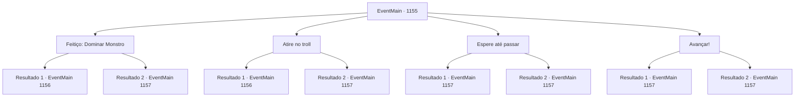

# Eventos principais · 1155

[Índice da tabela](index.md) · [Índice geral](../index.md)

ID: `pt:EventMain:1155` · Fonte: `EventMain4` · Versão: 1.2.47.

Mapeamento estático dos arquivos; a disponibilidade e a execução dependem do estado da run.

## Texto do evento

*Sem texto no arquivo.*

## Dados de entrada

```json
{
  "id": 1155,
  "grade": 1,
  "normalGoal": "",
  "required": ""
}
```

## Mapa das escolhas



## Escolhas e resultados

### Escolha 1

Feitiço: Dominar Monstro

Requisitos e outros campos da escolha:

```json
{
  "required": "20_0_4|1_1_2"
}
```

#### Resultado 1.1

Você tenta perturbar a mente do troll com um feitiço. Mas então, um xamã orc ergue seu cajado em resposta. Seu corpo está coberto de colares feitos de ossos de animais. Ele começa uma incantação, embora soe um pouco áspera. Então, sua força arcana vacila. É como se algo invisível impedisse você de se concentrar no feitiço. Mas você persiste, canalizando todo o seu mana. Finalmente, você desbloqueia o poder para mergulhar na mente do troll. Ele se vira, pega uma tábua, e a arremessa em outro troll. 

 "Gro--!"

 A cabeça do troll atacado explode. Mas o troll enfurecido não para por aí. Continua a causar estragos entre os orcs, rugindo. Grupos de orcs são lançados pelo ar. Em pânico, os orcs direcionam seu ataque ao troll enfurecido. Lâminas de machado se cravam na carne do troll, e óleo é jogado sobre ele. Logo, o fogo envolve o corpo do troll. Você aproveita a oportunidade, lançando o mesmo feitiço em outro troll, um por um. Por fim, todos os três trolls encontram seu fim, enfurecidos. O chão treme quando cada um cai. Enquanto isso, os orcs de alguma forma conseguiram reparar suas formações. Eles continuam a marchar em direção às paredes do castelo, rugindo. Você ergue sua arma e grita. 

 "ARQUEIROS! FOGO!"

 Os arqueiros lançam uma chuva coordenada de flechas, atingindo os orcs na cabeça, no pescoço e nas pernas. Um a um eles caem, mas não param. Os orcs sobreviventes conseguem alcançar as paredes do castelo. Escadas são apoiadas nelas, e os que foram ao portão começam a cravar seus machados. O portão geme de dor. Cada golpe sacode as portas, tornando-as instáveis.

Continuação registrada: [Evento 1156](1156.md) na mesma tabela.

```json
{
  "required": "",
  "chance": "1|0_7_1|0_12_1",
  "nextEvent": 1156,
  "type": 0,
  "reward": "0_1_-1|0_2_1"
}
```

#### Resultado 1.2

Você tenta perturbar a mente do troll com um feitiço. Mas então, um xamã orc ergue seu cajado em resposta. Seu corpo está coberto por colares feitos de ossos de animais. Ele inicia uma invocação, embora soe um pouco rústica. Então, sua força arcana vacila. Cada gota de essência mágica se dissipa no ar. Os trolls continuam sua marcha. Pedras são arremessadas contra as paredes, fazendo barulho a cada impacto. Estilhaços de pedra afiados ficam espalhados por toda parte, e os soldados são forçados a se abaixar. Outra pedra é lançada. Toda a muralha do castelo treme. Poeira e escombros enchem o ar. Infelizmente, após uma contínua chuva de pedradas, a parte leste da muralha do castelo cede. A bombardeio dos trolls para, e agora é a vez dos orcs. Eles começam a invadir o castelo, pulando sobre os escombros das paredes. Você imediatamente ergue sua arma e grita. 

 "ELES ESTÃO ENTRANDO! PAREM-OS!!"

 O combate corpo a corpo entre os soldados e os orcs começa. O som de machados e espadas colidindo, gritos e gritos de guerra enche o castelo.

Continuação registrada: [Evento 1157](1157.md) na mesma tabela.

```json
{
  "required": "",
  "chance": "36",
  "nextEvent": 1157,
  "type": 1,
  "reward": "6_0_198",
  "place": 4
}
```

### Escolha 2

Atire no troll

Requisitos e outros campos da escolha:

```json
{
  "required": "20_6_2"
}
```

#### Resultado 2.1

Você mira exatamente no olho do troll. Seu ataque acerta bem nele, deixando-o cego. 

 "GROOO--!!"

 Cobrindo o olho sangrando com as mãos, o troll treme de dor. As pedras caem de sua cesta, esmagando os orcs ao seu redor. O primeiro perde a consciência depois de lutar. Você ataca o segundo, desta vez mirando no tornozelo. Ele tenta pegar suas pedras, mas então é atingido no tornozelo, caindo no chão. O último vê os outros caírem, então se vira para fugir. Desta vez, os orcs começam a atacar as paredes do castelo. Você ergue sua arma e grita. 

 "ARQUEIROS! ATIREM!"

 Os arqueiros lançam uma chuva coordenada de flechas, acertando os orcs na cabeça, no pescoço e nas pernas. Um a um eles caem, mas eles não param. Os orcs sobreviventes conseguem alcançar as paredes do castelo. Escadas são encostadas nelas, e aqueles que foram ao portão começam a golpear com seus machados. O portão range de dor. Cada golpe sacode as portas, deixando-as instáveis.

Continuação registrada: [Evento 1156](1156.md) na mesma tabela.

```json
{
  "required": "",
  "chance": "1|0_6_1",
  "nextEvent": 1156,
  "type": 0,
  "reward": ""
}
```

#### Resultado 2.2

Você mira exatamente no olho do troll. Mas está muito longe — seu ataque não o alcança. Pedregulhos são lançados contra as muralhas, fazendo barulho a cada impacto. Estilhaços afiados de pedra se espalham por toda parte, e os soldados são obrigados a se abaixar. Outro pedregulho é lançado. Toda a parede do castelo treme. Poeira e detritos enchem o ar. Infelizmente, após uma contínua saraivada de pedregulhos, a parte leste da muralha do castelo cede. O bombardeio dos trolls para, e agora é a vez dos orcs. Eles começam a invadir o castelo, saltando sobre os escombros das muralhas. Você imediatamente ergue sua arma e grita. 

 "ELES ESTÃO ENTRANDO! PAREM-OS!!"

 Começa o combate corpo a corpo entre os soldados e os orcs. O som de machados e espadas se chocando, gritos e brados de batalha enchem o castelo.

Continuação registrada: [Evento 1157](1157.md) na mesma tabela.

```json
{
  "required": "",
  "chance": "14",
  "nextEvent": 1157,
  "type": 1,
  "reward": "6_0_198",
  "place": 4
}
```

### Escolha 3

Espere até passar

Requisitos e outros campos da escolha:

```json
{
  "required": ""
}
```

#### Resultado 3.1

Você ordena que seus homens se afastem das muralhas, decidindo esperar o bombardeio dos trolls. Infelizmente, após uma contínua chuva de rochas, a parte leste da muralha do castelo desaba. Você imediatamente levanta sua arma e grita. 

 "ELES ESTÃO ENTRANDO! PAREM-OS!!"

 Começa o combate corpo a corpo entre os soldados e os orcs. Seus soldados não se intimidam — soltam um brado de guerra em resposta, ainda mais alto que o dos orcs. 

 "PELO Briovich!!"

 O som de machados e espadas colidindo, gritos e brados de guerra enche o castelo.

Continuação registrada: [Evento 1157](1157.md) na mesma tabela.

```json
{
  "required": "5_918_1",
  "chance": "1",
  "nextEvent": 1157,
  "type": 2,
  "reward": "6_2_198",
  "place": 4
}
```

#### Resultado 3.2

Você ordena aos seus homens que se afastem das muralhas, decidindo esperar o bombardeio dos trolls passar. Infelizmente, após um contínuo bombardeio de rochas, a parte leste da muralha do castelo cede. O bombardeio dos trolls para, e agora é a vez dos orcs. Eles começam a invadir o castelo em massa, saltando sobre os escombros das muralhas. Você imediatamente ergue sua arma e grita. 

 "ELES ESTÃO ENTRANDO! PAREM-OS!!"

 Começa o combate corpo a corpo entre os soldados e os orcs. O som de machados e espadas se chocando, gritos e brados de guerra enchem o castelo.

Continuação registrada: [Evento 1157](1157.md) na mesma tabela.

```json
{
  "required": "18_918_1",
  "chance": "1",
  "nextEvent": 1157,
  "type": 2,
  "reward": "6_0_198",
  "place": 4
}
```

### Escolha 4

Avançar!

Requisitos e outros campos da escolha:

```json
{
  "required": ""
}
```

#### Resultado 4.1

Você ordena que seus homens abram os portões. Com um estrondo alto das correntes, o portão do castelo lentamente se abre. O vento gelado e o cheiro de terra entram pelo portão aberto. Você toma a linha de frente, arma na mão. Seus soldados seguem atrás, mantendo formação em ponta de flecha. Respirações nervosas e o som da armadura tilintando enchem o ar. Você lidera a investida contra os orcs. Seus homens imitam com um forte brado de guerra. Então, um troll lança uma enorme pedra em sua direção.
 'VUUUUSH--!!'
 A pedra lançada atinge seus soldados. Eles são arremessados pelo impacto, gritando. Sangue e terra espirrampelo ar. Mas você não vacila. Logo, os orcs soltam seu próprio brado de guerra em resposta. 

 "Grrrr....! Humanos, MATEM!"

 Eles avançam sobre você, com machados e lanças. Em pouco tempo, começa um combate desesperado, soldados e orcs enredados na batalha.

Continuação registrada: [Evento 1157](1157.md) na mesma tabela.

```json
{
  "required": "18_914_1",
  "chance": "1",
  "nextEvent": 1157,
  "type": 2,
  "reward": "6_0_198",
  "place": 0
}
```

#### Resultado 4.2

Você ordena aos seus homens que abram os portões. Mas então, o líder dos mercenários olha para a formação dos orcs e fala. 

 "Acho que podemos flanquear eles por trás."

 Ele aponta para a base da ladeira com os dedos. 

 "Faremos um desvio pela porta dos fundos e iremos para a colina do outro lado. Atacaremos pela retaguarda enquanto você e seus homens atacam pela frente."

 Você acena com a cabeça em resposta. Imediatamente, o líder dos mercenários reúne seus homens e desaparece pela porta dos fundos. Com um alto tilintar das correntes, o portão do castelo se abre lentamente. O vento gelado e o cheiro de terra entram pelo portão aberto. Você assume a linha de frente, arma em punho. Seus soldados seguem atrás, mantendo uma formação em cunha. Respirações nervosas e o som das armaduras se chocando enchem o ar. Você lidera a investida contra os orcs. Seus homens seguem com um alto brado de guerra. Então, um troll lança uma enorme pedra contra vocês.
 'WHOOOOSH--!!'
 A pedra lançada atinge seus soldados. Eles são arremessados para o ar com o impacto, gritando. Sangue e terra respingam no ar. Mas você não vacila. Logo, os orcs soltam um brado de guerra em resposta. 

 "Grrrr....! Humanos, MATEM!"

 Eles avançam contra você, com machados e lanças. Logo começa um combate desesperado, soldados e orcs entrelaçados na batalha.

Continuação registrada: [Evento 1157](1157.md) na mesma tabela.

```json
{
  "required": "5_914_1",
  "chance": "1",
  "nextEvent": 1157,
  "type": 2,
  "reward": "6_2_198",
  "place": 0
}
```

## Referências que chegam a este evento

- [Evento 1154 · escolha 1 · resultado 1](1154.md#escolha-1)
