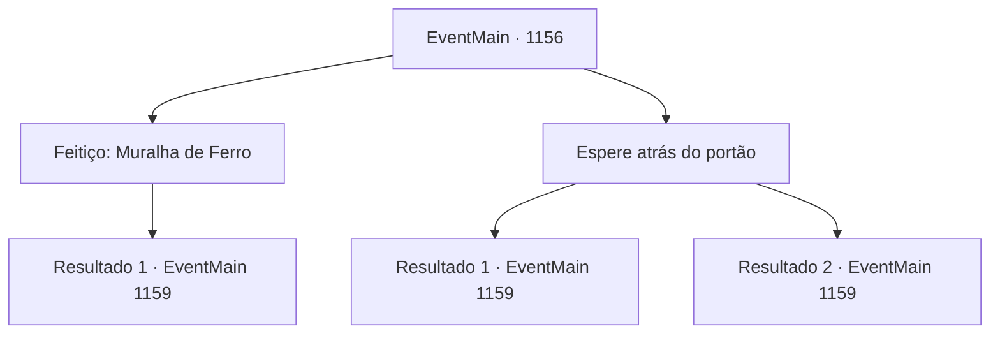

# Eventos principais · 1156

[Índice da tabela](index.md) · [Índice geral](../index.md)

ID: `pt:EventMain:1156` · Fonte: `EventMain4` · Versão: 1.2.47.

Mapeamento estático dos arquivos; a disponibilidade e a execução dependem do estado da run.

## Texto do evento

*Sem texto no arquivo.*

## Dados de entrada

```json
{
  "id": 1156,
  "grade": 1,
  "normalGoal": "",
  "required": ""
}
```

## Mapa das escolhas



## Escolhas e resultados

### Escolha 1

Feitiço: Muralha de Ferro

Requisitos e outros campos da escolha:

```json
{
  "required": "20_0_3|1_1_2"
}
```

#### Resultado 1.1

Você conjura um feitiço para erguer uma parede de ferro em frente às muralhas do castelo. A parede que surgiu do nada bloqueia os ataques dos orcs. Ela faz um ótimo trabalho ao desviar seus machados com sua natureza metálica. O orc que lidera a investida grita algo. Os orcs mudam de plano, encostando escadas nas paredes em vez de tentar arrombá-las. Seus soldados empurram as escadas com suas armas, atirando nos orcs de cima. Mas então, uma rajada de vento desvia as flechas. É a xamã orc — ela está conjurando vento. Isso dá tempo aos orcs para subirem as muralhas do castelo em segurança. Começa o combate corpo a corpo entre os soldados e os orcs.

Continuação registrada: [Evento 1159](1159.md) na mesma tabela.

```json
{
  "required": "",
  "chance": "1",
  "nextEvent": 1159,
  "type": 2,
  "reward": "0_1_-1|6_2_198",
  "place": 4
}
```

### Escolha 2

Espere atrás do portão

Requisitos e outros campos da escolha:

```json
{
  "required": ""
}
```

#### Resultado 2.1

Você desce das muralhas do castelo e fica diante do portão. Duas fileiras de portadores de escudo mantêm-se em formação. Atrás dos portadores de escudo, lanceiros seguram suas armas à frente. Os orcs continuam a golpear o portão e, em breve, com um estrondo alto, o portão cede. 

 "Grrrr...! Humanos, MATEM!"

 Os orcs avançam contra você. Começa o combate corpo a corpo entre os soldados e os orcs.

Continuação registrada: [Evento 1159](1159.md) na mesma tabela.

```json
{
  "required": "18_914_1",
  "chance": "1",
  "nextEvent": 1159,
  "type": 2,
  "reward": "6_0_198",
  "place": 4
}
```

#### Resultado 2.2

Você desce das muralhas do castelo e fica diante do portão. Duas filas de porta-escudos mantêm a formação. Atrás dos porta-escudos, lanceiros apontam suas armas para frente. Os mercenários também circulam ao seu redor, empunhando suas espadas longas e lanças. Os orcs continuam a serrar o portão e, em breve, com um estalo alto, o portão cede. 

 "Grraaah...! Humanos, MATEM!"

 Os orcs investem contra você. Começa o combate corpo a corpo entre os soldados e os orcs.

Continuação registrada: [Evento 1159](1159.md) na mesma tabela.

```json
{
  "required": "5_914_1",
  "chance": "1",
  "nextEvent": 1159,
  "type": 2,
  "reward": "6_2_198",
  "place": 4
}
```

## Referências que chegam a este evento

- [Evento 1155 · escolha 1 · resultado 1](1155.md#escolha-1)
- [Evento 1155 · escolha 2 · resultado 1](1155.md#escolha-2)
