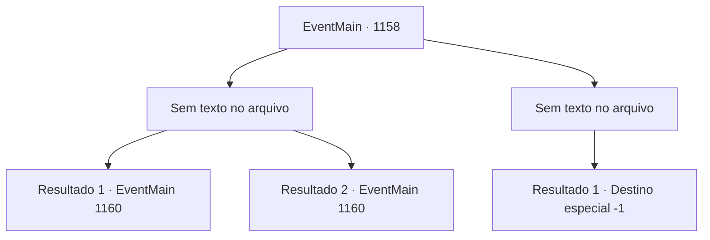

# Eventos principais · 1158

[Índice da tabela](index.md) · [Índice geral](../index.md)

ID: `pt:EventMain:1158` · Fonte: `EventMain4` · Versão: 1.2.47.

Mapeamento estático dos arquivos; a disponibilidade e a execução dependem do estado da run.

## Texto do evento

*Sem texto no arquivo.*

## Dados de entrada

```json
{
  "id": 1158,
  "grade": 1,
  "normalGoal": "",
  "required": ""
}
```

## Mapa das escolhas



## Escolhas e resultados

### Escolha 1

*Sem texto no arquivo; o papel dessa opção depende da interface do jogo.*

Requisitos e outros campos da escolha:

```json
{
  "required": ""
}
```

#### Resultado 1.1

O machado de Grizzly corta o ar e atravessa você. Você consegue desviar para frente, derrubando Grizzly e empurrando-o para trás. Grizzly, incapaz de suportar sua própria força, cai no chão. 

 "GRH! MALDITO HUMANO...!"

 Ele solta um suspiro áspero e tenta se levantar novamente. Então, Rennart dispara uma flecha nas suas panturrilhas. 

 "AAAAARGGHH!!"

 Grizzly grita. Seu joelho dobra, forçando-o a se ajoelhar. Ele tenta pegar a flecha na panturrilha, mas não antes de seus soldados correrem em sua direção. Três homens seguram seu braço, e outro par coloca correntes de aço ao redor dele. Grizzly torce seu próprio braço para empurrar os soldados para trás. Mas ainda mais soldados vêm para contê-lo. Grizzly, agora preso ao chão, olha para cima e grita, seus olhos ardendo de fúria. 

 "Apenas... me matem...!"


Continuação registrada: [Evento 1160](1160.md) na mesma tabela.

```json
{
  "required": "18_914_1",
  "chance": "1",
  "nextEvent": 1160,
  "type": 2,
  "reward": ""
}
```

#### Resultado 1.2

O grande machado de Grizzly corta o ar e atinge você. Você consegue desviar para a frente, investindo contra Grizzly e empurrando-o para trás. Grizzly, incapaz de suportar sua própria força, cai no chão. 

 "GRH! MALDITO HUMANO...!"

 Ele respira com dificuldade e tenta se levantar. Então, Rennart dispara uma flecha nas panturrilhas dele. 

 "AAAAARGGHH!!"

 Grizzly grita. Seu joelho dobra, obrigando-o a se ajoelhar. Ele tenta alcançar a flecha na panturrilha, mas não antes que os mercenários avancem. Eles habilmente lançam redes de aço para imobilizá-lo. Grizzly, agora preso ao chão, olha para cima e grita, seus olhos ardendo de fúria. 

 "Apenas... me matem...!"


Continuação registrada: [Evento 1160](1160.md) na mesma tabela.

```json
{
  "required": "5_914_1",
  "chance": "1",
  "nextEvent": 1160,
  "type": 2,
  "reward": ""
}
```

### Escolha 2

*Sem texto no arquivo; o papel dessa opção depende da interface do jogo.*

Requisitos e outros campos da escolha:

```json
{
  "required": ""
}
```

#### Resultado 2.1

Você sente dificuldade para respirar. Sangue da sua testa cobre sua visão, tornando-a parcialmente vermelha. Outro golpe de Grizzly acerta seu peito. Sangue quente jorra do seu corpo e escorre para baixo. Você não sente os joelhos. 

 "Hora de recuperar... o que é nosso... Briovich."

 Grizzly resmunga, olhando para você. Então, seu machado de batalha balança uma última vez.

Continuação registrada: [Destino especial `-1`](../destinos-especiais.md).

```json
{
  "required": "",
  "chance": "1",
  "nextEvent": -1,
  "type": 2,
  "reward": "0_0_-1|0_1_-1|15_7_16|25_8_1"
}
```

## Referências que chegam a este evento

- [Evento 1157 · escolha 1 · resultado 1](1157.md#escolha-1)
- [Evento 1157 · escolha 2 · resultado 1](1157.md#escolha-2)
- [Evento 1159 · escolha 1 · resultado 1](1159.md#escolha-1)
- [Evento 1159 · escolha 2 · resultado 1](1159.md#escolha-2)
