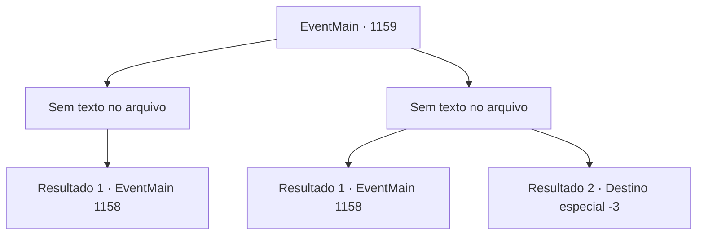

# Eventos principais · 1159

[Índice da tabela](index.md) · [Índice geral](../index.md)

ID: `pt:EventMain:1159` · Fonte: `EventMain4` · Versão: 1.2.47.

Mapeamento estático dos arquivos; a disponibilidade e a execução dependem do estado da run.

## Texto do evento

*Sem texto no arquivo.*

## Dados de entrada

```json
{
  "id": 1159,
  "grade": 1,
  "normalGoal": "",
  "required": ""
}
```

## Mapa das escolhas



## Escolhas e resultados

### Escolha 1

*Sem texto no arquivo; o papel dessa opção depende da interface do jogo.*

Requisitos e outros campos da escolha:

```json
{
  "required": ""
}
```

#### Resultado 1.1

Faíscas voam enquanto soldados e orcs se chocam. Poeira, sangue e suor enchem a área. Você lidera seus homens com confiança, esmagando orcs um por um. É um caos total, mas lenta e seguramente a maré da batalha está virando a seu favor. Então, Grizzly aparece e corre em sua direção. <link=shake>

 "Briovich!! VENHO ENFRENTAR VOCÊ!"

</link> O grito de batalha de Grizzly ecoa pelo campo de batalha. Ele levanta seu grande machado e inicia sua investida.

Continuação registrada: [Evento 1158](1158.md) na mesma tabela.

```json
{
  "required": "",
  "chance": "1",
  "nextEvent": 1158,
  "type": 2,
  "reward": "6_0_199",
  "place": 4
}
```

### Escolha 2

*Sem texto no arquivo; o papel dessa opção depende da interface do jogo.*

Requisitos e outros campos da escolha:

```json
{
  "required": ""
}
```

#### Resultado 2.1

Faíscas surgem enquanto soldados e orcs se chocam. Poeira, sangue e suor enchem a área. Um dos orcs te acerta com seu machado, e você rola no chão. Ele ergue o machado para desferir o golpe final. Pouco antes de atacar, um soldado crava sua lança no ventre dele. O orc cai, e o soldado te ajuda a levantar. Mas então, um machado arremessado atinge as costas do soldado. 

 "ACK!!"

 O soldado cai num instante. Você é lançado ao chão mais uma vez. Então, Grizzly aparece à sua frente e grita. <link=shake>

 "Briovich!! VENHO ENFRENTAR VOCÊ!"

</link> O brado de batalha de Grizzly ecoa pelo campo de batalha. Ele ergue seu grande machado e inicia sua investida.

Continuação registrada: [Evento 1158](1158.md) na mesma tabela.

```json
{
  "required": "1_0_2|1_1_2",
  "chance": "1",
  "nextEvent": 1158,
  "type": 2,
  "reward": "6_3_199|0_0_-1|0_1_-1",
  "place": 4
}
```

#### Resultado 2.2

Faíscas voam quando os soldados e os orcs colidem. Poeira, sangue e suor enchem a área. Um dos orcs te acerta com seu machado, e você rola pelo chão. Ele levanta o machado para desferir o golpe final. E assim, ele procede a esmagar seu crânio.

Continuação registrada: [Destino especial `-3`](../destinos-especiais.md).

```json
{
  "required": "-1|2_0_2|2_1_2",
  "chance": "1",
  "nextEvent": -3,
  "type": 2,
  "reward": "0_0_-1|0_1_-1"
}
```

## Referências que chegam a este evento

- [Evento 1156 · escolha 1 · resultado 1](1156.md#escolha-1)
- [Evento 1156 · escolha 2 · resultado 1](1156.md#escolha-2)
- [Evento 1156 · escolha 2 · resultado 2](1156.md#escolha-2)
