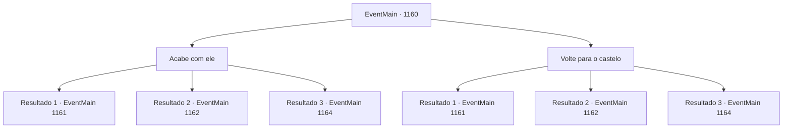

# Eventos principais · 1160

[Índice da tabela](index.md) · [Índice geral](../index.md)

ID: `pt:EventMain:1160` · Fonte: `EventMain4` · Versão: 1.2.47.

Mapeamento estático dos arquivos; a disponibilidade e a execução dependem do estado da run.

## Texto do evento

*Sem texto no arquivo.*

## Dados de entrada

```json
{
  "id": 1160,
  "grade": 1,
  "normalGoal": "",
  "required": ""
}
```

## Mapa das escolhas



## Escolhas e resultados

### Escolha 1

Acabe com ele

Requisitos e outros campos da escolha:

```json
{
  "required": "18_970_1"
}
```

#### Resultado 1.1

Você pega uma lança de um soldado próximo. Em seguida, procede a cravá-la no pescoço de Grizzly. 

 "Gack...! Uck..."

 Sangue orc morno jorra pela saída do ferimento. Mesmo na morte, Grizzly te encara e tenta dizer algo, mas nada sai de sua boca. O orc gigante cambaleia, ajoelha-se e então cai. Percebendo que seu chefe caiu, os orcs começam a se afastar um a um. O pânico se espalha pelo campo de batalha. 

 Passam-se alguns dias. Os orcs cumprem a palavra — removem seu posto avançado e retornam às planícies áridas. Você também ouve rumores de orcs lutando entre si para decidir quem sucederá Grizzly. Enquanto isso, o castelo passa por reparos e os soldados feridos são tratados. Você percorre a propriedade, certificando-se de que tudo está em ordem. Quando você retorna ao seu escritório, Rennart levanta-se e fala. 

 "As operações pós-batalha estão bem encaminhadas. As brechas nas muralhas foram em sua maioria reparadas, e reabastecemos cerca de setenta por cento das flechas que usamos."

 Ele organiza alguns documentos e os coloca sobre a escrivaninha. 

 "Segundo os relatórios, parece haver caos entre os orcs. Aparentemente estão divididos sobre quem deve suceder Grizzly."

 Rennart puxa um pedaço de pergaminho e o entrega a você. 

 "Aqui — um registro de negociações entre Zaraid e Greymoor. Encontrei-o nos restos do posto avançado deles."

 O rosto de Rennart fica vermelho de raiva. 

 "Esta é uma prova física e incontestável da Casa Greymoor pagando os orcs."


Continuação registrada: [Evento 1161](1161.md) na mesma tabela.

```json
{
  "required": "5_912_1",
  "chance": "1",
  "nextEvent": 1161,
  "type": 2,
  "reward": "3_388_1|3_383_1"
}
```

#### Resultado 1.2

Você pega uma lança de um soldado próximo. Então, você a crava no pescoço de Grizzly. 

 "Argh...! Ugh..."

 Sangue orc quente jorra pelo orifício de saída. Mesmo em sua morte, Grizzly te encara com um sorriso e tenta dizer algo, mas nada sai de sua boca. O orc gigante cambaleia, ajoelha-se e então cai. Percebendo que seu chefe caiu, os orcs começam a se dispersar um a um. O pânico se espalha pelo campo de batalha. 

 Passam-se alguns dias. Os orcs cumprem sua palavra - removem seu posto avançado e retornam às planícies desertas. Você também ouve boatos de orcs lutando entre si para decidir quem sucederá Grizzly. Entretanto, o castelo passa por reparos e os soldados feridos são tratados. Você percorre a propriedade, certificando-se de que tudo esteja em ordem. Ao voltar para seu escritório, Rennart levanta-se e fala. 

 "As operações pós-batalha estão bem encaminhadas. As brechas nas paredes estão em sua maioria reparadas, e reabastecemos cerca de setenta por cento das flechas que usamos."

 Ele organiza alguns documentos cuidadosamente e os coloca sobre a escrivaninha. 

 "Segundo os relatórios, parece haver caos entre os orcs. Aparentemente eles estão divididos sobre quem deve suceder Grizzly."


Continuação registrada: [Evento 1162](1162.md) na mesma tabela.

```json
{
  "required": "13_6_6",
  "chance": "1",
  "nextEvent": 1162,
  "type": 2,
  "reward": "3_383_1"
}
```

#### Resultado 1.3

Você pega uma lança de um soldado próximo. Em seguida, você a crava no pescoço do Grizzly. 

 "Gack...! Uck..."

 Sangue orc quente jorra pela ferida de saída. Mesmo na morte, Grizzly sorri maliciosamente para você e tenta dizer algo, mas nada sai de sua boca. O orc gigante cambaleia, ajoelha-se e então cai. Ao perceberem que seu chefe caiu, os orcs começam a se afastar um a um. O pânico se espalha pelo campo de batalha. 

 Passam-se alguns dias. Os orcs retornam às planícies áridas. Você também ouve rumores de orcs lutando entre si para decidir quem sucederá Grizzly. Enquanto isso, o castelo passa por reparos e os soldados feridos são tratados. Você percorre a propriedade, certificando-se de que tudo está em ordem. Quando você retorna ao seu escritório, Rennart se levanta e fala. 

 "As operações pós-batalha estão bem encaminhadas. As brechas nas paredes foram em sua maior parte reparadas, e reabastecemos cerca de setenta por cento das flechas que usamos."

 Ele organiza alguns documentos de maneira ordenada e os coloca sobre a mesa. 

 "De acordo com os relatórios, parece haver caos entre os orcs. Aparentemente estão divididos sobre quem deve suceder Grizzly."


Continuação registrada: [Evento 1164](1164.md) na mesma tabela.

```json
{
  "required": "5_908_1",
  "chance": "1",
  "nextEvent": 1164,
  "type": 2,
  "reward": "3_383_1"
}
```

### Escolha 2

Volte para o castelo

Requisitos e outros campos da escolha:

```json
{
  "required": "5_970_1"
}
```

#### Resultado 2.1

Quando você volta ao castelo, já é nascer do sol. O portão do castelo se abre, e Rennart corre para fora para te recepcionar. 

 "Como foi, meu senhor?!"

 Você lhe diz que o assassinato foi bem-sucedido. Rennart ouve e seu rosto se ilumina. 

 "Isso... é incrível! Que ótima notícia!"

 Ele se vira para olhar o cenário além das muralhas do castelo. A fumaça continua a subir de onde estão os postos avançados orcs. Ela reluz sob o luar com um brilho prateado. 

 "Ficaremos em alerta redobrado por enquanto. Você foi incrível, meu senhor."

 Alguns dias se passam. Os orcs retornam às planícies áridas. Enquanto isso, o castelo passa por reparos e os soldados feridos são tratados. Você percorre a propriedade, certificando-se de que tudo esteja em ordem. Quando retorna ao seu escritório, Rennart se levanta e fala. 

 "As operações pós-batalha estão em bom andamento. As brechas nas muralhas foram em sua maioria reparadas, e reabastecemos cerca de setenta por cento das flechas que usamos."

 Ele organiza alguns documentos com cuidado e os coloca sobre a mesa. 

 "Segundo os relatórios, parece haver caos entre os orcs. Aparentemente eles estão divididos quanto a quem deve suceder Grizzly."


Continuação registrada: [Evento 1161](1161.md) na mesma tabela.

```json
{
  "required": "5_912_1",
  "chance": "1",
  "nextEvent": 1161,
  "type": 2,
  "reward": "3_388_1"
}
```

#### Resultado 2.2

Quando você volta ao castelo, já é amanhecer. O portão do castelo se abre, e Rennart corre para fora para recebê-lo. 

 "Como foi, meu senhor?!"

 Você diz a ele que o assassinato foi bem-sucedido. Rennart ouve e seu rosto se ilumina. 

 "Isso... é incrível! Que ótima notícia!"

 Ele se vira para encarar a vista além das muralhas do castelo. A fumaça continua subindo de onde estão os postos avançados orcs. Ela brilha sob a luz da lua em um cintilar prateado. 

 "Ficaremos em alerta redobrado por enquanto. Você fez um trabalho incrível, meu senhor."

 Alguns dias se passam. Os orcs retornam às planícies áridas. Enquanto isso, o castelo passa por reparos e os soldados feridos são tratados. Você percorre a propriedade, certificando-se de que tudo está em ordem. Quando você retorna ao seu escritório, Rennart se levanta e fala. 

 "As operações pós-batalha estão bem encaminhadas. As brechas nas paredes foram em sua maioria reparadas, e reabastecemos cerca de setenta por cento das flechas que usamos."

 Ele organiza alguns documentos e os coloca sobre a mesa. 

 "Segundo os relatórios, parece haver caos entre os orcs. Aparentemente eles estão divididos sobre quem deve suceder Grizzly."


Continuação registrada: [Evento 1162](1162.md) na mesma tabela.

```json
{
  "required": "13_6_6",
  "chance": "1",
  "nextEvent": 1162,
  "type": 2,
  "reward": ""
}
```

#### Resultado 2.3

Quando você volta ao castelo, já é amanhecer. O portão do castelo se abre, e Rennart corre para fora para recebê-lo. 

 "Como foi, meu senhor?!"

 Você diz a ele que o assassinato foi bem-sucedido. Rennart ouve e seu rosto se ilumina. 

 "Isso... é incrível! Que ótima notícia!"

 Ele se vira para encarar a vista além das muralhas do castelo. A fumaça continua subindo de onde estão os postos avançados orcs. Ela brilha sob a luz da lua em um cintilar prateado. 

 "Ficaremos em alerta redobrado por enquanto. Você fez um trabalho incrível, meu senhor."

 Alguns dias se passam. Os orcs retornam às planícies áridas. Enquanto isso, o castelo passa por reparos e os soldados feridos são tratados. Você percorre a propriedade, certificando-se de que tudo está em ordem. Quando você retorna ao seu escritório, Rennart se levanta e fala. 

 "As operações pós-batalha estão bem encaminhadas. As brechas nas paredes foram em sua maioria reparadas, e reabastecemos cerca de setenta por cento das flechas que usamos."

 Ele organiza alguns documentos e os coloca sobre a mesa. 

 "Segundo os relatórios, parece haver caos entre os orcs. Aparentemente eles estão divididos sobre quem deve suceder Grizzly."


Continuação registrada: [Evento 1164](1164.md) na mesma tabela.

```json
{
  "required": "5_908_1",
  "chance": "1",
  "nextEvent": 1164,
  "type": 2,
  "reward": ""
}
```

## Referências que chegam a este evento

- [Evento 1151 · escolha 4 · resultado 1](1151.md#escolha-4)
- [Evento 1158 · escolha 1 · resultado 1](1158.md#escolha-1)
- [Evento 1158 · escolha 1 · resultado 2](1158.md#escolha-1)
