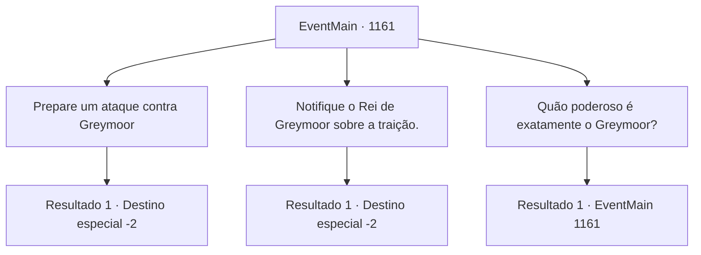

# Eventos principais · 1161

[Índice da tabela](index.md) · [Índice geral](../index.md)

ID: `pt:EventMain:1161` · Fonte: `EventMain4` · Versão: 1.2.47.

Mapeamento estático dos arquivos; a disponibilidade e a execução dependem do estado da run.

## Texto do evento

*Sem texto no arquivo.*

## Dados de entrada

```json
{
  "id": 1161,
  "grade": 1,
  "normalGoal": "",
  "required": ""
}
```

## Mapa das escolhas



## Escolhas e resultados

### Escolha 1

Prepare um ataque contra Greymoor

Requisitos e outros campos da escolha:

```json
{
  "required": ""
}
```

#### Resultado 1.1

Você ordena a Rennart que se prepare para a guerra. Rennart se inclina, atendendo ao seu comando. 

 "Entendido. Farei os preparativos necessários, assim que terminarmos de reparar as muralhas e cuidar dos feridos."

 Ele puxa um documento e anota algo. 

 "Vamos precisar de pelo menos um mês de suprimentos. E carroções para transportá-los. Será necessária uma conscrição — arranjaremos carroções e alguns bovinos da propriedade e criaremos uma esquadra de suprimento."

 Ele franze a testa. 

 "Poderíamos usar os caçadores como batedores, e os ferreiros e carpinteiros como engenheiros militares. Ah, e também precisamos avisar nossos vizinhos sobre os negócios da Casa Greymoor com Zaraid. Eles podem não querer nos ajudar, mas pelo menos devemos evitar que se alinhem com Greymoor."

 Seu olhar se volta para você. 

 "Muito bem, então. Avisarei assim que terminar."

 Você deixa Rennart e sai do escritório.

Continuação registrada: [Destino especial `-2`](../destinos-especiais.md).

```json
{
  "required": "",
  "chance": "1",
  "nextEvent": -2,
  "type": 2,
  "reward": "13_6_10"
}
```

### Escolha 2

Notifique o Rei de Greymoor sobre a traição.

Requisitos e outros campos da escolha:

```json
{
  "required": ""
}
```

#### Resultado 2.1

Você decide acusar a Condessa Greymoor perante o Rei. Rennart atende ao seu comando, puxa um pedaço de papel e molha a pena na tinta. Ele escreve uma carta curta, porém bem redigida, exigindo que a Condessa Greymoor seja julgada por pagar os orcs e atacar a propriedade de Briovich. Ele dobra a carta pronta ao meio, coloca-a em um envelope e o sela com cera de vela. Você carimba o brasão da casa nela, coloca a carta no bolso e parte. Você segue para a capital do reino.

Continuação registrada: [Destino especial `-2`](../destinos-especiais.md).

```json
{
  "required": "",
  "chance": "1",
  "nextEvent": -2,
  "type": 2,
  "reward": "13_6_11"
}
```

### Escolha 3

Quão poderoso é exatamente o Greymoor?

Requisitos e outros campos da escolha:

```json
{
  "required": "5_919_0"
}
```

#### Resultado 3.1

Você pergunta a Rennart sobre a situação militar exata de Greymoor. Ele tira outra pilha de documentos e responde. 

 "Eles têm aproximadamente o dobro do nosso efetivo, com uma proporção maior de cavaleiros fortemente armados também. São, com certeza, uma força a ser levada em conta."


Continuação registrada: [Evento 1161](1161.md) na mesma tabela.

```json
{
  "required": "",
  "chance": "1",
  "nextEvent": 1161,
  "type": 2,
  "reward": "5_919_1"
}
```

## Referências que chegam a este evento

- [Evento 1146 · escolha 1 · resultado 1](1146.md#escolha-1)
- [Evento 1160 · escolha 1 · resultado 1](1160.md#escolha-1)
- [Evento 1160 · escolha 2 · resultado 1](1160.md#escolha-2)
- [Evento 1161 · escolha 3 · resultado 1](1161.md#escolha-3)
