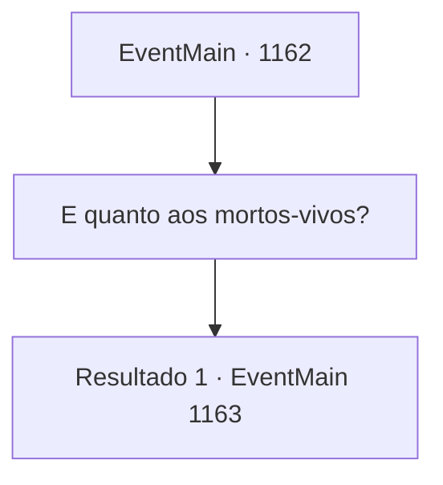

# Eventos principais · 1162

[Índice da tabela](index.md) · [Índice geral](../index.md)

ID: `pt:EventMain:1162` · Fonte: `EventMain4` · Versão: 1.2.47.

Mapeamento estático dos arquivos; a disponibilidade e a execução dependem do estado da run.

## Texto do evento

*Sem texto no arquivo.*

## Dados de entrada

```json
{
  "id": 1162,
  "grade": 1,
  "normalGoal": "",
  "required": ""
}
```

## Mapa das escolhas



## Escolhas e resultados

### Escolha 1

E quanto aos mortos-vivos?

Requisitos e outros campos da escolha:

```json
{
  "required": ""
}
```

#### Resultado 1.1

Você pergunta a Rennart sobre o problema dos mortos-vivos. Rennart responde imediatamente. 

 "Não sabemos por quê, mas recentemente os avistamentos de mortos-vivos diminuíram muito. Contratei alguns aventureiros para investigar o assunto, mas até agora nada foi confirmado."


Continuação registrada: [Evento 1163](1163.md) na mesma tabela.

```json
{
  "required": "",
  "chance": "1",
  "nextEvent": 1163,
  "type": 2,
  "reward": ""
}
```

## Referências que chegam a este evento

- [Evento 1146 · escolha 1 · resultado 2](1146.md#escolha-1)
- [Evento 1160 · escolha 1 · resultado 2](1160.md#escolha-1)
- [Evento 1160 · escolha 2 · resultado 2](1160.md#escolha-2)
