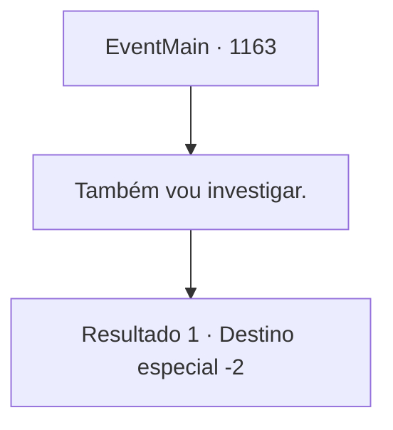

# Eventos principais · 1163

[Índice da tabela](index.md) · [Índice geral](../index.md)

ID: `pt:EventMain:1163` · Fonte: `EventMain4` · Versão: 1.2.47.

Mapeamento estático dos arquivos; a disponibilidade e a execução dependem do estado da run.

## Texto do evento

*Sem texto no arquivo.*

## Dados de entrada

```json
{
  "id": 1163,
  "grade": 1,
  "normalGoal": "",
  "required": ""
}
```

## Mapa das escolhas



## Escolhas e resultados

### Escolha 1

Também vou investigar.

Requisitos e outros campos da escolha:

```json
{
  "required": ""
}
```

#### Resultado 1.1

Você diz a Rennart que vai investigar o assunto pessoalmente. Rennart assente e aponta para um ponto no mapa. É um velho moinho d'água, construído perto do Rio Shilling. 

 "Entendido. Que tal irmos a esse lugar para começar? Foi lá que tivemos mais avistamentos."

 Você confere novamente a localização do moinho d'água, então se levanta. Você arruma suas coisas e sai do castelo para investigar o súbito desaparecimento dos mortos-vivos

Continuação registrada: [Destino especial `-2`](../destinos-especiais.md).

```json
{
  "required": "",
  "chance": "1",
  "nextEvent": -2,
  "type": 2,
  "reward": "13_6_7"
}
```

## Referências que chegam a este evento

- [Evento 1162 · escolha 1 · resultado 1](1162.md#escolha-1)
