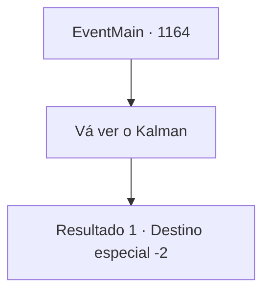

# Eventos principais · 1164

[Índice da tabela](index.md) · [Índice geral](../index.md)

ID: `pt:EventMain:1164` · Fonte: `EventMain4` · Versão: 1.2.47.

Mapeamento estático dos arquivos; a disponibilidade e a execução dependem do estado da run.

## Texto do evento

*Sem texto no arquivo.*

## Dados de entrada

```json
{
  "id": 1164,
  "grade": 1,
  "normalGoal": "",
  "required": ""
}
```

## Mapa das escolhas



## Escolhas e resultados

### Escolha 1

Vá ver o Kalman

Requisitos e outros campos da escolha:

```json
{
  "required": ""
}
```

#### Resultado 1.1

Você diz a Rennart que se uniu a Kalman. Os dedos dele tremem. 

 "Hm... Cooperar com Kalman...? Bem, isso explica por que os avistamentos de mortos-vivos caíram de repente."

 Rennart olha para você. Você percebe preocupação em seus olhos. 

 "Se você acha que foi a decisão certa, quem sou eu para questioná-la."

 Segue-se um breve silêncio. 

 "Mas... cuidado, meu senhor. É muito provável que Kalman ainda não tenha abandonado sua ambição por Briovich."

 Você se despede de Rennart e sai do escritório.

Continuação registrada: [Destino especial `-2`](../destinos-especiais.md).

```json
{
  "required": "",
  "chance": "1",
  "nextEvent": -2,
  "type": 2,
  "reward": "13_6_8"
}
```

## Referências que chegam a este evento

- [Evento 1146 · escolha 1 · resultado 3](1146.md#escolha-1)
- [Evento 1160 · escolha 1 · resultado 3](1160.md#escolha-1)
- [Evento 1160 · escolha 2 · resultado 3](1160.md#escolha-2)
