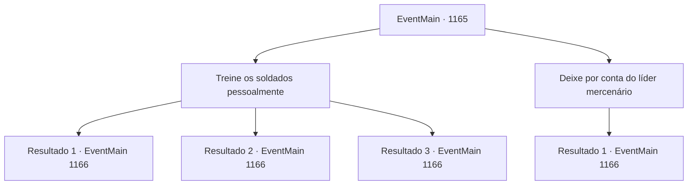

# Eventos principais · 1165

[Índice da tabela](index.md) · [Índice geral](../index.md)

ID: `pt:EventMain:1165` · Fonte: `EventMain4` · Versão: 1.2.47.

Mapeamento estático dos arquivos; a disponibilidade e a execução dependem do estado da run.

## Texto do evento

|drawing_getheringSoldiers| Conscritos adicionais se reúnem no Castelo Briovich. Caçadores recebem arcos e flechas, com carpinteiros e ferreiros designados como engenheiros militares. Carroças puxadas por vacas e cavalos são carregadas com rações de emergência e peças de equipamentos de cerco. Rennart se aproxima de você, olha um documento e relata. 

 "Temos alguns novos recrutas adicionais. Eles não estão acostumados a combates de verdade, porém - terão que ser treinados."


## Dados de entrada

```json
{
  "id": 1165,
  "grade": 1,
  "normalGoal": "",
  "required": "13_6_10|1_2_100"
}
```

## Mapa das escolhas



## Escolhas e resultados

### Escolha 1

Treine os soldados pessoalmente

Requisitos e outros campos da escolha:

```json
{
  "required": ""
}
```

#### Resultado 1.1

Você treina os novos recrutas pessoalmente. Você os ensina a manter uma formação em quadrado, como se mover mantendo a formação e a maneira mais eficiente de empunhar suas lanças. No começo, os soldados não estão acostumados a coordenar seus ataques. Um por um, você corrige sua postura e o tempo dos golpes. Seguem-se três semanas de treinamento. Agora, os soldados estão acostumados a se mover e atacar em formação. Rennart se aproxima de você e lhe entrega uma tigela de água. 

 "Agora, esses novos recrutas poderão cumprir sua parte."


Continuação registrada: [Evento 1166](1166.md) na mesma tabela.

```json
{
  "required": "21_48_1",
  "chance": "1|0_7_1|0_12_1",
  "nextEvent": 1166,
  "type": 0,
  "reward": "5_915_2"
}
```

#### Resultado 1.2

Você treina os recrutas novos pessoalmente. Você lhes ensina como manter uma formação em quadrado, como se mover mantendo a formação e a maneira mais eficiente de estocar com as lanças. Mas mesmo depois de dias de treinamento, você não vê melhora visível. Rennart se aproxima de você e lhe entrega uma tigela de água. 

 "Precisamos partir agora, meu senhor. Se nos demorarmos mais, não teremos rações suficientes."


Continuação registrada: [Evento 1166](1166.md) na mesma tabela.

```json
{
  "required": "21_48_1",
  "chance": "30",
  "nextEvent": 1166,
  "type": 1,
  "reward": ""
}
```

#### Resultado 1.3

Você treina os novos recrutas pessoalmente. Você os ensina a manter uma formação em quadrado, como se mover mantendo a formação e a maneira mais eficiente de empunhar suas lanças. No começo, os soldados não estão acostumados a coordenar seus ataques. Um por um, você corrige sua postura e o tempo dos golpes. Seguem-se três semanas de treinamento. Agora, os soldados estão acostumados a se mover e atacar em formação. Rennart se aproxima de você e lhe entrega uma tigela de água. 

 "Agora, esses novos recrutas poderão cumprir sua parte."


Continuação registrada: [Evento 1166](1166.md) na mesma tabela.

```json
{
  "required": "20_48_1",
  "chance": "1",
  "nextEvent": 1166,
  "type": 2,
  "reward": "5_915_2"
}
```

### Escolha 2

Deixe por conta do líder mercenário

Requisitos e outros campos da escolha:

```json
{
  "required": "5_914_1"
}
```

#### Resultado 2.1

Você convoca o capitão dos mercenários, encarregando-o de colocar os novos recrutas em forma. Ele bate repetidamente no próprio peito e responde em voz alta. 

 "Hah! Entendido. Deixe comigo."

 Ele segue imediatamente para o campo de treinamento. Os novos recrutas estão ali, murmurando. O capitão dos mercenários fica diante deles, de braços cruzados, e observa cada recruta, um por um. Uma breve pausa segue. 

 "O que vocês tão olhando! Enfileirem-se! Começamos com formações!"

 Três semanas se passam. Rennart bate na porta do seu escritório. 

 "O capitão dos mercenários deseja mostrar a você os resultados do treinamento."

 Você segue Rennart até o campo de treinamento. Lá, você nota um grupo de soldados, alinhados em ordem perfeita. Seguindo as ordens do capitão, eles coordenam seu ataque, como se todo o grupo fosse controlado por uma única pessoa. Ele percebe você e sorri, satisfeito. 

 "Como ficou? Nada mal, né?"

 Rennart responde. 

 "Agora, esses novos recrutas vão poder ajudar de verdade."


Continuação registrada: [Evento 1166](1166.md) na mesma tabela.

```json
{
  "required": "",
  "chance": "1",
  "nextEvent": 1166,
  "type": 2,
  "reward": "5_915_2"
}
```

## Referências que chegam a este evento

Nenhum `nextEvent` positivo da mesma tabela aponta para este nó. Isso não prova que seja inacessível: sorteio e estado de história podem selecioná-lo.

