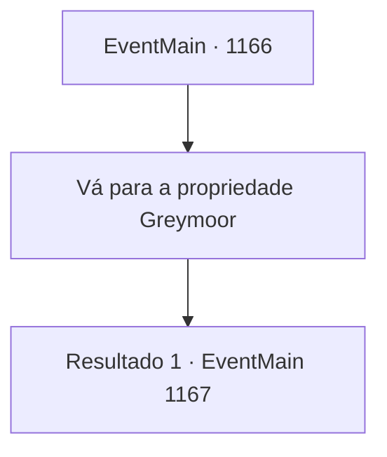

# Eventos principais · 1166

[Índice da tabela](index.md) · [Índice geral](../index.md)

ID: `pt:EventMain:1166` · Fonte: `EventMain4` · Versão: 1.2.47.

Mapeamento estático dos arquivos; a disponibilidade e a execução dependem do estado da run.

## Texto do evento

*Sem texto no arquivo.*

## Dados de entrada

```json
{
  "id": 1166,
  "grade": 1,
  "normalGoal": "",
  "required": ""
}
```

## Mapa das escolhas



## Escolhas e resultados

### Escolha 1

Vá para a propriedade Greymoor

Requisitos e outros campos da escolha:

```json
{
  "required": ""
}
```

#### Resultado 1.1

Você declara guerra à Casa Greymoor. Você lidera seus homens e marcha para o Castelo Greymoor. Uma bandeira preta com o símbolo de um lobo branco tremula no ar. Na manhã do quarto dia, o Castelo Greymoor aparece diante dos seus olhos. |drawing_greymoor| O portão do castelo está completamente fechado, com soldados posicionados por toda a extensão das muralhas. Você percebe bestas apontando pelas frestas de flechas. Em frente ao portão ergue-se uma barricada improvisada, feita de pilhas de barris de madeira e carroças. Você ordena aos seus homens que parem, fora do alcance dos arqueiros. Lá, seus homens começam a construir um posto avançado. Rennart ergue a viseira do capacete e fala. Seu olhar se volta para as muralhas do castelo. 

 "A questão é: como abrimos aquele portão exterior?"

 O cavalo de Rennart relincha, e ele o acaricia no pescoço para acalmá-lo. 

 "Precisamos acabar com isso o mais rápido possível — se o cerco durar muito, seremos o lado perdedor."


Continuação registrada: [Evento 1167](1167.md) na mesma tabela.

```json
{
  "required": "",
  "chance": "1",
  "nextEvent": 1167,
  "type": 2,
  "reward": ""
}
```

## Referências que chegam a este evento

- [Evento 1165 · escolha 1 · resultado 1](1165.md#escolha-1)
- [Evento 1165 · escolha 1 · resultado 2](1165.md#escolha-1)
- [Evento 1165 · escolha 1 · resultado 3](1165.md#escolha-1)
- [Evento 1165 · escolha 2 · resultado 1](1165.md#escolha-2)
