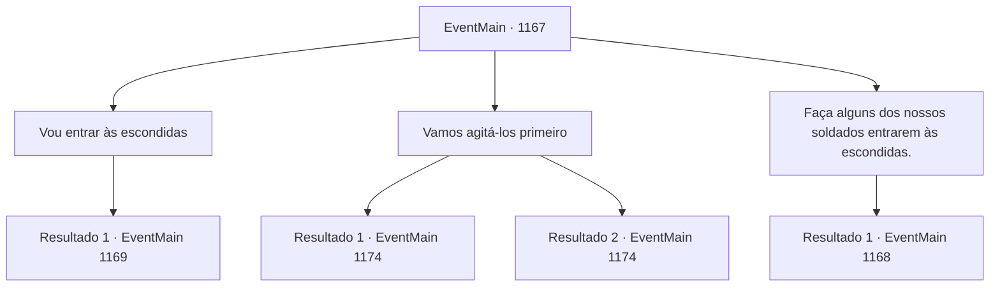

# Eventos principais · 1167

[Índice da tabela](index.md) · [Índice geral](../index.md)

ID: `pt:EventMain:1167` · Fonte: `EventMain4` · Versão: 1.2.47.

Mapeamento estático dos arquivos; a disponibilidade e a execução dependem do estado da run.

## Texto do evento

*Sem texto no arquivo.*

## Dados de entrada

```json
{
  "id": 1167,
  "grade": 1,
  "normalGoal": "",
  "required": ""
}
```

## Mapa das escolhas



## Escolhas e resultados

### Escolha 1

Vou entrar às escondidas

Requisitos e outros campos da escolha:

```json
{
  "required": ""
}
```

#### Resultado 1.1

Você lhe diz que vai se infiltrar por conta própria. Rennart pisca uma vez, atônito. 

 "Você vai... entrar sozinho?"

 Você acena com a cabeça, dizendo que vai pular as muralhas do castelo à noite e abrir o portão por dentro. Ele morde os lábios. Vira-se para as muralhas para estimar sua altura e volta-se para você. 

 "É um movimento arriscado, com certeza... mas com grande retorno, se você conseguir. Certo. Liderarei a investida assim que vermos o portão abrindo."

 Logo, o sol se põe e a lua nasce. Pouca luz no céu. Você cobre o rosto com fuligem, abandona o posto avançado e desaparece na escuridão. Você se aproxima das muralhas do Castelo Greymoor. Patrulhas com tochas se movem pelo topo. Você espera que elas passem.

Continuação registrada: [Evento 1169](1169.md) na mesma tabela.

```json
{
  "required": "",
  "chance": "1",
  "nextEvent": 1169,
  "type": 2,
  "reward": ""
}
```

### Escolha 2

Vamos agitá-los primeiro

Requisitos e outros campos da escolha:

```json
{
  "required": ""
}
```

#### Resultado 2.1

Você sugere desmoralizar o inimigo primeiro. Você grita com os soldados de Greymoor. Em voz alta, você lhes grita provocações, perguntando se eles realmente vão morrer lutando por alguém que cometeu traição ao instigar os orcs. Seu discurso causa uma grande comoção entre eles. Os soldados de Greymoor começam a murmurar. Eles ainda mantêm suas posições, mas você pode ver que estão visivelmente perturbados. Percebendo isso, você ordena que seus homens ataquem. Seus soldados imediatamente começam a se mover, montando uma catapulta em uma colina distante do castelo. Uma aríete é preparada atrás das linhas, carregada em uma carroça. A catapulta lança uma pedra em arco, que se choca contra as muralhas do castelo. Os arqueiros de Greymoor revidam do alto, mas seus arcos não alcançam a catapulta. O cerco continua. Após algumas horas, Rennart se aproxima de você. 

 "Vamos colocar o aríete agora."


Continuação registrada: [Evento 1174](1174.md) na mesma tabela.

```json
{
  "required": "",
  "chance": "1|0_12_1",
  "nextEvent": 1174,
  "type": 0,
  "reward": "5_920_1"
}
```

#### Resultado 2.2

Você sugere desmoralizar o inimigo primeiro. Você grita com os soldados de Greymoor. Em voz alta, você grita provocações para eles, perguntando se eles realmente vão morrer lutando por alguém que cometeu traição ao instigar os orcs. Mas seu discurso não parece ter efeito sobre eles. Sem dizer nada, você levanta a mão, ordenando aos seus homens que ataquem. Seus soldados imediatamente começam a se mover, montando uma catapulta em uma colina distante do castelo. Um aríete é preparado atrás das linhas, carregado em uma carroça. A catapulta lança uma pedra em arco, que se choca contra as muralhas do castelo. Arqueiros de Greymoor revidam do topo, mas seus arcos não alcançam a catapulta. O cerco continua. Depois de algumas horas, Rennart se aproxima de você. 

 "Vamos colocar o aríete agora."


Continuação registrada: [Evento 1174](1174.md) na mesma tabela.

```json
{
  "required": "",
  "chance": "25",
  "nextEvent": 1174,
  "type": 1,
  "reward": ""
}
```

### Escolha 3

Faça alguns dos nossos soldados entrarem às escondidas.

Requisitos e outros campos da escolha:

```json
{
  "required": "18_881_1"
}
```

#### Resultado 3.1

Você sugere infiltrar alguns soldados, para abrir o portão por dentro. Rennart acena. 

 "Entendido. Vou chamar o Marechal e ordenar que ele infiltre-se no castelo."

 Ele convoca Tarrys, o Marechal. Em seguida, delega sua ordem a ele. Tarrys começa a coçar o queixo, olhando para o Castelo Greymoor. 

 "Hm... Vamos ver..."

 Segue-se um breve silêncio antes de Tarrys continuar. 

 "Claro. Vou trazer alguns homens e entrar por dentro."

 Algumas horas depois, o sol começa a se pôr. Tarrys traz um par de soldados, carregando uma carroça com barris de cerveja. Então ele parte rumo ao Castelo Greymoor. Passam-se mais algumas horas.

Continuação registrada: [Evento 1168](1168.md) na mesma tabela.

```json
{
  "required": "",
  "chance": "1",
  "nextEvent": 1168,
  "type": 2,
  "reward": ""
}
```

## Referências que chegam a este evento

- [Evento 1166 · escolha 1 · resultado 1](1166.md#escolha-1)
