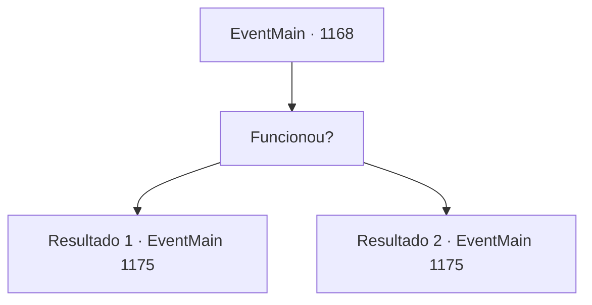

# Eventos principais · 1168

[Índice da tabela](index.md) · [Índice geral](../index.md)

ID: `pt:EventMain:1168` · Fonte: `EventMain4` · Versão: 1.2.47.

Mapeamento estático dos arquivos; a disponibilidade e a execução dependem do estado da run.

## Texto do evento

*Sem texto no arquivo.*

## Dados de entrada

```json
{
  "id": 1168,
  "grade": 1,
  "normalGoal": "",
  "required": ""
}
```

## Mapa das escolhas



## Escolhas e resultados

### Escolha 1

Funcionou?

Requisitos e outros campos da escolha:

```json
{
  "required": ""
}
```

#### Resultado 1.1

Você resmunga para si mesmo. Então, o portão do castelo começa a se abrir. Você lidera seus homens e marcha imediatamente em direção ao portão. 

 "O PORTÃO ESTÁ ABERTO! CARGA!!"

 Os soldados de Greymoor que estavam de guarda entram em pânico, pegos de surpresa por um ataque repentino. 

 "H- HEIN?! O portão está aberto! Fechem-no!!"

 Eles tentam puxar a alavanca de controle, mas Tarrys já cuidou disso. 

 "Droga! Alguém desativou a manivela! Impedam que entrem!"

 Mas antes que possam se formar, você arromba o portão do castelo com seus homens. Assim começou a batalha entre a Casa Briovich e a Casa Greymoor.

Continuação registrada: [Evento 1175](1175.md) na mesma tabela.

```json
{
  "required": "5_915_2",
  "chance": "1",
  "nextEvent": 1175,
  "type": 2,
  "reward": "6_2_136",
  "place": 4
}
```

#### Resultado 1.2

Você resmunga para si mesmo. Então, o portão do castelo começa a se abrir. Você lidera seus homens e marcha imediatamente em direção ao portão. 

 "O PORTÃO ESTÁ ABERTO! CARGA!!"

 Os soldados de Greymoor que estavam de guarda entram em pânico, pegos de surpresa por um ataque repentino. 

 "H- HEIN?! O portão está aberto! Fechem-no!!"

 Eles tentam puxar a alavanca de controle, mas Tarrys já cuidou disso. 

 "Droga! Alguém desativou a manivela! Impedam que entrem!"

 Mas antes que possam se formar, você arromba o portão do castelo com seus homens. Assim começou a batalha entre a Casa Briovich e a Casa Greymoor.

Continuação registrada: [Evento 1175](1175.md) na mesma tabela.

```json
{
  "required": "18_915_2",
  "chance": "1",
  "nextEvent": 1175,
  "type": 2,
  "reward": "6_0_136",
  "place": 4
}
```

## Referências que chegam a este evento

- [Evento 1167 · escolha 3 · resultado 1](1167.md#escolha-3)
