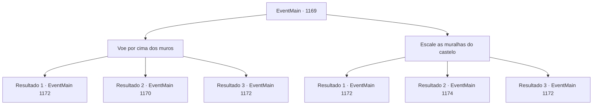

# Eventos principais · 1169

[Índice da tabela](index.md) · [Índice geral](../index.md)

ID: `pt:EventMain:1169` · Fonte: `EventMain4` · Versão: 1.2.47.

Mapeamento estático dos arquivos; a disponibilidade e a execução dependem do estado da run.

## Texto do evento

*Sem texto no arquivo.*

## Dados de entrada

```json
{
  "id": 1169,
  "grade": 1,
  "normalGoal": "",
  "required": ""
}
```

## Mapa das escolhas



## Escolhas e resultados

### Escolha 1

Voe por cima dos muros

Requisitos e outros campos da escolha:

```json
{
  "required": "-1|20_10_1|20_0_1"
}
```

#### Resultado 1.1

Você voa pelo ar, pairando sobre as muralhas do castelo. Então, você se esconde nas sombras, mantendo-se oculto. Você olha para baixo e localiza o pátio do castelo externo. Alguns suportes de tochas nas paredes iluminam o suficiente para distinguir sua forma. Você nota uma alavanca de aço de um lado da parede. Há correntes ligadas ao topo do portão. Você supõe que deve ser a alavanca do portão. À frente há um soldado fazendo guarda. A cabeça dele está inclinada para baixo, e sua lança parece fora do seu alcance. Você desce a estreita escada de pedra e entra no pátio. Então, você se esconde atrás dos prédios, onde a luz das tochas não alcança. Você ouve passos — soldados em patrulha, carregando tochas. Silenciosamente, você os segue, chegando finalmente à alavanca do portão. O guarda está a cerca de três passos de você.

Continuação registrada: [Evento 1172](1172.md) na mesma tabela.

```json
{
  "required": "21_5_4|21_43",
  "chance": "1|0_6_1",
  "nextEvent": 1172,
  "type": 0,
  "reward": ""
}
```

#### Resultado 1.2

Você voa pelo ar, pairando sobre as muralhas do castelo Talvez você tenha voado alto demais — um soldado de Greymoor patrulhando as muralhas nota você imediatamente. 

 "Hã?! Um intruso!"

 Ele imediatamente pega sua lança e a aponta para você.

Continuação registrada: [Evento 1170](1170.md) na mesma tabela.

```json
{
  "required": "21_5_4|21_43",
  "chance": "16",
  "nextEvent": 1170,
  "type": 1,
  "reward": "6_0_197",
  "place": 4
}
```

#### Resultado 1.3

Você voa pelo ar, pairando sobre as muralhas do castelo. Então, você se esconde nas sombras, mantendo-se oculto. Você olha para baixo e localiza o pátio do castelo externo. Alguns suportes de tochas nas paredes iluminam o suficiente para distinguir sua forma. Você nota uma alavanca de aço de um lado da parede. Há correntes ligadas ao topo do portão. Você supõe que deve ser a alavanca do portão. À frente há um soldado fazendo guarda. A cabeça dele está inclinada para baixo, e sua lança parece fora do seu alcance. Você desce a estreita escada de pedra e entra no pátio. Então, você se esconde atrás dos prédios, onde a luz das tochas não alcança. Você ouve passos — soldados em patrulha, carregando tochas. Silenciosamente, você os segue, chegando finalmente à alavanca do portão. O guarda está a cerca de três passos de você.

Continuação registrada: [Evento 1172](1172.md) na mesma tabela.

```json
{
  "required": "-1|20_5_4|20_43",
  "chance": "1",
  "nextEvent": 1172,
  "type": 2,
  "reward": ""
}
```

### Escolha 2

Escale as muralhas do castelo

Requisitos e outros campos da escolha:

```json
{
  "required": ""
}
```

#### Resultado 2.1

Você sobe pelas muralhas do castelo, equilibrando-se em pequenos buracos entre elas. Logo, você alcança o topo. Você cuidadosamente enfia a cabeça acima das muralhas. Você olha para baixo e localiza o pátio do castelo externo. Alguns suportes de tochas nas paredes iluminam o suficiente para distinguir sua forma. Você percebe uma alavanca de aço em um dos lados da muralha. Ela tem correntes conectadas até o topo do portão. Você supõe que deve ser a alavanca do portão. Na frente, um soldado está de guarda. A cabeça dele está inclinada para baixo, e sua lança parece fora de alcance. Você desce pela estreita escadaria de pedra e entra no pátio. Então, você se esconde atrás dos edifícios, onde a luz das tochas não alcança. Você ouve passos — soldados em patrulha, carregando tochas. Silenciosamente, você os segue, eventualmente chegando à alavanca do portão. O guarda está a cerca de três passos de você.

Continuação registrada: [Evento 1172](1172.md) na mesma tabela.

```json
{
  "required": "21_5_4|21_43",
  "chance": "1|0_5_1|0_6_1",
  "nextEvent": 1172,
  "type": 0,
  "reward": ""
}
```

#### Resultado 2.2

Você tenta escalar as muralhas do castelo, apoiando-se em pequenos buracos entre elas. Mas as muralhas são altas demais. Infelizmente, você perde a firmeza e cai da parede, no chão. Suas mãos tremem. Você tenta agarrar as paredes e subir de novo, mas não tem energia para isso. Infelizmente, você desiste de escalar as muralhas e retorna ao posto avançado. Um novo dia começa. Você ordena aos seus homens que iniciem o cerco. Seus soldados começam a se mover imediatamente, montando uma catapulta em uma colina distante do castelo. Uma aríete é preparada atrás das linhas, carregada em uma carroça. A catapulta lança uma pedra em arco, que atinge as muralhas do castelo. Os arqueiros de Greymoor revidam do topo, mas seus arcos não alcançam a catapulta. O cerco continua. Depois de algumas horas, Rennart se aproxima de você. 

 "Agora vamos colocar o aríete."


Continuação registrada: [Evento 1174](1174.md) na mesma tabela.

```json
{
  "required": "21_5_4|21_43",
  "chance": "32",
  "nextEvent": 1174,
  "type": 1,
  "reward": ""
}
```

#### Resultado 2.3

Você sobe pelas muralhas do castelo, equilibrando-se em pequenos buracos entre elas. Logo, você alcança o topo. Você cuidadosamente enfia a cabeça acima das muralhas. Você olha para baixo e localiza o pátio do castelo externo. Alguns suportes de tochas nas paredes iluminam o suficiente para distinguir sua forma. Você percebe uma alavanca de aço em um dos lados da muralha. Ela tem correntes conectadas até o topo do portão. Você supõe que deve ser a alavanca do portão. Na frente, um soldado está de guarda. A cabeça dele está inclinada para baixo, e sua lança parece fora de alcance. Você desce pela estreita escadaria de pedra e entra no pátio. Então, você se esconde atrás dos edifícios, onde a luz das tochas não alcança. Você ouve passos — soldados em patrulha, carregando tochas. Silenciosamente, você os segue, eventualmente chegando à alavanca do portão. O guarda está a cerca de três passos de você.

Continuação registrada: [Evento 1172](1172.md) na mesma tabela.

```json
{
  "required": "-1|20_5_4|20_43",
  "chance": "1",
  "nextEvent": 1172,
  "type": 2,
  "reward": ""
}
```

## Referências que chegam a este evento

- [Evento 1167 · escolha 1 · resultado 1](1167.md#escolha-1)
