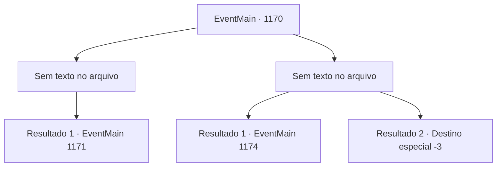

# Eventos principais · 1170

[Índice da tabela](index.md) · [Índice geral](../index.md)

ID: `pt:EventMain:1170` · Fonte: `EventMain4` · Versão: 1.2.47.

Mapeamento estático dos arquivos; a disponibilidade e a execução dependem do estado da run.

## Texto do evento

*Sem texto no arquivo.*

## Dados de entrada

```json
{
  "id": 1170,
  "grade": 1,
  "normalGoal": "",
  "required": ""
}
```

## Mapa das escolhas



## Escolhas e resultados

### Escolha 1

*Sem texto no arquivo; o papel dessa opção depende da interface do jogo.*

Requisitos e outros campos da escolha:

```json
{
  "required": ""
}
```

#### Resultado 1.1

Você consegue derrotar o guarda. Mas logo um sino de alarme toca, e um grupo de soldados de Greymoor começa a se mover. Você olha para baixo e localiza o pátio do castelo externo. Algumas tochas nas paredes iluminam o suficiente para discernir sua forma. Você nota uma alavanca de aço em um lado da parede. Ela tem correntes conectadas até o topo do portão. Você supõe que deve ser a alavanca do portão. Na frente há um soldado em guarda. Lá, você percebe os soldados olhando para cima, gritando. 

 "LÁ! PEGUEM O INVASOR!!"

 Sozinho no topo das muralhas do castelo, você combate os soldados.

Continuação registrada: [Evento 1171](1171.md) na mesma tabela.

```json
{
  "required": "",
  "chance": "1",
  "nextEvent": 1171,
  "type": 2,
  "reward": "6_0_136",
  "place": 4
}
```

### Escolha 2

*Sem texto no arquivo; o papel dessa opção depende da interface do jogo.*

Requisitos e outros campos da escolha:

```json
{
  "required": ""
}
```

#### Resultado 2.1

Você está ocupado lutando com o guarda. Mas logo, um sino de alarme toca, e um grupo de soldados de Greymoor começa a se mover. Você pula de volta por cima das muralhas do castelo para fugir. Você faz o possível para aterrissar em segurança, mas não consegue escapar da dor nos tornozelos. Soldados de Greymoor continuam a persegui-lo das muralhas do castelo, gritando. 

 "LÁ!"

 Uma tempestade de flechas o persegue, mas graças à escuridão, nenhuma o acerta. Um novo dia começa. Você ordena aos seus homens que comecem o cerco. Seus soldados imediatamente começam a se mover, montando uma catapulta em uma colina distante do castelo. Um aríete é preparado atrás das linhas, carregado em uma carroça. A catapulta lança um pedregulho em arco, que se choca contra as muralhas do castelo. Arqueiros de Greymoor retaliam do alto, mas seus arcos não alcançam a catapulta. O cerco continua. Depois de algumas horas, Rennart se aproxima de você. 

 "Vamos colocar o aríete agora."


Continuação registrada: [Evento 1174](1174.md) na mesma tabela.

```json
{
  "required": "1_0_2|1_1_2",
  "chance": "1",
  "nextEvent": 1174,
  "type": 2,
  "reward": "0_0_-1|0_1_-1"
}
```

#### Resultado 2.2

Um soldado de Greymoor arremessa sua lança em você, acertando seu tornozelo. Você tropeça nela, perde o equilíbrio e cai. Infelizmente, você mergulha direto no chão, batendo com a cabeça na terra. Com um alto splat, você encontra seu fim.

Continuação registrada: [Destino especial `-3`](../destinos-especiais.md).

```json
{
  "required": "-1|2_0_2|2_1_2",
  "chance": "1",
  "nextEvent": -3,
  "type": 2,
  "reward": "0_0_-1|0_1_-1"
}
```

## Referências que chegam a este evento

- [Evento 1169 · escolha 1 · resultado 2](1169.md#escolha-1)
