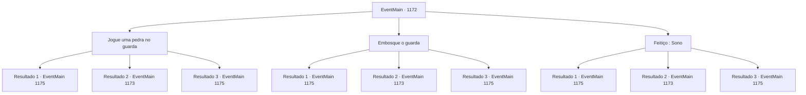

# Eventos principais · 1172

[Índice da tabela](index.md) · [Índice geral](../index.md)

ID: `pt:EventMain:1172` · Fonte: `EventMain4` · Versão: 1.2.47.

Mapeamento estático dos arquivos; a disponibilidade e a execução dependem do estado da run.

## Texto do evento

*Sem texto no arquivo.*

## Dados de entrada

```json
{
  "id": 1172,
  "grade": 1,
  "normalGoal": "",
  "required": ""
}
```

## Mapa das escolhas



## Escolhas e resultados

### Escolha 1

Jogue uma pedra no guarda

Requisitos e outros campos da escolha:

```json
{
  "required": ""
}
```

#### Resultado 1.1

Você pega uma pedra próxima e a joga na cabeça do guarda. O guarda, cochilando, leva a pedrada na cabeça e desaba. Você se aproxima da alavanca e a puxa para baixo. As correntes tilintam, e o portão do castelo se abre. Outros soldados de Greymoor são alertados pelo som do portão abrindo. Logo, percebem você e gritam. 

 "Merd...! Fechem o portão!"

 "Nâo — prendam o intruso primeiro!!"

 Os soldados de Greymoor começam a entrar em pânico. Rennart irrompe pelo portão aberto do castelo, liderando o exército de Briovich. 

 "O portão está aberto! AVANÇAR!!"

 Infelizmente, a batalha entre a Casa Briovich e a Casa Greymoor começou.

Continuação registrada: [Evento 1175](1175.md) na mesma tabela.

```json
{
  "required": "21_60_2",
  "chance": "1|0_5_1",
  "nextEvent": 1175,
  "type": 0,
  "reward": "6_0_136",
  "place": 4
}
```

#### Resultado 1.2

Você pega uma pedra próxima e a joga na cabeça do guarda. Ela passa pelo capacete dele. Em vez de derrubá-lo, você consegue acordá-lo. 

 "*ofegante* Q- Q- Hã?!"

 Imediatamente, ele pega sua lança e ataca.

Continuação registrada: [Evento 1173](1173.md) na mesma tabela.

```json
{
  "required": "21_60_2",
  "chance": "16",
  "nextEvent": 1173,
  "type": 1,
  "reward": "6_0_197",
  "place": 4
}
```

#### Resultado 1.3

Você pega uma pedra próxima e a atira na cabeça do guarda. O guarda, cochilando, é atingido na cabeça e simplesmente explode. Você se aproxima da alavanca e a puxa para baixo. As correntes tilintam, e o portão do castelo se abre. Outros soldados de Greymoor são alertados pelo som do portão se abrindo. Logo, eles percebem você e gritam. 

 "Droga...! Fechem o portão!"

 "Não — prendam o intruso primeiro!!"

 Os soldados de Greymoor começam a entrar em pânico. Rennart irrompe pelo portão aberto do castelo, liderando o exército Briovich. 

 "O portão está aberto! CARGA!!"

 E assim começou a batalha entre a Casa Briovich e a Casa Greymoor.

Continuação registrada: [Evento 1175](1175.md) na mesma tabela.

```json
{
  "required": "20_60_2",
  "chance": "1",
  "nextEvent": 1175,
  "type": 2,
  "reward": "6_0_136",
  "place": 4
}
```

### Escolha 2

Embosque o guarda

Requisitos e outros campos da escolha:

```json
{
  "required": ""
}
```

#### Resultado 2.1

Você se aproxima do guarda por trás. Ele não consegue resistir e imediatamente perde a consciência. Você o deita no chão, alcança a alavanca e a puxa gentilmente para baixo. As correntes chacoalham, e o portão do castelo se abre. Outros soldados de Greymoor são alertados pelo som do portão se abrindo. Logo, eles percebem você e gritam. 

 "Droga...! Fechem o portão!"

 "Não — peguem o intruso primeiro!!"

 Os soldados de Greymoor começam a entrar em pânico. Rennart avança correndo pelo portão aberto do castelo, liderando o exército Briovich. 

 "O portão está aberto! AVANCEM!!"

 Ai, a batalha entre a Casa Briovich e a Casa Greymoor começou.

Continuação registrada: [Evento 1175](1175.md) na mesma tabela.

```json
{
  "required": "21_5_4|21_43",
  "chance": "1|0_6_1",
  "nextEvent": 1175,
  "type": 0,
  "reward": "6_0_136",
  "place": 4
}
```

#### Resultado 2.2

Você se aproxima do guarda por trás. Mas ele percebe sua presença e acorda. 

 "*ofegante* H- Hã?!"

 Imediatamente, ele pega sua lança e ataca.

Continuação registrada: [Evento 1173](1173.md) na mesma tabela.

```json
{
  "required": "21_5_4|21_43",
  "chance": "20",
  "nextEvent": 1173,
  "type": 1,
  "reward": "6_0_197",
  "place": 4
}
```

#### Resultado 2.3

Você se aproxima do guarda por trás. Ele não consegue resistir e imediatamente perde a consciência. Você o deita no chão, alcança a alavanca e a puxa gentilmente para baixo. As correntes chacoalham, e o portão do castelo se abre. Outros soldados de Greymoor são alertados pelo som do portão se abrindo. Logo, eles percebem você e gritam. 

 "Droga...! Fechem o portão!"

 "Não — peguem o intruso primeiro!!"

 Os soldados de Greymoor começam a entrar em pânico. Rennart avança correndo pelo portão aberto do castelo, liderando o exército Briovich. 

 "O portão está aberto! AVANCEM!!"

 Ai, a batalha entre a Casa Briovich e a Casa Greymoor começou.

Continuação registrada: [Evento 1175](1175.md) na mesma tabela.

```json
{
  "required": "-1|20_5_4|20_43",
  "chance": "1",
  "nextEvent": 1175,
  "type": 2,
  "reward": "6_0_136",
  "place": 4
}
```

### Escolha 3

Feitiço : Sono

Requisitos e outros campos da escolha:

```json
{
  "required": "20_0_2|1_1_2"
}
```

#### Resultado 3.1

Você lança um feitiço, garantindo ao guarda uma boa e merecida noite de sono. Então, você alcança a alavanca e a puxa suavemente para baixo. As correntes tilintam, e o portão do castelo se abre. Outros soldados de Greymoor são alertados pelo som do portão se abrindo. Logo percebem você e gritam. 

 "Droga...! Fechem o portão!"

 "Não — agarrem o intruso primeiro!!"

 Os soldados de Greymoor começam a entrar em pânico. Rennart avança pelo portão aberto do castelo, liderando o exército de Briovich. 

 "O portão está aberto! AVANÇAR!!"

 Assim, a batalha entre a Casa Briovich e a Casa Greymoor começou.

Continuação registrada: [Evento 1175](1175.md) na mesma tabela.

```json
{
  "required": "21_0_4",
  "chance": "1|0_7_1|0_12_1",
  "nextEvent": 1175,
  "type": 0,
  "reward": "0_1_-1|6_0_136",
  "place": 4
}
```

#### Resultado 3.2

Você conjura um feitiço, tentando adormecer o guarda. Mas ele percebe sua presença e acorda. 

 "*ofegante* Q- O quê?!"

 Imediatamente, ele alcança a lança e ataca.

Continuação registrada: [Evento 1173](1173.md) na mesma tabela.

```json
{
  "required": "21_0_4",
  "chance": "30",
  "nextEvent": 1173,
  "type": 1,
  "reward": "6_0_197",
  "place": 4
}
```

#### Resultado 3.3

Você lança um feitiço, garantindo ao guarda uma boa e merecida noite de sono. Então, você alcança a alavanca e a puxa suavemente para baixo. As correntes tilintam, e o portão do castelo se abre. Outros soldados de Greymoor são alertados pelo som do portão se abrindo. Logo percebem você e gritam. 

 "Droga...! Fechem o portão!"

 "Não — agarrem o intruso primeiro!!"

 Os soldados de Greymoor começam a entrar em pânico. Rennart avança pelo portão aberto do castelo, liderando o exército de Briovich. 

 "O portão está aberto! AVANÇAR!!"

 Assim, a batalha entre a Casa Briovich e a Casa Greymoor começou.

Continuação registrada: [Evento 1175](1175.md) na mesma tabela.

```json
{
  "required": "20_0_4",
  "chance": "1",
  "nextEvent": 1175,
  "type": 2,
  "reward": "0_1_-1|6_0_136",
  "place": 4
}
```

## Referências que chegam a este evento

- [Evento 1169 · escolha 1 · resultado 1](1169.md#escolha-1)
- [Evento 1169 · escolha 1 · resultado 3](1169.md#escolha-1)
- [Evento 1169 · escolha 2 · resultado 1](1169.md#escolha-2)
- [Evento 1169 · escolha 2 · resultado 3](1169.md#escolha-2)
