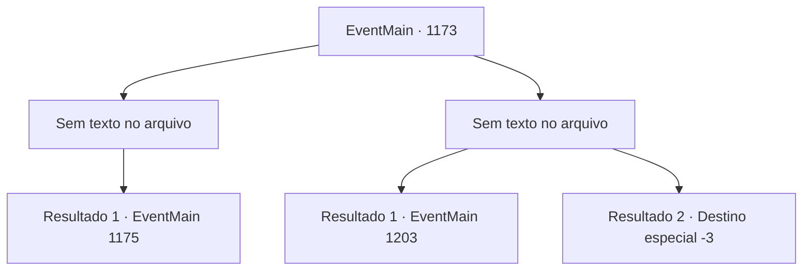

# Eventos principais · 1173

[Índice da tabela](index.md) · [Índice geral](../index.md)

ID: `pt:EventMain:1173` · Fonte: `EventMain4` · Versão: 1.2.47.

Mapeamento estático dos arquivos; a disponibilidade e a execução dependem do estado da run.

## Texto do evento

*Sem texto no arquivo.*

## Dados de entrada

```json
{
  "id": 1173,
  "grade": 1,
  "normalGoal": "",
  "required": ""
}
```

## Mapa das escolhas



## Escolhas e resultados

### Escolha 1

*Sem texto no arquivo; o papel dessa opção depende da interface do jogo.*

Requisitos e outros campos da escolha:

```json
{
  "required": ""
}
```

#### Resultado 1.1

Você lida com o guarda e puxa a alavanca. As correntes tilintam, e o portão do castelo se abre. Outros soldados de Greymoor são alertados pelo som do portão se abrindo. Logo, eles te percebem e gritam. 

 "Droga...! Fechem o portão!"

 "Não — apanhem o intruso primeiro!!"

 Os soldados de Greymoor começam a entrar em pânico. Rennart avança pelo portão aberto do castelo, liderando o exército Briovich. 

 "O portão está aberto! AVANCEM!!"

 Infelizmente, a batalha entre a Casa Briovich e a Casa Greymoor começou.

Continuação registrada: [Evento 1175](1175.md) na mesma tabela.

```json
{
  "required": "",
  "chance": "1",
  "nextEvent": 1175,
  "type": 2,
  "reward": "6_0_136",
  "place": 4
}
```

### Escolha 2

*Sem texto no arquivo; o papel dessa opção depende da interface do jogo.*

Requisitos e outros campos da escolha:

```json
{
  "required": ""
}
```

#### Resultado 2.1

O guarda te empurra ao limite. Outros soldados também se preparam para entrar na luta. Infelizmente, você fica cercado e acaba sendo dominado pelos soldados. Um deles acerta suas costas com o pomo da espada. Sua visão oscila e então tudo fica preto. 

 Alguns instantes depois, você abre os olhos sentindo dor. Você se encontra em uma cela. O chão está molhado.

Continuação registrada: [Evento 1203](1203.md) na mesma tabela.

```json
{
  "required": "1_0_2|1_1_2",
  "chance": "1",
  "nextEvent": 1203,
  "type": 2,
  "reward": "0_0_-1|0_1_-1"
}
```

#### Resultado 2.2

O guarda te empurra até o limite. Outros soldados também se preparam para entrar na luta. Infelizmente, você fica cercado e acaba sendo dominado pelos soldados. Um deles acerta suas costas com o pomo da espada. Você ouve algo quebrar perto do seu crânio. Infelizmente, sua visão pisca, e então tudo fica preto.

Continuação registrada: [Destino especial `-3`](../destinos-especiais.md).

```json
{
  "required": "-1|2_0_2|2_1_2",
  "chance": "1",
  "nextEvent": -3,
  "type": 2,
  "reward": "0_0_-1|0_1_-1"
}
```

## Referências que chegam a este evento

- [Evento 1172 · escolha 1 · resultado 2](1172.md#escolha-1)
- [Evento 1172 · escolha 2 · resultado 2](1172.md#escolha-2)
- [Evento 1172 · escolha 3 · resultado 2](1172.md#escolha-3)
- [Evento 1174 · escolha 2 · resultado 1](1174.md#escolha-2)
- [Evento 1174 · escolha 2 · resultado 4](1174.md#escolha-2)
