# Eventos principais · 1174

[Índice da tabela](index.md) · [Índice geral](../index.md)

ID: `pt:EventMain:1174` · Fonte: `EventMain4` · Versão: 1.2.47.

Mapeamento estático dos arquivos; a disponibilidade e a execução dependem do estado da run.

## Texto do evento

*Sem texto no arquivo.*

## Dados de entrada

```json
{
  "id": 1174,
  "grade": 1,
  "normalGoal": "",
  "required": ""
}
```

## Mapa das escolhas

```mermaid
flowchart TD
  E["EventMain · 1174"]
  C0["Empurre o aríete você mesmo"]
  E --> C0
  R0_0["Resultado 1 · EventMain 1175"]
  C0 --> R0_0
  R0_1["Resultado 2 · EventMain 1174"]
  C0 --> R0_1
  R0_2["Resultado 3 · EventMain 1175"]
  C0 --> R0_2
  R0_3["Resultado 4 · EventMain 1175"]
  C0 --> R0_3
  R0_4["Resultado 5 · EventMain 1175"]
  C0 --> R0_4
  C1["Suba com escadas"]
  E --> C1
  R1_0["Resultado 1 · EventMain 1173"]
  C1 --> R1_0
  R1_1["Resultado 2 · EventMain 1174"]
  C1 --> R1_1
  R1_2["Resultado 3 · Destino especial -3"]
  C1 --> R1_2
  R1_3["Resultado 4 · EventMain 1173"]
  C1 --> R1_3
  C2["Feitiço: Terremoto"]
  E --> C2
  R2_0["Resultado 1 · EventMain 1175"]
  C2 --> R2_0
  R2_1["Resultado 2 · EventMain 1174"]
  C2 --> R2_1
  R2_2["Resultado 3 · EventMain 1175"]
  C2 --> R2_2
  C3["Afaste-se"]
  E --> C3
  R3_0["Resultado 1 · EventMain 1176"]
  C3 --> R3_0
```



## Escolhas e resultados

### Escolha 1

Empurre o aríete você mesmo

Requisitos e outros campos da escolha:

```json
{
  "required": "5_922_0"
}
```

#### Resultado 1.1

Você se junta aos seus homens para empurrar o aríete. Eles dividem a força de trabalho, alguns encarregados de colocar escadas nas muralhas do castelo e outros de subi-las. Arqueiros de Greymoor disparam flechas contra o aríete, apenas para ver suas flechas desviadas pelos portadores de escudos que o protegem. Eventualmente, o aríete chega diante do portão do castelo. 

 "Um, dois!"

 Os soldados seguem sua voz, empurrando o aríete de maneira coordenada.
 *TUM* *TUM* *TUM*
 A cada golpe, o portão fica visivelmente danificado. Finalmente, com o quarto golpe, os portões são arrombados. 

 "O portão está aberto! CARGA!!"

 Assim começou a batalha entre a Casa Briovich e a Casa Greymoor.

Continuação registrada: [Evento 1175](1175.md) na mesma tabela.

```json
{
  "required": "18_920_1|21_60_2|10_253_1",
  "chance": "1|0_5_1",
  "nextEvent": 1175,
  "type": 0,
  "reward": "6_0_136",
  "place": 4
}
```

#### Resultado 1.2

Você se junta aos seus homens empurrando o aríete. Eles dividem seu efetivo, alguns encarregados de posicionar escadas nas muralhas do castelo e outros de subi-las. Arqueiros de Greymoor disparam flechas contra o aríete, apenas para ver suas flechas desviadas pelos portadores de escudo que o protegem. Eventualmente, o aríete chega em frente ao portão do castelo. 

 "Um, dois!"

 Os soldados seguem sua voz, empurrando o aríete de forma coordenada.
 *TUM* *TUM* *TUM*
 Um barulho alto enche o ar, mas o portão do castelo permanece fechado. Então, do topo das muralhas do castelo, você percebe uma enorme pedra caindo sobre o aríete, arrancando suas rodas. Lamentavelmente, o aríete se quebra.

Continuação registrada: [Evento 1174](1174.md) na mesma tabela.

```json
{
  "required": "18_920_1|21_60_2|10_253_1",
  "chance": "30",
  "nextEvent": 1174,
  "type": 1,
  "reward": "5_922_9"
}
```

#### Resultado 1.3

Você se junta aos seus homens empurrando o aríete. Eles dividem seu efetivo, alguns encarregados de colocar escadas nas muralhas do castelo e outros de subi-las. Arqueiros de Greymoor disparam flechas contra o aríete, apenas para ver suas flechas serem desviadas pelos portadores de escudo que o protegem. Eventualmente, o aríete chega diante do portão do castelo. 

 "Um, dois!"

 Os soldados seguem sua voz, empurrando o aríete de maneira coordenada.
 *THUD*
 Graças à sua força sobre-humana, o portão do castelo cede com um único golpe. Os soldados ficam boquiabertos, olhando para você com admiração. Ignorando-os, você grita ordens aos seus homens. 

 "O portão está aberto! CARGA!!"

 Ai começou a batalha entre a Casa Briovich e a Casa Greymoor.

Continuação registrada: [Evento 1175](1175.md) na mesma tabela.

```json
{
  "required": "20_60_2|10_253_1",
  "chance": "1",
  "nextEvent": 1175,
  "type": 2,
  "reward": "6_0_136",
  "place": 4
}
```

#### Resultado 1.4

Você se junta aos seus homens para empurrar o aríete. Eles dividem sua força de trabalho, alguns encarregados de colocar escadas nas muralhas do castelo e outros de subi-las. Os arqueiros de Greymoor disparam flechas no aríete, apenas para ver suas flechas desviadas pelos escudeiros que o protegem. Eventualmente, o aríete chega diante do portão do castelo. 

 "Um, dois!"

 Os soldados seguem sua voz, empurrando o aríete de forma coordenada.
 *THUD* *THUD* *THUD*
 A cada golpe, o portão fica visivelmente danificado. Finalmente, com o quarto golpe, os portões são arremessados abertos. Você grita ordens aos seus homens. 

 "O portão está aberto! AVANÇAR!!"

 Ai de nós, a batalha entre a Casa Briovich e a Casa Greymoor começou.

Continuação registrada: [Evento 1175](1175.md) na mesma tabela.

```json
{
  "required": "5_920_1|10_253_1",
  "chance": "1",
  "nextEvent": 1175,
  "type": 2,
  "reward": "6_0_136",
  "place": 4
}
```

#### Resultado 1.5

Você se junta aos seus homens para empurrar o aríete. Eles dividem sua força de trabalho, alguns encarregados de colocar escadas nas muralhas do castelo e outros de subi-las. Os arqueiros de Greymoor disparam flechas contra o aríete, apenas para verem suas flechas desviadas pelos guardas com escudos que o protegem. Eventualmente, o aríete chega diante do portão do castelo. Você deixa seus homens com o aríete, enquanto começa a atacar o portão do castelo com dois aríetes. *TUM* *TUM* *TUM*
 A cada golpe, o portão fica visivelmente danificado. Os portões não resistem por muito tempo antes de serem arrombados. Assim que você nota a brecha, grita ordens aos seus homens. 

 "O PORTÃO ESTÁ ABERTO! AVANCEM!!"

 E assim começou a batalha entre a Casa Briovich e a Casa Greymoor.

Continuação registrada: [Evento 1175](1175.md) na mesma tabela.

```json
{
  "required": "8_253_1",
  "chance": "1",
  "nextEvent": 1175,
  "type": 2,
  "reward": "6_0_136",
  "place": 4
}
```

### Escolha 2

Suba com escadas

Requisitos e outros campos da escolha:

```json
{
  "required": "5_923_0"
}
```

#### Resultado 2.1

Você ordena que seus homens coloquem escadas nas muralhas do castelo. 

 "Escalem as muralhas do castelo!"

 Os soldados de Greymoor resistem empurrando as escadas com lanças em forma de gancho e atirando pedras nos seus homens. Você se junta aos seus homens para subir pelas escadas. Mais ou menos na metade, um soldado de Greymoor solta uma pedra na sua cabeça. Você continua apesar de ser atingido pela pedra lançada, finalmente pisando no topo das muralhas do castelo. Imediatamente, você ataca o soldado de Greymoor.

Continuação registrada: [Evento 1173](1173.md) na mesma tabela.

```json
{
  "required": "21_9_4",
  "chance": "1|0_13_1",
  "nextEvent": 1173,
  "type": 0,
  "reward": "6_0_197",
  "place": 4
}
```

#### Resultado 2.2

Você ordena aos seus homens que coloquem escadas nas muralhas do castelo. 

 "Escalem as muralhas do castelo!"

 Os soldados de Greymoor resistem empurrando as escadas com lanças em forma de gancho e atirando pedras nos seus soldados. Você se junta aos seus homens para subir as escadas. Mais ou menos na metade, um soldado de Greymoor deixa cair uma pedra na sua cabeça. Você é atingido pela pedra e perde o equilíbrio, caindo da escada até o chão. Um caroço incha na sua cabeça.

Continuação registrada: [Evento 1174](1174.md) na mesma tabela.

```json
{
  "required": "21_9_4|1_0_2",
  "chance": "20",
  "nextEvent": 1174,
  "type": 1,
  "reward": "5_923_9|0_0_-1"
}
```

#### Resultado 2.3

Você ordena que seus homens coloquem escadas nas muralhas do castelo. 

 "Escalem as muralhas do castelo!"

 Soldados Greymoor resistem empurrando as escadas com lanças em forma de gancho e atirando pedras contra seus homens. Você se junta aos seus homens para subir pelas escadas. Mais ou menos na metade, um soldado Greymoor solta uma pedra que cai na sua cabeça. Você é atingido pela pedra e perde o equilíbrio, caindo da escada até o chão. Infelizmente, você se choca contra a terra e perde a consciência.

Continuação registrada: [Destino especial `-3`](../destinos-especiais.md).

```json
{
  "required": "21_9_4|2_0_2",
  "chance": "20",
  "nextEvent": -3,
  "type": 1,
  "reward": "0_0_-1"
}
```

#### Resultado 2.4

Você ordena que seus homens coloquem escadas nas muralhas do castelo. 

 "Escalem as muralhas do castelo!"

 Os soldados de Greymoor resistem empurrando as escadas com lanças em forma de gancho e atirando pedras nos seus homens. Você se junta aos seus homens para subir pelas escadas. Mais ou menos na metade, um soldado de Greymoor solta uma pedra na sua cabeça. Você continua apesar de ser atingido pela pedra lançada, finalmente pisando no topo das muralhas do castelo. Imediatamente, você ataca o soldado de Greymoor.

Continuação registrada: [Evento 1173](1173.md) na mesma tabela.

```json
{
  "required": "20_9_4",
  "chance": "1",
  "nextEvent": 1173,
  "type": 2,
  "reward": "6_0_197",
  "place": 4
}
```

### Escolha 3

Feitiço: Terremoto

Requisitos e outros campos da escolha:

```json
{
  "required": "20_0_4|1_1_2|5_924_0"
}
```

#### Resultado 3.1

Você conjura um feitiço. Logo, o chão sob o Castelo Greymoor começa a tremer. As muralhas do castelo, já enfraquecidas por tiros de catapulta, não resistem ao terremoto.

 <b><link=shake>*RUMBLEEEEEE*</link></b>

 Com um estrondo, as muralhas do castelo desabam. Rennart e seus homens ficam maravilhados diante do milagre que você acabou de realizar. Todos gritam de alegria. 

 "UOOOAAH--!! O CASTELO DESABOU!"

 Você grita ordens aos seus homens. 

 "TODOS! AVANCEM!"

 E assim começou a batalha entre a Casa Briovich e a Casa Greymoor.

Continuação registrada: [Evento 1175](1175.md) na mesma tabela.

```json
{
  "required": "21_0_4",
  "chance": "1|0_7_1|0_12_1",
  "nextEvent": 1175,
  "type": 0,
  "reward": "0_1_-1|6_0_136",
  "place": 4
}
```

#### Resultado 3.2

Você conjura um feitiço antes de ordenar que seus homens ataquem. Logo, o chão sob o Castelo Greymoor começa a tremer. Mas isso não faz muita coisa. A vibração não foi forte o suficiente para derrubar um castelo.

Continuação registrada: [Evento 1174](1174.md) na mesma tabela.

```json
{
  "required": "21_0_4",
  "chance": "30",
  "nextEvent": 1174,
  "type": 1,
  "reward": "5_924_9"
}
```

#### Resultado 3.3

Você conjura um feitiço. Logo, o chão sob o Castelo Greymoor começa a tremer. As muralhas do castelo, já enfraquecidas por tiros de catapulta, não resistem ao terremoto.

 <b><link=shake>*RUMBLEEEEEE*</link></b>

 Com um estrondo, as muralhas do castelo desabam. Rennart e seus homens ficam maravilhados diante do milagre que você acabou de realizar. Todos gritam de alegria. 

 "UOOOAAH--!! O CASTELO DESABOU!"

 Você grita ordens aos seus homens. 

 "TODOS! AVANCEM!"

 E assim começou a batalha entre a Casa Briovich e a Casa Greymoor.

Continuação registrada: [Evento 1175](1175.md) na mesma tabela.

```json
{
  "required": "20_0_4",
  "chance": "1",
  "nextEvent": 1175,
  "type": 2,
  "reward": "0_1_-1|6_2_136",
  "place": 4
}
```

### Escolha 4

Afaste-se

Requisitos e outros campos da escolha:

```json
{
  "required": "-1|5_924_9|5_923_9|5_922_9"
}
```

#### Resultado 4.1

Mesmo após um longo cerco, as forças de Briovich não conseguem avançar muito. Você ergue sua arma e ordena que seus homens recuem. Toques de tambor sinalizam sua ordem, e os soldados começam a retornar ao posto avançado. Um bando de corvos voa para o campo de batalha e começa a se alimentar dos soldados mortos. |drawing_crowsOnBattlefield| Você e Rennart entram na tenda de comando e encontram uma cadeira para se sentar. Rennart estica o ombro. Sua armadura emite um som metálico. Ele aponta para um mapa sobre a mesa e fala. 

 "Aparentemente, uma catapulta sozinha não foi suficiente. Devemos manter o cerco e construir um trebuquete."


Continuação registrada: [Evento 1176](1176.md) na mesma tabela.

```json
{
  "required": "",
  "chance": "1",
  "nextEvent": 1176,
  "type": 2,
  "reward": ""
}
```

## Referências que chegam a este evento

- [Evento 1167 · escolha 2 · resultado 1](1167.md#escolha-2)
- [Evento 1167 · escolha 2 · resultado 2](1167.md#escolha-2)
- [Evento 1169 · escolha 2 · resultado 2](1169.md#escolha-2)
- [Evento 1170 · escolha 2 · resultado 1](1170.md#escolha-2)
- [Evento 1171 · escolha 2 · resultado 1](1171.md#escolha-2)
- [Evento 1174 · escolha 1 · resultado 2](1174.md#escolha-1)
- [Evento 1174 · escolha 2 · resultado 2](1174.md#escolha-2)
- [Evento 1174 · escolha 3 · resultado 2](1174.md#escolha-3)
