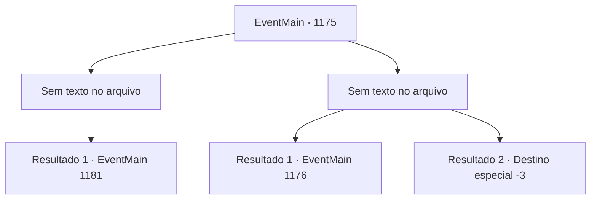

# Eventos principais · 1175

[Índice da tabela](index.md) · [Índice geral](../index.md)

ID: `pt:EventMain:1175` · Fonte: `EventMain4` · Versão: 1.2.47.

Mapeamento estático dos arquivos; a disponibilidade e a execução dependem do estado da run.

## Texto do evento

*Sem texto no arquivo.*

## Dados de entrada

```json
{
  "id": 1175,
  "grade": 1,
  "normalGoal": "",
  "required": ""
}
```

## Mapa das escolhas



## Escolhas e resultados

### Escolha 1

*Sem texto no arquivo; o papel dessa opção depende da interface do jogo.*

Requisitos e outros campos da escolha:

```json
{
  "required": ""
}
```

#### Resultado 1.1

Ferozmente, você derrota os soldados de Greymoor um por um. Seus soldados seguem atrás, fazendo o mesmo. Num piscar de olhos, você conquistou o castelo externo de Greymoor. Os combatentes sobreviventes de Greymoor recuam para o castelo interno. Rennart olha para o castelo interno e fala. 

 "O portão do castelo interno tem duas camadas. Se entrarmos sem um plano, ficaremos presos no meio, vulneráveis aos ataques deles."

 Seus dedos se movem em direção a uma torre do castelo interno. 

 "Eu suponho que a alavanca do portão esteja lá, dentro da torre superior."

 Ele coça o queixo e continua. 

 "...A torre superior é ainda mais alta que as muralhas do castelo externo. Escadas não ajudarão muito lá. Como devemos fazer isso?"


Continuação registrada: [Evento 1181](1181.md) na mesma tabela.

```json
{
  "required": "",
  "chance": "1",
  "nextEvent": 1181,
  "type": 2,
  "reward": ""
}
```

### Escolha 2

*Sem texto no arquivo; o papel dessa opção depende da interface do jogo.*

Requisitos e outros campos da escolha:

```json
{
  "required": ""
}
```

#### Resultado 2.1

Mesmo após um longo cerco, as forças de Briovich não conseguem avançar muito. Você ergue sua arma e ordena que seus homens recuem. Toques de tambor sinalizam sua ordem, e os soldados começam a recuar para o posto avançado. Um bando de corvos voa para o campo de batalha e começa a se alimentar dos soldados mortos. |drawing_crowsOnBattlefield| Você e Rennart entram na tenda de comando e encontram uma cadeira para se sentar. Rennart alonga o ombro. Sua armadura produz um som metálico. Ele aponta para um mapa sobre a mesa e fala. 

 "Devemos manter o cerco e construir um trebuquete."


Continuação registrada: [Evento 1176](1176.md) na mesma tabela.

```json
{
  "required": "1_0_2|1_1_2",
  "chance": "1",
  "nextEvent": 1176,
  "type": 2,
  "reward": "0_0_-1|0_1_-1"
}
```

#### Resultado 2.2

Soldados de Greymoor te derrubam com suas espadas e lanças. Mesmo depois de você sucumbir, eles pisoteiam seu corpo repetidas vezes. Seu corpo começa a perder o calor, enquanto o barulho da batalha lentamente desaparece.

Continuação registrada: [Destino especial `-3`](../destinos-especiais.md).

```json
{
  "required": "-1|2_0_2|2_1_2",
  "chance": "1",
  "nextEvent": -3,
  "type": 2,
  "reward": "0_0_-1|0_1_-1"
}
```

## Referências que chegam a este evento

- [Evento 1168 · escolha 1 · resultado 1](1168.md#escolha-1)
- [Evento 1168 · escolha 1 · resultado 2](1168.md#escolha-1)
- [Evento 1171 · escolha 1 · resultado 1](1171.md#escolha-1)
- [Evento 1171 · escolha 1 · resultado 2](1171.md#escolha-1)
- [Evento 1172 · escolha 1 · resultado 1](1172.md#escolha-1)
- [Evento 1172 · escolha 1 · resultado 3](1172.md#escolha-1)
- [Evento 1172 · escolha 2 · resultado 1](1172.md#escolha-2)
- [Evento 1172 · escolha 2 · resultado 3](1172.md#escolha-2)
- [Evento 1172 · escolha 3 · resultado 1](1172.md#escolha-3)
- [Evento 1172 · escolha 3 · resultado 3](1172.md#escolha-3)
- [Evento 1173 · escolha 1 · resultado 1](1173.md#escolha-1)
- [Evento 1174 · escolha 1 · resultado 1](1174.md#escolha-1)
- [Evento 1174 · escolha 1 · resultado 3](1174.md#escolha-1)
- [Evento 1174 · escolha 1 · resultado 4](1174.md#escolha-1)
- [Evento 1174 · escolha 1 · resultado 5](1174.md#escolha-1)
- [Evento 1174 · escolha 3 · resultado 1](1174.md#escolha-3)
- [Evento 1174 · escolha 3 · resultado 3](1174.md#escolha-3)
