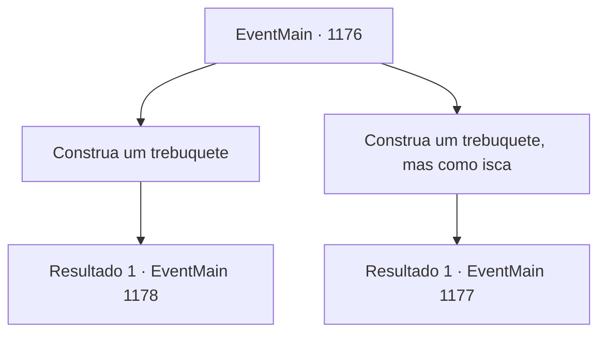

# Eventos principais · 1176

[Índice da tabela](index.md) · [Índice geral](../index.md)

ID: `pt:EventMain:1176` · Fonte: `EventMain4` · Versão: 1.2.47.

Mapeamento estático dos arquivos; a disponibilidade e a execução dependem do estado da run.

## Texto do evento

*Sem texto no arquivo.*

## Dados de entrada

```json
{
  "id": 1176,
  "grade": 1,
  "normalGoal": "",
  "required": ""
}
```

## Mapa das escolhas



## Escolhas e resultados

### Escolha 1

Construa um trebuquete

Requisitos e outros campos da escolha:

```json
{
  "required": "5_925_0"
}
```

#### Resultado 1.1

Os soldados começam a cortar madeira de uma floresta próxima, trazendo toras de volta nos vagões. Seus engenheiros militares trabalham com o material, talhando madeira, fazendo nós e reforçando cavilhas. Rennart e seus homens se revezam nas vigias. Passam-se alguns dias. Você dorme profundamente em um leito improvisado, sob um céu noturno iluminado pela lua. Então, um sino de alarme toca. Você corre para fora da sua tenda. Rennart já está se aprontando com sua armadura. 

 "Olhe, ali!"

 Você vira o olhar para onde Rennart está apontando. Seus soldados e combatentes do castelo Greymoor estão lutando. 

 "Os Greymoor — eles lançaram um ataque noturno!"

 Ele abaixa a viseira e empunha sua espada. Você se junta a ele para combater os soldados de Greymoor.

Continuação registrada: [Evento 1178](1178.md) na mesma tabela.

```json
{
  "required": "",
  "chance": "1",
  "nextEvent": 1178,
  "type": 2,
  "reward": "6_0_136|5_925_1",
  "place": 13
}
```

### Escolha 2

Construa um trebuquete, mas como isca

Requisitos e outros campos da escolha:

```json
{
  "required": "-1|20_48_1|1_14_14"
}
```

#### Resultado 2.1

Você propõe que finjam construir um trebuchet, para atrair os soldados de Greymoor. Rennart parece achar sua ideia plausível. 

 "De fato... Eles provavelmente vão querer nos impedir de terminar o trebuchet — poderemos usar isso a nosso favor."

 Você aponta um ponto no mapa e dá ordens. O trebuchet deve ser montado morro abaixo. Alguns soldados devem ser colocados como guardas, com o restante posicionados atrás da inclinação para uma emboscada. O olhar de Rennart acompanha a ponta dos seus dedos. 

 "...Para que, quando eles se aventurarem fundo demais nas colinas, nossas forças possam emboscá‑los pelos flancos."

 Os soldados começam a recolher madeira de uma floresta próxima, carregando toras de volta em suas carroças. Seus engenheiros militares fazem de propósito um trabalho malfeito na construção do trebuchet, entalhando a madeira, amarrando nós e reforçando parafusos de forma descuidada. Alguns dias depois, o trebuchet isca está completo. Você esconde seus homens além da inclinação. Então, cerca o trebuchet com alguns soldados, fingindo protegê‑lo. O sol se põe, e um de seus batedores vem correndo e reporta. 

 "Os soldados de Greymoor abriram o portão e estão vindo aqui para destruir o trebuchet!"

 Você lidera seus homens embora. Mas então, um dos cavaleiros de Greymoor percebe você e grita. 

 "Para onde você pensa que vai?!"

 Ele dá um bom pontapé no cavalo, investindo direto contra você. Atrás dele, um exército de soldados de Greymoor avança em direção ao trebuchet.

Continuação registrada: [Evento 1177](1177.md) na mesma tabela.

```json
{
  "required": "",
  "chance": "1",
  "nextEvent": 1177,
  "type": 2,
  "reward": "6_2_136",
  "place": 13
}
```

## Referências que chegam a este evento

- [Evento 1174 · escolha 4 · resultado 1](1174.md#escolha-4)
- [Evento 1175 · escolha 2 · resultado 1](1175.md#escolha-2)
