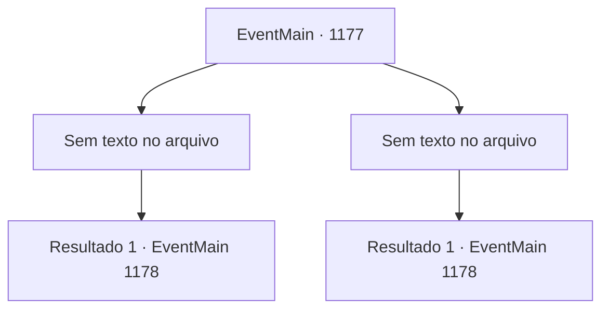

# Eventos principais · 1177

[Índice da tabela](index.md) · [Índice geral](../index.md)

ID: `pt:EventMain:1177` · Fonte: `EventMain4` · Versão: 1.2.47.

Mapeamento estático dos arquivos; a disponibilidade e a execução dependem do estado da run.

## Texto do evento

*Sem texto no arquivo.*

## Dados de entrada

```json
{
  "id": 1177,
  "grade": 1,
  "normalGoal": "",
  "required": ""
}
```

## Mapa das escolhas



## Escolhas e resultados

### Escolha 1

*Sem texto no arquivo; o papel dessa opção depende da interface do jogo.*

Requisitos e outros campos da escolha:

```json
{
  "required": ""
}
```

#### Resultado 1.1

Você finge revidar, recuando gradualmente. As forças de Greymoor estão ocupadas perseguindo você. Elas nem sequer percebem sua posição. Confiante, eles derramam óleo no seu trebuquete e o colocam fogo. 

 "Hahaha! Olhe só. Seu trebuquete não passa de um monte de cinzas agora!"

 O cavaleiro de Greymoor zomba de você, rindo. Ignorando-o, você levanta a mão como sinal. 

 "Arqueiros! Atirem!"

 Assim que você ordena, os arqueiros escondidos além da encosta levantam-se. Uma chuva de flechas cai sobre as forças de Greymoor. 

 "Argh--!!"

 Eles são derrubados por flechas, caindo no chão. Depois que os arqueiros cumprem sua parte, você conduz os lanceiros morro abaixo. Os soldados sobreviventes de Greymoor fazem o possível para revidar. O confiante cavaleiro de Greymoor levanta a espada e investe contra você.

Continuação registrada: [Evento 1178](1178.md) na mesma tabela.

```json
{
  "required": "",
  "chance": "1",
  "nextEvent": 1178,
  "type": 2,
  "reward": "6_2_197",
  "place": 13
}
```

### Escolha 2

*Sem texto no arquivo; o papel dessa opção depende da interface do jogo.*

Requisitos e outros campos da escolha:

```json
{
  "required": ""
}
```

#### Resultado 2.1

Você finge revidar, recuando gradualmente. As forças de Greymoor estão ocupadas perseguindo você. Elas nem sequer percebem sua posição. Confiante, eles derramam óleo no seu trebuquete e o colocam fogo. 

 "Hahaha! Olhe só. Seu trebuquete não passa de um monte de cinzas agora!"

 O cavaleiro de Greymoor zomba de você, rindo. Ignorando-o, você levanta a mão como sinal. 

 "Arqueiros! Atirem!"

 Assim que você ordena, os arqueiros escondidos além da encosta levantam-se. Uma chuva de flechas cai sobre as forças de Greymoor. 

 "Argh--!!"

 Eles são derrubados por flechas, caindo no chão. Depois que os arqueiros cumprem sua parte, você conduz os lanceiros morro abaixo. Os soldados sobreviventes de Greymoor fazem o possível para revidar. O confiante cavaleiro de Greymoor levanta a espada e investe contra você.

Continuação registrada: [Evento 1178](1178.md) na mesma tabela.

```json
{
  "required": "",
  "chance": "1",
  "nextEvent": 1178,
  "type": 2,
  "reward": "6_2_197",
  "place": 13
}
```

## Referências que chegam a este evento

- [Evento 1176 · escolha 2 · resultado 1](1176.md#escolha-2)
