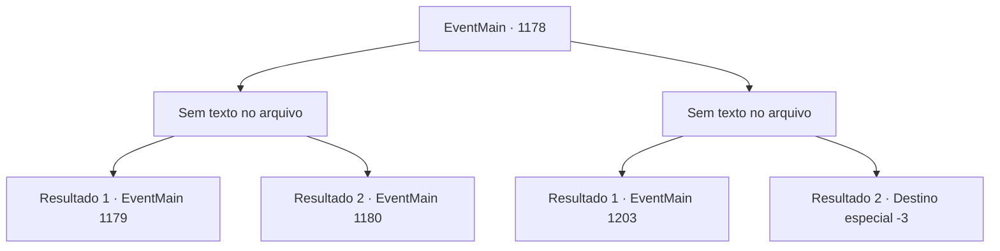

# Eventos principais · 1178

[Índice da tabela](index.md) · [Índice geral](../index.md)

ID: `pt:EventMain:1178` · Fonte: `EventMain4` · Versão: 1.2.47.

Mapeamento estático dos arquivos; a disponibilidade e a execução dependem do estado da run.

## Texto do evento

*Sem texto no arquivo.*

## Dados de entrada

```json
{
  "id": 1178,
  "grade": 1,
  "normalGoal": "",
  "required": ""
}
```

## Mapa das escolhas



## Escolhas e resultados

### Escolha 1

*Sem texto no arquivo; o papel dessa opção depende da interface do jogo.*

Requisitos e outros campos da escolha:

```json
{
  "required": ""
}
```

#### Resultado 1.1

Você aniquila as forças Greymoor. A colina está coberta de sangue. Os cavaleiros e soldados Greymoor sobreviventes tornam-se seus reféns. O olhar de Rennart volta-se para o trebuquete. 

 "O trebuquete será concluído em breve."


Continuação registrada: [Evento 1179](1179.md) na mesma tabela.

```json
{
  "required": "5_925_1",
  "chance": "1",
  "nextEvent": 1179,
  "type": 2,
  "reward": ""
}
```

#### Resultado 1.2

Você aniquila as forças de Greymoor. A colina está coberta de sangue. Os cavaleiros e soldados sobreviventes de Greymoor tornam-se seus reféns. O olhar de Rennart se volta para o Castelo Greymoor. 

 "Presumo que eles tenham perdido muito efetivo aqui. Agora teremos muito mais facilidade para atravessar as muralhas do castelo."

 Você ordena aos seus homens que comecem o ataque ao Castelo Briovich imediatamente.

Continuação registrada: [Evento 1180](1180.md) na mesma tabela.

```json
{
  "required": "18_925_1",
  "chance": "1",
  "nextEvent": 1180,
  "type": 2,
  "reward": "6_2_136",
  "place": 4
}
```

### Escolha 2

*Sem texto no arquivo; o papel dessa opção depende da interface do jogo.*

Requisitos e outros campos da escolha:

```json
{
  "required": ""
}
```

#### Resultado 2.1

Você luta bravamente contra as forças de Greymoor, mas, infelizmente, o cavaleiro de Greymoor te nocauteia com o pomo de sua espada. Sua cabeça zumbia, e o mundo girava. 

 Alguns instantes depois, você abre os olhos com dor. Você se encontra em uma cela. O chão está molhado. Você percebe que suas mãos e pés estão algemados.

Continuação registrada: [Evento 1203](1203.md) na mesma tabela.

```json
{
  "required": "1_0_2|1_1_2",
  "chance": "1",
  "nextEvent": 1203,
  "type": 2,
  "reward": "0_0_-1|0_1_-1"
}
```

#### Resultado 2.2

Você luta valentemente contra as forças de Greymoor, mas, infelizmente, o cavaleiro de Greymoor te nocauteia com o pomo da sua espada. Sua cabeça zombeia, e o mundo gira. Sua consciência desvanece-se na escuridão.

Continuação registrada: [Destino especial `-3`](../destinos-especiais.md).

```json
{
  "required": "-1|2_0_2|2_1_2",
  "chance": "1",
  "nextEvent": -3,
  "type": 2,
  "reward": "0_0_-1|0_1_-1"
}
```

## Referências que chegam a este evento

- [Evento 1176 · escolha 1 · resultado 1](1176.md#escolha-1)
- [Evento 1177 · escolha 1 · resultado 1](1177.md#escolha-1)
- [Evento 1177 · escolha 2 · resultado 1](1177.md#escolha-2)
