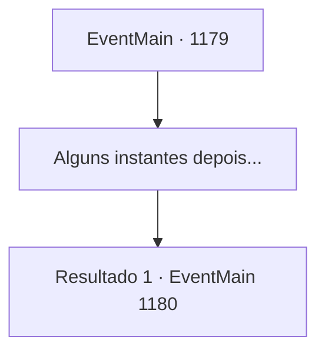

# Eventos principais · 1179

[Índice da tabela](index.md) · [Índice geral](../index.md)

ID: `pt:EventMain:1179` · Fonte: `EventMain4` · Versão: 1.2.47.

Mapeamento estático dos arquivos; a disponibilidade e a execução dependem do estado da run.

## Texto do evento

*Sem texto no arquivo.*

## Dados de entrada

```json
{
  "id": 1179,
  "grade": 1,
  "normalGoal": "",
  "required": ""
}
```

## Mapa das escolhas



## Escolhas e resultados

### Escolha 1

Alguns instantes depois...

Requisitos e outros campos da escolha:

```json
{
  "required": ""
}
```

#### Resultado 1.1

|drawing_trebuchet| Você e Rennart ficam acordados a noite toda. Você pressiona os engenheiros militares, completando o trebuquete muito mais rápido. Rennart esfrega os olhos cansados e grita ordens. 

 "Carreguem o trebuquete! Explodam as muralhas deles!"

 Os soldados obedecem ao comando, carregando o trebuquete com uma enorme pedra. Um engenheiro corta a corda do trebuquete e, com um rangido arrepiante, a pedra é lançada ao ar, chocando-se contra as muralhas do Castelo Greymoor. Um forte estrondo sinaliza o impacto. Fragmentos de rocha enchem o ar. Outra vez — uma segunda pedra acerta o mesmo lugar. Finalmente, quando a terceira pedra acerta, as muralhas do castelo cedem, desabando. Você grita ordens para seus homens. 

 "As muralhas do castelo caíram! TODOS! AVANCEM!"

 Você lidera a investida, indo em direção às muralhas desabadas. Seus soldados seguem atrás, rugindo.

Continuação registrada: [Evento 1180](1180.md) na mesma tabela.

```json
{
  "required": "",
  "chance": "1",
  "nextEvent": 1180,
  "type": 2,
  "reward": "6_2_136",
  "place": 4
}
```

## Referências que chegam a este evento

- [Evento 1178 · escolha 1 · resultado 1](1178.md#escolha-1)
