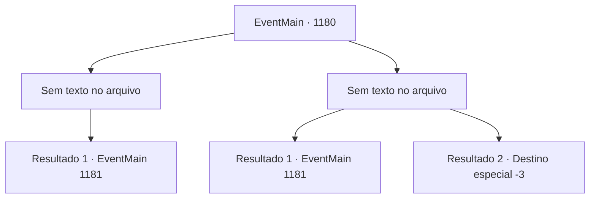

# Eventos principais · 1180

[Índice da tabela](index.md) · [Índice geral](../index.md)

ID: `pt:EventMain:1180` · Fonte: `EventMain4` · Versão: 1.2.47.

Mapeamento estático dos arquivos; a disponibilidade e a execução dependem do estado da run.

## Texto do evento

*Sem texto no arquivo.*

## Dados de entrada

```json
{
  "id": 1180,
  "grade": 1,
  "normalGoal": "",
  "required": ""
}
```

## Mapa das escolhas



## Escolhas e resultados

### Escolha 1

*Sem texto no arquivo; o papel dessa opção depende da interface do jogo.*

Requisitos e outros campos da escolha:

```json
{
  "required": ""
}
```

#### Resultado 1.1

Ferozmente, você derrota os soldados de Greymoor um por um. Num piscar de olhos, você conquistou o castelo externo de Greymoor. Os combatentes sobreviventes de Greymoor recuam para o castelo interior. Rennart olha para o castelo interior e fala. 

 "O portão do castelo interior tem duas camadas. Se entrarmos sem um plano, ficaremos presos entre elas, vulneráveis aos ataques deles."

 Seus dedos se movem para uma torre no castelo interior. 

 "Espero que a alavanca do portão esteja lá, dentro da torre superior."

 Ele coça o queixo e continua. 

 "...A torre superior é ainda mais alta do que as muralhas do castelo externo. Escadas não ajudarão muito lá. Como devemos fazer isso?"


Continuação registrada: [Evento 1181](1181.md) na mesma tabela.

```json
{
  "required": "",
  "chance": "1",
  "nextEvent": 1181,
  "type": 2,
  "reward": ""
}
```

### Escolha 2

*Sem texto no arquivo; o papel dessa opção depende da interface do jogo.*

Requisitos e outros campos da escolha:

```json
{
  "required": ""
}
```

#### Resultado 2.1

Durante o ataque às muralhas do castelo, você é atingido por uma flecha perdida. Seus homens fazem um círculo para protegê-lo, um deles levantando o escudo e outro puxando você de volta para cima. 

 "Você está bem, meu senhor?"

 A batalha já está a seu favor — o restante de suas forças conquista facilmente o castelo externo enquanto você é levado de volta ao posto avançado. Os combatentes sobreviventes de Greymoor recuam para o castelo interior. Rennart se aproxima de você, verifica sua ferida e fala. 

 "Felizmente, a ferida não é profunda."

 Ele puxa a flecha da sua carne e envolve a ferida com uma bandagem. 

 "A porta interna do castelo tem duas camadas. Se entrarmos sem um plano, ficaremos presos no meio, vulneráveis aos ataques deles."

 Ele aponta com os dedos para uma torre no castelo interior. 

 "Suponho que a alavanca do portão esteja lá, dentro da torre superior."

 Ele coça o queixo e continua. 

 "...A torre superior é ainda mais alta que as muralhas externas do castelo. Escadas não vão ajudar muito lá. Como devemos fazer isso?"


Continuação registrada: [Evento 1181](1181.md) na mesma tabela.

```json
{
  "required": "1_0_2|1_1_2",
  "chance": "1",
  "nextEvent": 1181,
  "type": 2,
  "reward": "0_0_-1|0_1_-1"
}
```

#### Resultado 2.2

Soldados de Greymoor te derrubam com suas espadas e lanças. Mesmo depois de você sucumbir, eles pisoteiam seu corpo repetidas vezes. Seu corpo começa a perder o calor, enquanto o barulho da batalha lentamente desaparece.

Continuação registrada: [Destino especial `-3`](../destinos-especiais.md).

```json
{
  "required": "-1|2_0_2|2_1_2",
  "chance": "1",
  "nextEvent": -3,
  "type": 2,
  "reward": "0_0_-1|0_1_-1"
}
```

## Referências que chegam a este evento

- [Evento 1178 · escolha 1 · resultado 2](1178.md#escolha-1)
- [Evento 1179 · escolha 1 · resultado 1](1179.md#escolha-1)
