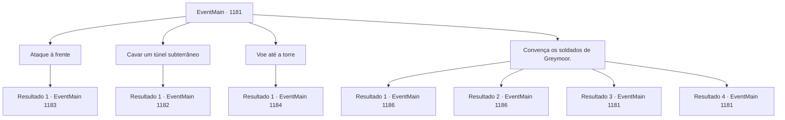

# Eventos principais · 1181

[Índice da tabela](index.md) · [Índice geral](../index.md)

ID: `pt:EventMain:1181` · Fonte: `EventMain4` · Versão: 1.2.47.

Mapeamento estático dos arquivos; a disponibilidade e a execução dependem do estado da run.

## Texto do evento

*Sem texto no arquivo.*

## Dados de entrada

```json
{
  "id": 1181,
  "grade": 1,
  "normalGoal": "",
  "required": ""
}
```

## Mapa das escolhas



## Escolhas e resultados

### Escolha 1

Ataque à frente

Requisitos e outros campos da escolha:

```json
{
  "required": ""
}
```

#### Resultado 1.1

Você decide distrair as forças de Greymoor liderando o ataque. Rennart acena em resposta. 

 "Vou tentar flanquear pelos lados e cavar um túnel, então."

 Ele leva alguns soldados, um grupo de engenheiros militares, depois sai da formação. Você reúne o resto dos seus homens e chega aos portões internos do castelo. Flechas vêm voando do alto das muralhas. Porta-escudos fazem seu trabalho, bloqueando os projéteis. Você continua pressionando o portão pela frente. Avançando e recuando repetidas vezes, você constantemente atrai atenção. Então, um grito de guerra vem do interior do castelo. Soldados de Greymoor perto dos portões se viram para olhar para trás. Soldados de Briovich estão surgindo em massa pela muralha leste, perto dos estábulos. Rennart está à frente, brandindo sua espada, avançando para dentro do castelo. Os soldados de Greymoor começam a entrar em pânico. 

 "Abram os portões!"

 Você ouve Rennart gritando ordens de dentro. Logo, com um estrondo alto, os portões duplos começam a se abrir. Você lidera seus homens, investindo pelos portões. O pátio interno já é um campo de batalha caótico. Você se junta aos homens lá dentro, rapidamente unindo forças com o exército de Rennart.

Continuação registrada: [Evento 1183](1183.md) na mesma tabela.

```json
{
  "required": "",
  "chance": "1",
  "nextEvent": 1183,
  "type": 2,
  "reward": "6_0_136",
  "place": 4
}
```

### Escolha 2

Cavar um túnel subterrâneo

Requisitos e outros campos da escolha:

```json
{
  "required": ""
}
```

#### Resultado 2.1

Você decide cavar um túnel, e Rennart atacará o portão pela frente. Você lidera os sapadores e alguns soldados, quebra a formação e se move para o lado direito da muralha interna. Os soldados pegam pás e começam a cavar sob a muralha interna. 

 "Espera, você acabou de ouvir algo?"

 "...Está embaixo do baluarte. Vá verificar."

 Ao ouvirem vozes do alto da muralha, os soldados param. Parece que o som da escavação foi ouvido. Em pouco tempo, alguns cavaleiros aparecem liderando tropas. Você e seus homens ficam em emboscada e, quando eles se aproximam, vocês atacam todos de uma vez.

Continuação registrada: [Evento 1182](1182.md) na mesma tabela.

```json
{
  "required": "",
  "chance": "1",
  "nextEvent": 1182,
  "type": 2,
  "reward": "6_2_136",
  "place": 4
}
```

### Escolha 3

Voe até a torre

Requisitos e outros campos da escolha:

```json
{
  "required": "-1|20_10_1|20_0_1"
}
```

#### Resultado 3.1

Você responde que vai voar até a torre mais alta do castelo interno. Rennart olha para os soldados e responde. 

 "Então eu conduzirei os homens para a frente e os distrairei."

 Rennart reúne os soldados e segue para o portão da frente. Você sai da formação e se dirige ao castelo interno. Logo, uma luta começa nos portões da frente. Arqueiros disparam flechas através das fendas das bestas de mão, e porteiros encostam-se nos portões do castelo, bloqueando os projéteis. Enquanto isso, você voa pelo ar, indo em direção às torres do castelo interno. Você vê a totalidade do castelo interno abaixo de seus pés. Soldados de Greymoor transportam incansavelmente itens como óleo fervente, flechas e pedras. Você aterrissa no ponto mais alto que conseguiu encontrar nas torres do castelo interno. Então, um dos soldados de Greymoor te avista e grita. 

 "INTRUSO!"

 Outros soldados se reúnem em resposta.

Continuação registrada: [Evento 1184](1184.md) na mesma tabela.

```json
{
  "required": "",
  "chance": "1",
  "nextEvent": 1184,
  "type": 2,
  "reward": "6_0_197|0_1_-1",
  "place": 4
}
```

### Escolha 4

Convença os soldados de Greymoor.

Requisitos e outros campos da escolha:

```json
{
  "required": "5_927_0"
}
```

#### Resultado 4.1

Você se coloca à frente dos seus homens, aproximando-se dos portões internos do castelo. Soldados de Greymoor olham para você das ameias e das muralhas. Você levanta lentamente os braços, falando com eles. Você lhes diz que o pecado de pagar os orcs para atacar uma propriedade vizinha é exclusivamente da Casa Greymoor. Você acrescenta que os soldados, individualmente, ainda são cidadãos do Reino de Rothar, e que não é necessário derramar mais sangue se eles se renderem. Os soldados começam a murmurar. Eles se viram para encarar uns aos outros. Você encerra seu discurso com uma última frase - 'por qual grande motivo vocês devem morrer por eles'? Segue-se um longo silêncio. Então, um soldado nas ameias larga sua besta. O movimento se espalha num instante - os soldados abandonam suas armas, um a um. Logo, os portões se abrem com um alto estrondo. Rennart se vira para olhar para você. 

 "A caneta é de fato mais poderosa que a espada."

 Ele tira o capacete e continua. 

 "Mas... ainda temos uma última tarefa à nossa frente."|drawing_greymoorKeep| Ele se volta para o Greymoor Keep - o edifício principal, onde reside o castelão do Castelo Greymoor.

Continuação registrada: [Evento 1186](1186.md) na mesma tabela.

```json
{
  "required": "21_4_4",
  "chance": "1|0_12_1",
  "nextEvent": 1186,
  "type": 0,
  "reward": "5_927_1"
}
```

#### Resultado 4.2

Você se coloca à frente dos seus homens, aproximando-se dos portões internos do castelo. Soldados de Greymoor olham para você das ameias e das muralhas. Você levanta lentamente os braços, falando com eles. Você lhes diz que o pecado de pagar os orcs para atacar uma propriedade vizinha é exclusivamente da Casa Greymoor. Você acrescenta que os soldados, individualmente, ainda são cidadãos do Reino de Rothar, e que não é necessário derramar mais sangue se eles se renderem. Os soldados começam a murmurar. Eles se viram para encarar uns aos outros. Você encerra seu discurso com uma última frase - 'por qual grande motivo vocês devem morrer por eles'? Segue-se um longo silêncio. Então, um soldado nas ameias larga sua besta. O movimento se espalha num instante - os soldados abandonam suas armas, um a um. Logo, os portões se abrem com um alto estrondo. Rennart se vira para olhar para você. 

 "A caneta é de fato mais poderosa que a espada."

 Ele tira o capacete e continua. 

 "Mas... ainda temos uma última tarefa à nossa frente."|drawing_greymoorKeep| Ele se volta para o Greymoor Keep - o edifício principal, onde reside o castelão do Castelo Greymoor.

Continuação registrada: [Evento 1186](1186.md) na mesma tabela.

```json
{
  "required": "20_4_4",
  "chance": "1|0_12_2",
  "nextEvent": 1186,
  "type": 0,
  "reward": "5_927_1"
}
```

#### Resultado 4.3

Você se coloca à frente de seus homens, aproximando-se dos portões internos do castelo. Soldados de Greymoor olham para você das ameias e das muralhas. Você levanta os braços devagar, falando com eles. Você lhes diz que o pecado de pagar os orcs para atacar uma propriedade vizinha é somente de Casa Greymoor. Você acrescenta que os soldados, individualmente, ainda são cidadãos do Reino de Rothar, que não é necessário derramar mais sangue, contanto que se rendam. Mas o cavaleiro de Greymoor responde abaixando a viseira. Os soldados fazem o mesmo — nenhum deles reage ao seu discurso. Infelizmente, você volta para se juntar aos seus soldados.

Continuação registrada: [Evento 1181](1181.md) na mesma tabela.

```json
{
  "required": "18_920_1",
  "chance": "40",
  "nextEvent": 1181,
  "type": 1,
  "reward": "5_927_9"
}
```

#### Resultado 4.4

Você se coloca à frente de seus homens, aproximando-se dos portões internos do castelo. Soldados de Greymoor olham para você das ameias e das muralhas. Você levanta os braços devagar, falando com eles. Você lhes diz que o pecado de pagar os orcs para atacar uma propriedade vizinha é somente de Casa Greymoor. Você acrescenta que os soldados, individualmente, ainda são cidadãos do Reino de Rothar, que não é necessário derramar mais sangue, contanto que se rendam. Mas o cavaleiro de Greymoor responde abaixando a viseira. Os soldados fazem o mesmo — nenhum deles reage ao seu discurso. Infelizmente, você volta para se juntar aos seus soldados.

Continuação registrada: [Evento 1181](1181.md) na mesma tabela.

```json
{
  "required": "5_920_1",
  "chance": "16",
  "nextEvent": 1181,
  "type": 1,
  "reward": "5_927_9"
}
```

## Referências que chegam a este evento

- [Evento 1175 · escolha 1 · resultado 1](1175.md#escolha-1)
- [Evento 1180 · escolha 1 · resultado 1](1180.md#escolha-1)
- [Evento 1180 · escolha 2 · resultado 1](1180.md#escolha-2)
- [Evento 1181 · escolha 4 · resultado 3](1181.md#escolha-4)
- [Evento 1181 · escolha 4 · resultado 4](1181.md#escolha-4)
