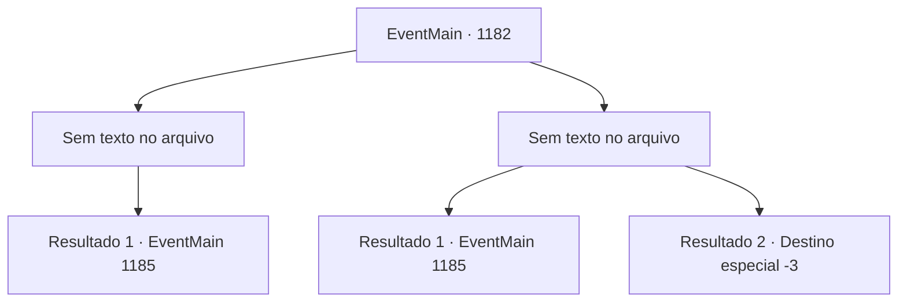

# Eventos principais · 1182

[Índice da tabela](index.md) · [Índice geral](../index.md)

ID: `pt:EventMain:1182` · Fonte: `EventMain4` · Versão: 1.2.47.

Mapeamento estático dos arquivos; a disponibilidade e a execução dependem do estado da run.

## Texto do evento

*Sem texto no arquivo.*

## Dados de entrada

```json
{
  "id": 1182,
  "grade": 1,
  "normalGoal": "",
  "required": ""
}
```

## Mapa das escolhas



## Escolhas e resultados

### Escolha 1

*Sem texto no arquivo; o papel dessa opção depende da interface do jogo.*

Requisitos e outros campos da escolha:

```json
{
  "required": ""
}
```

#### Resultado 1.1

Quando a batalha termina, um dos soldados se aproxima de você, coberto de sujeira. 

 "Consigo ver a luz. Já estamos quase lá."

 Você o segue para dentro do túnel. Vigas de sustentação estão colocadas aqui e ali para evitar que o túnel desabe. O cheiro de terra preenche o túnel. É uma passagem estreita, larga o bastante só se você encolher os ombros. Você se espreme pela saída. O túnel dava para um estábulo. Quatro cavalos ficam no curral. Eles olham para você com curiosidade e farejam, mas parecem acostumados a humanos. Um por um, você ajuda seus homens a sair do túnel. Agora sua equipe está pronta no estábulo. Pelas cercas do estábulo, você espreita o outro lado. Você percebe uma escadaria, que presumivelmente leva ao interior do castelo. Soldados de Greymoor transportam incansavelmente itens como óleo fervente, flechas e pedras.

Continuação registrada: [Evento 1185](1185.md) na mesma tabela.

```json
{
  "required": "",
  "chance": "1",
  "nextEvent": 1185,
  "type": 2,
  "reward": ""
}
```

### Escolha 2

*Sem texto no arquivo; o papel dessa opção depende da interface do jogo.*

Requisitos e outros campos da escolha:

```json
{
  "required": ""
}
```

#### Resultado 2.1


 "SEU VAGABUNDO Briovich!!"

 O cavaleiro Greymoor ensanguentado investe contra você com toda a sua força. Você consegue desviar da lâmina, mas o seu fio consegue arranhar seu braço esquerdo. 

 "Você ousa tocar nosso Senhor?!"

 "MATE-O!"

 Seus soldados investem de imediato, espancando o cavaleiro. Ele não dura muito. Você recupera o fôlego, pressionando a ferida. Logo, um dos soldados se aproxima de você, coberto de sujeira. 

 "Consigo ver a luz. Estamos quase lá."

 Você o segue para dentro do túnel. Vigas de sustentação estão colocadas aqui e ali para evitar que o túnel desabe. O cheiro de terra enche o túnel. É uma passagem estreita, larga o bastante só se você encolher os ombros. Você se espreme pela saída. O túnel levou a um estábulo. Quatro cavalos estão no local. Eles olham para você com curiosidade e cheiram, mas por fora parecem acostumados a humanos. Um a um, você ajuda seus homens para fora do túnel. Agora você tem sua equipe pronta no estábulo. Através das cercas do estábulo, você espreita o outro lado. Você nota escadas, que presumivelmente levam ao interior do castelo. Soldados de Greymoor estão incansavelmente transportando itens como óleo fervente, flechas e pedras.

Continuação registrada: [Evento 1185](1185.md) na mesma tabela.

```json
{
  "required": "1_0_2|1_1_2",
  "chance": "1",
  "nextEvent": 1185,
  "type": 2,
  "reward": "0_0_-1|0_1_-1"
}
```

#### Resultado 2.2


 "SEU CANALHA Briovich!!"

 O cavaleiro sangrento de Greymoor investe contra você com toda a força. Você tenta desviar da lâmina dele, mas sua lâmina é mais rápida. 

 *corte* 

 Um frio metálico percorre seu pescoço. O céu é a última coisa que você vê antes do seu mundo virar de cabeça para baixo. Então, tudo escurece.

Continuação registrada: [Destino especial `-3`](../destinos-especiais.md).

```json
{
  "required": "-1|2_0_2|2_1_2",
  "chance": "1",
  "nextEvent": -3,
  "type": 2,
  "reward": "0_0_-1|0_1_-1"
}
```

## Referências que chegam a este evento

- [Evento 1181 · escolha 2 · resultado 1](1181.md#escolha-2)
