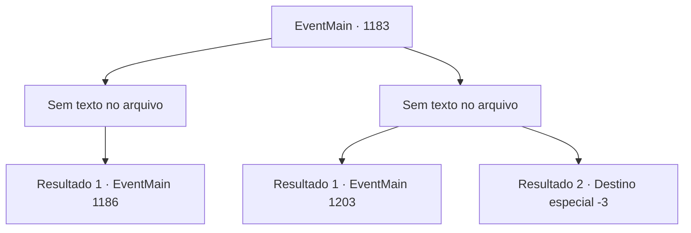

# Eventos principais · 1183

[Índice da tabela](index.md) · [Índice geral](../index.md)

ID: `pt:EventMain:1183` · Fonte: `EventMain4` · Versão: 1.2.47.

Mapeamento estático dos arquivos; a disponibilidade e a execução dependem do estado da run.

## Texto do evento

*Sem texto no arquivo.*

## Dados de entrada

```json
{
  "id": 1183,
  "grade": 1,
  "normalGoal": "",
  "required": ""
}
```

## Mapa das escolhas



## Escolhas e resultados

### Escolha 1

*Sem texto no arquivo; o papel dessa opção depende da interface do jogo.*

Requisitos e outros campos da escolha:

```json
{
  "required": ""
}
```

#### Resultado 1.1

Após uma batalha feroz, você derrota as forças de Greymoor e conquista o castelo interno. Corpos, corpos por toda parte. Poças de sangue enchem o chão, algumas até escorrendo pelos ralos. Você respira pesadamente, encostado em uma parede próxima. Rennart se aproxima de você. Você consegue ouvir sua voz ecoando dentro do elmo. 

 "Puxa... Ótimo trabalho, meu senhor."

 Ele tira o elmo e continua. 

 "Mas... ainda temos uma última tarefa pela frente."|drawing_greymoorKeep| Ele se volta para o Castelo Greymoor — o edifício principal, onde reside o castelão do Castelo Greymoor.

Continuação registrada: [Evento 1186](1186.md) na mesma tabela.

```json
{
  "required": "",
  "chance": "1",
  "nextEvent": 1186,
  "type": 2,
  "reward": ""
}
```

### Escolha 2

*Sem texto no arquivo; o papel dessa opção depende da interface do jogo.*

Requisitos e outros campos da escolha:

```json
{
  "required": ""
}
```

#### Resultado 2.1

Enquanto luta contra os soldados de Greymoor, você é atingido por um martelo. Sua visão pisca, então tudo fica escuro. 

 Alguns momentos depois, você abre os olhos com dor. Você se encontra em uma cela. O chão está molhado. Você percebe que suas mãos e pés estão algemados.

Continuação registrada: [Evento 1203](1203.md) na mesma tabela.

```json
{
  "required": "1_0_2|1_1_2",
  "chance": "1",
  "nextEvent": 1203,
  "type": 2,
  "reward": "0_0_-1|0_1_-1"
}
```

#### Resultado 2.2

Enquanto luta contra os soldados de Greymoor, você é atingido por um martelo. Você ouve algo se quebrar perto do seu crânio. Sua visão pisca, então tudo fica escuro.

Continuação registrada: [Destino especial `-3`](../destinos-especiais.md).

```json
{
  "required": "-1|2_0_2|2_1_2",
  "chance": "1",
  "nextEvent": -3,
  "type": 2,
  "reward": "0_0_-1|0_1_-1"
}
```

## Referências que chegam a este evento

- [Evento 1181 · escolha 1 · resultado 1](1181.md#escolha-1)
- [Evento 1185 · escolha 1 · resultado 1](1185.md#escolha-1)
