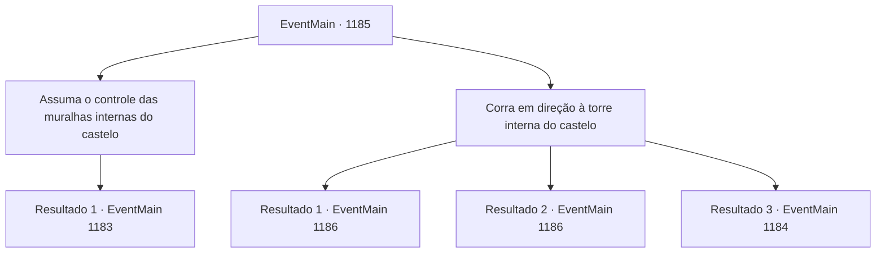

# Eventos principais · 1185

[Índice da tabela](index.md) · [Índice geral](../index.md)

ID: `pt:EventMain:1185` · Fonte: `EventMain4` · Versão: 1.2.47.

Mapeamento estático dos arquivos; a disponibilidade e a execução dependem do estado da run.

## Texto do evento

*Sem texto no arquivo.*

## Dados de entrada

```json
{
  "id": 1185,
  "grade": 1,
  "normalGoal": "",
  "required": ""
}
```

## Mapa das escolhas



## Escolhas e resultados

### Escolha 1

Assuma o controle das muralhas internas do castelo

Requisitos e outros campos da escolha:

```json
{
  "required": ""
}
```

#### Resultado 1.1

Você lidera seus homens e embosca o inimigo. 

 "Aqui, seus idiotas!"

 Os soldados de Greymoor ficam surpresos com a emboscada. Em pânico, eles pegam as espadas. 

 "N- não pode ser! De onde eles apareceram?!"

 "Droga! Temos uma brecha! Um túnel subterrâneo!"

 Você ataca os soldados de Greymoor em pânico.

Continuação registrada: [Evento 1183](1183.md) na mesma tabela.

```json
{
  "required": "",
  "chance": "1",
  "nextEvent": 1183,
  "type": 2,
  "reward": "6_2_136",
  "place": 4
}
```

### Escolha 2

Corra em direção à torre interna do castelo

Requisitos e outros campos da escolha:

```json
{
  "required": ""
}
```

#### Resultado 2.1

Você ordena aos seus homens um ataque total. Sozinho, você corre para a torre interior do castelo, onde deve estar a alavanca do portão. 

 "Aqui, seus traidores bastardos!"

 Soldados de Briovich avançam sobre os soldados de Greymoor, gritando. Eles ficam surpresos com a emboscada. Entrando em pânico, alcançam suas espadas. 

 "N- não pode ser! De onde eles saíram?!"

 Enquanto estão ocupados lidando com seus homens, você já está subindo a escada para a torre interior do castelo. Ninguém parece ter reconhecido sua presença. Os guardas da torre devem ter se juntado à batalha no pátio. Sem resistência, você chega à alavanca. As correntes tilintam, e os portões se abrem. 

 "O portão está aberto! Avancem!"

 Você ouve Rennart do lado de fora. Assim que Rennart grita ordens, os soldados de Briovich invadem. Logo, os ruídos no pátio cessam. As forças de Briovich derrotaram as forças de Greymoor e conquistaram o castelo interno. Então, você desce das torres e se dirige ao pátio interno. Rennart se aproxima de você. Você pode ouvir sua voz ecoando dentro do elmo. 

 "Ufa... Ótimo trabalho, meu senhor."

 Ele remove o elmo e continua. 

 "Mas... ainda temos uma última tarefa diante de nós."|drawing_greymoorKeep| Ele se vira para encarar o Greymoor Keep — o prédio principal, onde reside o castelão do Castelo Greymoor.

Continuação registrada: [Evento 1186](1186.md) na mesma tabela.

```json
{
  "required": "21_5_4|21_43_1",
  "chance": "1|0_6_1",
  "nextEvent": 1186,
  "type": 0,
  "reward": ""
}
```

#### Resultado 2.2

Você ordena aos seus homens um ataque total. Sozinho, você corre para a torre interior do castelo, onde deve estar a alavanca do portão. 

 "Aqui, seus traidores bastardos!"

 Soldados de Briovich avançam sobre os soldados de Greymoor, gritando. Eles ficam surpresos com a emboscada. Entrando em pânico, alcançam suas espadas. 

 "N- não pode ser! De onde eles saíram?!"

 Enquanto estão ocupados lidando com seus homens, você já está subindo a escada para a torre interior do castelo. Ninguém parece ter reconhecido sua presença. Os guardas da torre devem ter se juntado à batalha no pátio. Sem resistência, você chega à alavanca. As correntes tilintam, e os portões se abrem. 

 "O portão está aberto! Avancem!"

 Você ouve Rennart do lado de fora. Assim que Rennart grita ordens, os soldados de Briovich invadem. Logo, os ruídos no pátio cessam. As forças de Briovich derrotaram as forças de Greymoor e conquistaram o castelo interno. Então, você desce das torres e se dirige ao pátio interno. Rennart se aproxima de você. Você pode ouvir sua voz ecoando dentro do elmo. 

 "Ufa... Ótimo trabalho, meu senhor."

 Ele remove o elmo e continua. 

 "Mas... ainda temos uma última tarefa diante de nós."|drawing_greymoorKeep| Ele se vira para encarar o Greymoor Keep — o prédio principal, onde reside o castelão do Castelo Greymoor.

Continuação registrada: [Evento 1186](1186.md) na mesma tabela.

```json
{
  "required": "-1|20_5_4|20_43_1",
  "chance": "1|0_6_1",
  "nextEvent": 1186,
  "type": 0,
  "reward": ""
}
```

#### Resultado 2.3

Você ordena aos seus homens um ataque total. Sozinho, você corre para a torre interna do castelo, onde deveria estar a alavanca do portão. 

 "Venham cá, seus bastardos traidores!"

 Soldados de Briovich atacam os soldados de Greymoor, gritando. Eles ficam surpresos com a emboscada. Entrando em pânico, eles sacam as espadas. 

 "N- não pode ser! De onde eles surgiram?!"

 Enquanto eles lidam com seus homens, você se dirige às escadas que levam ao topo da torre interna do castelo. Mas então, um guarda impede você. 

 "Ai, aonde você pensa que vai?!"


Continuação registrada: [Evento 1184](1184.md) na mesma tabela.

```json
{
  "required": "",
  "chance": "25",
  "nextEvent": 1184,
  "type": 1,
  "reward": "6_0_136",
  "place": 4
}
```

## Referências que chegam a este evento

- [Evento 1182 · escolha 1 · resultado 1](1182.md#escolha-1)
- [Evento 1182 · escolha 2 · resultado 1](1182.md#escolha-2)
