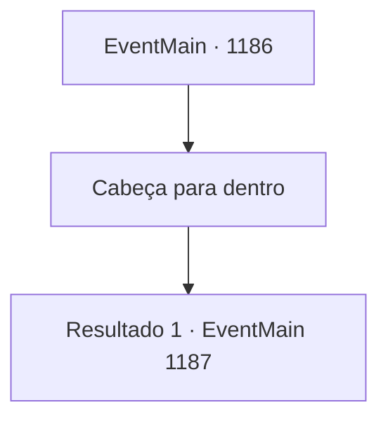

# Eventos principais · 1186

[Índice da tabela](index.md) · [Índice geral](../index.md)

ID: `pt:EventMain:1186` · Fonte: `EventMain4` · Versão: 1.2.47.

Mapeamento estático dos arquivos; a disponibilidade e a execução dependem do estado da run.

## Texto do evento

*Sem texto no arquivo.*

## Dados de entrada

```json
{
  "id": 1186,
  "grade": 1,
  "normalGoal": "",
  "required": ""
}
```

## Mapa das escolhas



## Escolhas e resultados

### Escolha 1

Cabeça para dentro

Requisitos e outros campos da escolha:

```json
{
  "required": ""
}
```

#### Resultado 1.1

Soldados de Briovich entram na Fortaleza de Greymoor. Passos soldados ecoam pelo edifício. Gritos seguem, e então um choque metálico. Logo, um dos soldados corre para fora da fortaleza. 

 "Há uma passagem, lá no porão. Sir Wojciech está bloqueando o caminho. Supomos que a Condessa Greymoor fugiu para lá."

 Você entra na fortaleza, acompanhado por Rennart. Você desce por uma escadaria em espiral. O porão parece mais frio, o cheiro de mofo preenchendo o ar. As escadas chegam ao fim, e você encontra um depósito subterrâneo de alimentos. Prateleiras estão cheias de sacos de grãos e potes de sal, com carne seca pendurada no teto. Na outra extremidade do porão há uma porta de madeira. Um cavaleiro está em frente a ela. Rennart fala com o cavaleiro. 

 "Sir Wojciech. Você poderia, por favor, se afastar?"

 O homem de meia-idade, presumivelmente Wojciech, balança a cabeça lentamente. Seus olhos estão marcados pela fadiga, mas seus pés não mostram sinais de tremor. 

 "Isso não é possível, receio. Vocês terão que me derrotar primeiro."


Continuação registrada: [Evento 1187](1187.md) na mesma tabela.

```json
{
  "required": "",
  "chance": "1",
  "nextEvent": 1187,
  "type": 2,
  "reward": "6_0_205",
  "place": 10
}
```

## Referências que chegam a este evento

- [Evento 1181 · escolha 4 · resultado 1](1181.md#escolha-4)
- [Evento 1181 · escolha 4 · resultado 2](1181.md#escolha-4)
- [Evento 1183 · escolha 1 · resultado 1](1183.md#escolha-1)
- [Evento 1184 · escolha 1 · resultado 1](1184.md#escolha-1)
- [Evento 1185 · escolha 2 · resultado 1](1185.md#escolha-2)
- [Evento 1185 · escolha 2 · resultado 2](1185.md#escolha-2)
- [Evento 1206 · escolha 2 · resultado 1](1206.md#escolha-2)
- [Evento 1206 · escolha 2 · resultado 2](1206.md#escolha-2)
- [Evento 1207 · escolha 1 · resultado 1](1207.md#escolha-1)
- [Evento 1207 · escolha 2 · resultado 1](1207.md#escolha-2)
- [Evento 1208 · escolha 1 · resultado 1](1208.md#escolha-1)
