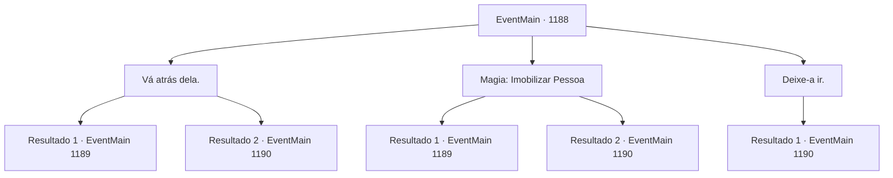

# Eventos principais · 1188

[Índice da tabela](index.md) · [Índice geral](../index.md)

ID: `pt:EventMain:1188` · Fonte: `EventMain4` · Versão: 1.2.47.

Mapeamento estático dos arquivos; a disponibilidade e a execução dependem do estado da run.

## Texto do evento

*Sem texto no arquivo.*

## Dados de entrada

```json
{
  "id": 1188,
  "grade": 1,
  "normalGoal": "",
  "required": ""
}
```

## Mapa das escolhas



## Escolhas e resultados

### Escolha 1

Vá atrás dela.

Requisitos e outros campos da escolha:

```json
{
  "required": ""
}
```

#### Resultado 1.1

Você persegue Katrin. Seus passos são muito maiores que os dela — ela logo percebe que não vai te despistar, para e se vira. Suas roupas estão esfarrapadas e sujas, mas sua expressão ainda conserva a graça de Matriarca da Casa. 

 "...Então, você chegou até aqui."

 Katrin encara seus olhos e fala. 

 "Você tem certeza mesmo de que eu paguei os orcs para encenarem um ataque à sua propriedade? O suficiente para me encurralar assim?"

 Ela ajeita as mangas e continua. 

 "É assim, então, que se desfazem os séculos de confiança entre nossas duas Casas?"


Continuação registrada: [Evento 1189](1189.md) na mesma tabela.

```json
{
  "required": "",
  "chance": "1|0_6_1",
  "nextEvent": 1189,
  "type": 0,
  "reward": ""
}
```

#### Resultado 1.2

Você persegue Katrin. Mas ela é muito mais rápida do que você esperava. Quando você chega ao fim da passagem secreta, não encontra nada além de pegadas de cavalo. 

 "*arf*... *arf*... Vejo que ela tinha um plano B sólido, afinal."

 Rennart fala, ofegante. 

 "Vou mandar um batedor atrás dela."

 Você e Rennart retornam pela passagem secreta e voltam para a fortaleza. Seus homens já estão desarmando os soldados de Greymoor um por um.

Continuação registrada: [Evento 1190](1190.md) na mesma tabela.

```json
{
  "required": "",
  "chance": "16",
  "nextEvent": 1190,
  "type": 1,
  "reward": ""
}
```

### Escolha 2

Magia: Imobilizar Pessoa

Requisitos e outros campos da escolha:

```json
{
  "required": "20_0_2|1_1_2"
}
```

#### Resultado 2.1

Você prende Katrin com magia. As roupas dela estão esfarrapadas e sujas, mas sua expressão ainda conserva a graça da Matriarca da Casa. 

 "...Então, você chegou até aqui."

 Katrin encara seus olhos e fala. 

 "Tem certeza mesmo de que eu paguei os orcs para encenar um ataque à sua propriedade? O bastante para me encurralar assim?"

 Ela alisa as mangas e continua. 

 "É assim tão volúvel a confiança de séculos entre nossas duas Casas?"


Continuação registrada: [Evento 1189](1189.md) na mesma tabela.

```json
{
  "required": "",
  "chance": "1|0_7_1|0_12_1",
  "nextEvent": 1189,
  "type": 0,
  "reward": "0_1_-1"
}
```

#### Resultado 2.2

Você tenta capturar Katrin com magia. Mas antes que você possa completar seu feitiço, ela consegue escapar pela passagem e some da sua vista. Quando você chega ao fim da passagem secreta, não encontra nada além de pegadas de cavalo. 

 "*ofegante*... *ofegante*... Vejo que ela tinha um plano B sólido, afinal."

 Rennart fala, ofegante. 

 "Vou enviar um batedor atrás dela."

 Você e Rennart retornam pela passagem secreta de volta à fortaleza. Seus homens já estão desarmando os soldados de Greymoor um por um.

Continuação registrada: [Evento 1190](1190.md) na mesma tabela.

```json
{
  "required": "",
  "chance": "32",
  "nextEvent": 1190,
  "type": 1,
  "reward": ""
}
```

### Escolha 3

Deixe-a ir.

Requisitos e outros campos da escolha:

```json
{
  "required": ""
}
```

#### Resultado 3.1

Você decide não ir atrás dela. Então, você volta pelo corredor secreto, de volta à fortaleza. Seus homens já estão desarmando os soldados de Greymoor um por um.

Continuação registrada: [Evento 1190](1190.md) na mesma tabela.

```json
{
  "required": "",
  "chance": "1",
  "nextEvent": 1190,
  "type": 2,
  "reward": ""
}
```

## Referências que chegam a este evento

- [Evento 1187 · escolha 1 · resultado 1](1187.md#escolha-1)
- [Evento 1187 · escolha 2 · resultado 1](1187.md#escolha-2)
