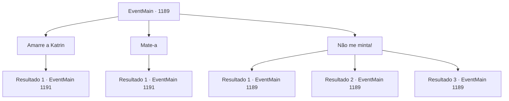

# Eventos principais · 1189

[Índice da tabela](index.md) · [Índice geral](../index.md)

ID: `pt:EventMain:1189` · Fonte: `EventMain4` · Versão: 1.2.47.

Mapeamento estático dos arquivos; a disponibilidade e a execução dependem do estado da run.

## Texto do evento

*Sem texto no arquivo.*

## Dados de entrada

```json
{
  "id": 1189,
  "grade": 1,
  "normalGoal": "",
  "required": ""
}
```

## Mapa das escolhas



## Escolhas e resultados

### Escolha 1

Amarre a Katrin

Requisitos e outros campos da escolha:

```json
{
  "required": ""
}
```

#### Resultado 1.1

Você ordena que prendam os pulsos e os tornozelos de Katrin. Ela encara você por um momento, então debocha. 

 "Ha..."

 Rennart a pega e segue para o pátio interno do castelo. Logo, você percebe que já é crepúsculo e o céu está ficando laranja. Então, um dos soldados montados de guarda sobre as muralhas grita. 

 "Aí! Os mortos — eles estão... eles estão se levantando!"

 Uma aura fria e sinistra envolve os soldados mortos no chão, e eles lentamente começam a tropeçar de volta. |drawing_undeadWakeUp| Então, um bando de corvos voa para o ponto mais alto das torres internas do castelo. Os corvos lentamente formam a forma de um humano. É Kalman. 

 "Que agradecido, por estarem dispostos a ajudar o velho tio Kalman. Todos esses cadáveres frescos. Devo agradecer pessoalmente."

 A voz de Kalman ecoa pelo castelo. Ele avista Katrin, capturada, e acrescenta. 

 "Ah, vejo que vocês também pegaram a gatinha astuta."

 Kalman estala a língua. 

 "Tsc tsc. Vocês me traem, e agora vejam o quanto caíram."

 Kalman faz um sinal, balançando a mão no ar. Os soldados mortos começam a avançar de uma vez.

Continuação registrada: [Evento 1191](1191.md) na mesma tabela.

```json
{
  "required": "",
  "chance": "1",
  "nextEvent": 1191,
  "type": 2,
  "reward": "6_0_200",
  "place": 4
}
```

### Escolha 2

Mate-a

Requisitos e outros campos da escolha:

```json
{
  "required": "2_3_-14"
}
```

#### Resultado 2.1

Você leva Katrin ao pátio interno você mesmo. Você percebe que já é crepúsculo, e o céu está ficando laranja. Soldados Briovich estão descansando ali. Você força Katrin a se ajoelhar. Então, você pega uma espada próxima. 

 "H- Como ousa!"

 Katrin encara seus olhos, insistindo. Mesmo assim, você aponta a espada para o pescoço dela e pergunta se tem alguma última palavra. Os olhos de Katrin se arregalam de terror. 

 "H- espere, agora. Eu sou nobre. Sou a estimada matriarca da Casa Greymoor! M- me matar assim é contra a lei!"

 Você não lhe dá atenção. Sem hesitar, você balança a espada, cortando seu pescoço. A cabeça de Katrin rola ao chão. Sangue jorra de seu corpo e para o pátio. O fedor de sangue enche o ar, e um breve silêncio se segue. Então, um dos soldados vigiando no alto das muralhas grita. 

 "Lá! Os mortos — eles... eles estão se levantando!"

 Uma aura fria e sinistra envolve os soldados mortos no chão, e eles lentamente começam a se reerguer. |drawing_undeadWakeUp| Então, um bando de corvos voa ao ponto mais alto das torres internas do castelo. Os corvos lentamente formam a forma de um humano. É Kalman. 

 "Que agradecimento, que vocês estejam dispostos a ajudar o velho tio Kalman. Todos esses corpos frescos. Devo agradecer pessoalmente."

 A voz de Kalman ecoa pelo castelo. Ele avista Katrin, capturada, e acrescenta. 

 "Ah, vejo que você também lidou com a gatinha astuta."

 Kalman estala a língua. 

 "Tsc tsc. Você me trai, e agora veja o quanto caiu."

 Kalman faz um sinal, mexendo a mão no ar. Os soldados mortos começam a avançar de uma vez só.

Continuação registrada: [Evento 1191](1191.md) na mesma tabela.

```json
{
  "required": "",
  "chance": "1",
  "nextEvent": 1191,
  "type": 2,
  "reward": "6_0_200|5_928_9",
  "place": 4
}
```

### Escolha 3

Não me minta!

Requisitos e outros campos da escolha:

```json
{
  "required": "5_929_0"
}
```

#### Resultado 3.1

Você a repreende por mentir, apesar de haver provas materiais. Katrin nem sequer pisca ao responder. 

 "Aquele livro-caixa?! Ah, por favor — você não vê que foi falsificado? A Casa Greymoor nunca fez um acordo com os orcs. O brasão da casa no livro-caixa? Também deve ser falso."

 As sobrancelhas de Rennart se contraem.

Continuação registrada: [Evento 1189](1189.md) na mesma tabela.

```json
{
  "required": "10_93_1|21_0_1",
  "chance": "1",
  "nextEvent": 1189,
  "type": 2,
  "reward": "5_929_9"
}
```

#### Resultado 3.2

Você a repreende por mentir, apesar de existirem provas materiais. Mesmo antes que Katrin possa responder, o Respondedor voa e para bem na frente do pescoço dela. Os olhos de Katrin tremem. 

 "E- Eu..."

 Katrin não consegue apresentar mais desculpas. Tudo o que ela consegue é gaguejar. Rennart olha para ela e fala. 

 "Ela não consegue dizer nada."


Continuação registrada: [Evento 1189](1189.md) na mesma tabela.

```json
{
  "required": "8_93_1",
  "chance": "1",
  "nextEvent": 1189,
  "type": 2,
  "reward": "5_929_1"
}
```

#### Resultado 3.3

Você conjura Zona da Verdade, colocando Katrin em seu centro. Você a repreende por mentir, apesar de haver provas materiais. Mesmo antes de Katrin poder responder, o Answerer voa e para bem diante do pescoço dela. Os olhos de Katrin tremem. 

 "I- I..."

 Katrin não consegue inventar mais desculpas. Tudo o que ela consegue fazer é gaguejar. Rennart olha para ela e fala. 

 "Ela não pode dizer nada."


Continuação registrada: [Evento 1189](1189.md) na mesma tabela.

```json
{
  "required": "20_0_1",
  "chance": "1",
  "nextEvent": 1189,
  "type": 2,
  "reward": "5_929_1"
}
```

## Referências que chegam a este evento

- [Evento 1188 · escolha 1 · resultado 1](1188.md#escolha-1)
- [Evento 1188 · escolha 2 · resultado 1](1188.md#escolha-2)
- [Evento 1189 · escolha 3 · resultado 1](1189.md#escolha-3)
- [Evento 1189 · escolha 3 · resultado 2](1189.md#escolha-3)
- [Evento 1189 · escolha 3 · resultado 3](1189.md#escolha-3)
