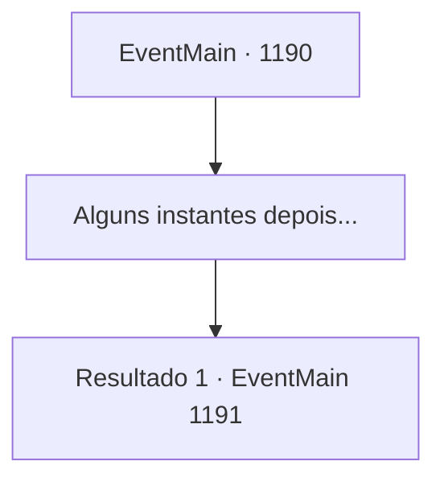

# Eventos principais · 1190

[Índice da tabela](index.md) · [Índice geral](../index.md)

ID: `pt:EventMain:1190` · Fonte: `EventMain4` · Versão: 1.2.47.

Mapeamento estático dos arquivos; a disponibilidade e a execução dependem do estado da run.

## Texto do evento

*Sem texto no arquivo.*

## Dados de entrada

```json
{
  "id": 1190,
  "grade": 1,
  "normalGoal": "",
  "required": ""
}
```

## Mapa das escolhas



## Escolhas e resultados

### Escolha 1

Alguns instantes depois...

Requisitos e outros campos da escolha:

```json
{
  "required": ""
}
```

#### Resultado 1.1

Você faz uma pausa merecida, observando seus soldados limpar a área. Então, um dos soldados de guarda no topo das muralhas grita. 

 "Aí! Os mortos — eles estão... eles estão se levantando!"

 Uma aura fria e sinistra envolve os soldados mortos no chão, e eles lentamente começam a se arrastar de volta. |drawing_undeadWakeUp| Então, um bando de corvos voa para o ponto mais alto das torres internas do castelo. Os corvos lentamente formam a forma de um humano. É Kalman. 

 "Que agradecimento, que vocês estejam dispostos a ajudar o velho tio Kalman. Todos esses corpos frescos. Devo agradecer pessoalmente."

 Você percebe Katrin presa em seu abraço. 

 "Eu também capturei a traidora, tudo graças a vocês."

 Katrin luta, o aperto de Kalman estrangulando seu pescoço. 

 "L- LARGUE! Venha, vamos conversar como pessoas civilizadas..."

 Mas antes que ela possa terminar, Kalman a empurra para fora da beirada da torre. 

 "NÃOOOOOOO--!!"

 Seu grito logo termina com um estrondo alto. Kalman solta uma risada maligna. 

 "Fufufu... Ah, eu precisava disso."

 Com isso, os soldados mortos começam a atacar.

Continuação registrada: [Evento 1191](1191.md) na mesma tabela.

```json
{
  "required": "",
  "chance": "1",
  "nextEvent": 1191,
  "type": 2,
  "reward": "0_0_1|0_1_1|6_0_200|5_928_1",
  "place": 4
}
```

## Referências que chegam a este evento

- [Evento 1188 · escolha 1 · resultado 2](1188.md#escolha-1)
- [Evento 1188 · escolha 2 · resultado 2](1188.md#escolha-2)
- [Evento 1188 · escolha 3 · resultado 1](1188.md#escolha-3)
