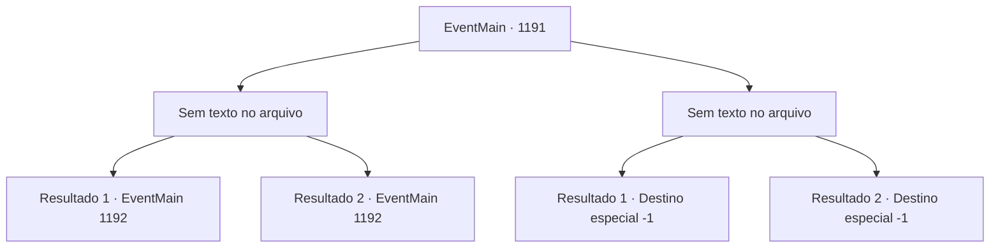

# Eventos principais · 1191

[Índice da tabela](index.md) · [Índice geral](../index.md)

ID: `pt:EventMain:1191` · Fonte: `EventMain4` · Versão: 1.2.47.

Mapeamento estático dos arquivos; a disponibilidade e a execução dependem do estado da run.

## Texto do evento

*Sem texto no arquivo.*

## Dados de entrada

```json
{
  "id": 1191,
  "grade": 1,
  "normalGoal": "",
  "required": ""
}
```

## Mapa das escolhas



## Escolhas e resultados

### Escolha 1

*Sem texto no arquivo; o papel dessa opção depende da interface do jogo.*

Requisitos e outros campos da escolha:

```json
{
  "required": ""
}
```

#### Resultado 1.1

Apesar de estar exausto da campanha, seus soldados lutam valentemente contra os mortos-vivos. Suas espadas quebram seus ossos, suas lanças perfuram a carne. Seus homens mal conseguem manter a posição, contra um exército de soldados imortos. Você segue para a linha de frente, lidando com os mortos-vivos e ascendendo à torre onde Kalman está. Você corre pela escada em espiral e confronta Kalman. Ele sorri, como se estivesse esperando por este momento. 

 "Sim... Eu não esperava menos de você. Isso vai ser divertido."

 Kalman pisa nas muralhas do castelo. O vento sacode seu manto. Então, ele pula, estendendo os braços. Você corre até a beira da torre e olha para baixo. Lá embaixo, os mortos-vivos estão convergindo em uma única massa gigante. Rennart vê isso e fica pálido. 

 "P- pelos deuses..."

 O enorme pedaço de carne e osso logo cresce seu próprio par de braços e pernas. Depois, uma cauda, e por fim um pescoço — na ponta do qual se forma uma cabeça. |drawing_abominationCreature| A abominação ergue a cabeça e solta um rugido gutural. É uma cacofonia de cem vozes diferentes, risos e gritos misturados. <link=shake><color=purple>

 "AHAHAHAH!! GYAHHH!!!"

</color></link> A monstruosidade colide com a torre em que você está. Com um único golpe, toda a estrutura desaba, e você também cai ao chão.

Continuação registrada: [Evento 1192](1192.md) na mesma tabela.

```json
{
  "required": "-1|5_928_1|5_928_9",
  "chance": "1",
  "nextEvent": 1192,
  "type": 2,
  "reward": ""
}
```

#### Resultado 1.2

Apesar de estar exausto da campanha, seu soldado luta valentemente contra os mortos-vivos. Suas espadas quebram seus ossos, suas lanças perfuram a carne. Seus homens mal conseguem manter a posição, contra um exército de soldados imortais. Você vai para a linha de frente, lidando com os mortos-vivos e subindo a torre onde Kalman está. Você corre pela escada em espiral e confronta Kalman. Ele sorri, como se estivesse esperando por este momento. 

 "Sim... Eu esperava nada menos de você. Isso deve ser divertido."

 Kalman pisa nas muralhas do castelo. O vento balança sua túnica. Então, ele pula, estendendo os braços. Você corre até a beira da torre e olha para baixo. Lá embaixo, os mortos-vivos estão convergindo em uma única massa gigante. Rennart vê isso e fica pálido. 

 "P- pelos deuses..."

 O enorme pedaço de carne e osso logo cresce seu próprio par de braços e pernas. Depois, um rabo, e por fim um pescoço - na ponta do qual se forma uma cabeça. |drawing_abominationCreature| A abominação ergue a cabeça e solta um rugido gutural. É uma cacofonia de cem vozes diferentes, risos e gritos misturados. <link=shake><color=purple>

 "AHAHAHAH!! GYAHHH!!!"

</color></link> Katrin fica pálida de medo. Ela congela, suas pernas cedendo. A monstruosidade se choca contra a torre em que você está. Com um único golpe, toda a estrutura desaba, e você também cai no chão.

Continuação registrada: [Evento 1192](1192.md) na mesma tabela.

```json
{
  "required": "18_928_1|18_928_9",
  "chance": "1",
  "nextEvent": 1192,
  "type": 2,
  "reward": ""
}
```

### Escolha 2

*Sem texto no arquivo; o papel dessa opção depende da interface do jogo.*

Requisitos e outros campos da escolha:

```json
{
  "required": ""
}
```

#### Resultado 2.1

Você já está exausto de lutar continuamente. Seus soldados também. Um por um, a horda de mortos-vivos converte seus homens em um dos seus. A batalha não está indo bem. Então, Rennart se aproxima de você e fala. 

 "Temos que recuar! Talvez depois possamos..."

 Mas ele não chega a terminar, pois Kalman atravessa Rennart com sua lança de osso. Logo, tudo fica silencioso. Você e Kalman são os únicos de pé. 

 "Devo admitir, gostei de ver você sofrer. Mas aqui é onde a diversão termina."

 Os mortos-vivos obedecem às suas ordens. Ghouls, wights, golems de carne e até cavaleiros da morte - os mortos-vivos implacavelmente o derrubam. A voz de Kalman é a última coisa que você ouve. 

 "Oh, não fique tão triste agora. Vou fazer bom uso da sua carne."

 Uma lança de osso se finca no seu peito. Com ela vem uma dor imensa, e você sente gosto de sangue na boca. Então, tudo fica escuro.

Continuação registrada: [Destino especial `-1`](../destinos-especiais.md).

```json
{
  "required": "-1|5_928_1|5_928_9",
  "chance": "1",
  "nextEvent": -1,
  "type": 2,
  "reward": "15_7_1|15_7_6|25_8_1"
}
```

#### Resultado 2.2

Você já está exausto de lutar continuamente. Seus soldados também. Um por um, a horda de mortos-vivos converte seus homens em um dos seus. A batalha não está indo bem. Então, Rennart se aproxima de você e fala. 

 "Temos que recuar! Talvez depois possamos..."

 Mas ele não chega a terminar, pois Kalman atravessa Rennart com sua lança de osso. Logo, tudo fica silencioso. Você e Kalman são os únicos de pé. 

 "Devo admitir, gostei de ver você sofrer. Mas aqui é onde a diversão termina."

 Os mortos-vivos obedecem às suas ordens. Ghouls, wights, golems de carne e até cavaleiros da morte - os mortos-vivos implacavelmente o derrubam. A voz de Kalman é a última coisa que você ouve. 

 "Oh, não fique tão triste agora. Vou fazer bom uso da sua carne."

 Uma lança de osso se finca no seu peito. Com ela vem uma dor imensa, e você sente gosto de sangue na boca. Então, tudo fica escuro.

Continuação registrada: [Destino especial `-1`](../destinos-especiais.md).

```json
{
  "required": "18_928_1|18_928_9",
  "chance": "1",
  "nextEvent": -1,
  "type": 2,
  "reward": "15_7_1|15_7_6|25_8_1"
}
```

## Referências que chegam a este evento

- [Evento 1189 · escolha 1 · resultado 1](1189.md#escolha-1)
- [Evento 1189 · escolha 2 · resultado 1](1189.md#escolha-2)
- [Evento 1190 · escolha 1 · resultado 1](1190.md#escolha-1)
