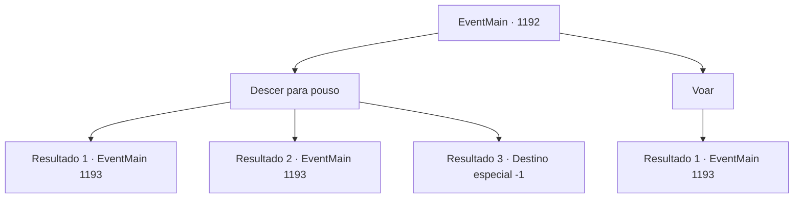

# Eventos principais · 1192

[Índice da tabela](index.md) · [Índice geral](../index.md)

ID: `pt:EventMain:1192` · Fonte: `EventMain4` · Versão: 1.2.47.

Mapeamento estático dos arquivos; a disponibilidade e a execução dependem do estado da run.

## Texto do evento

*Sem texto no arquivo.*

## Dados de entrada

```json
{
  "id": 1192,
  "grade": 1,
  "normalGoal": "",
  "required": ""
}
```

## Mapa das escolhas



## Escolhas e resultados

### Escolha 1

Descer para pouso

Requisitos e outros campos da escolha:

```json
{
  "required": ""
}
```

#### Resultado 1.1

Você pula da torre em ruínas. Você rola rapidamente, absorvendo a queda. A torre desmorona atrás de você, liberando uma onda de poeira e destroços. Kalman, ou a abominação que antes foi Kalman, se vira para encarar você. <color=purple>

 "Olhe só para você, rolando na terra. Combina muito com você!"

</color> Seus muitos olhos se fixam em você. Sua carne enegrecida secreta continuamente um líquido negro e viscoso. Parece que um único contato poderia infectar você com doenças. Rennart e alguns soldados tentam flanquear a abominação, mas a carne podre simplesmente engole a lança inteira. Quando o líquido negro toca as mãos de um soldado, ele grita de dor. 

 "ACCCK!!"

 A mão do soldado apodrece imediatamente. Rennart rapidamente corta a mão necrosada, gritando para seus homens. 

 "Recuem! Não deixem o líquido tocar vocês!"

 Os soldados cambaleiam para longe de Kalman.

Continuação registrada: [Evento 1193](1193.md) na mesma tabela.

```json
{
  "required": "",
  "chance": "1|0_6_1|0_13_1",
  "nextEvent": 1193,
  "type": 0,
  "reward": ""
}
```

#### Resultado 1.2

Você salta da torre em ruínas. Você tropeça e cai de cabeça no chão. A torre desmorona atrás de você, liberando uma onda de poeira e destroços. Kalman, ou a abominação que um dia foi Kalman, vira-se para encarar você. <color=purple>

 "Tsc tsc... Tenha cuidado, pequeno."

</color> Seus muitos olhos se fixam em você. Sua carne chamuscada secreta continuamente um líquido negro e viscoso. Parece que um único contato poderia infectá-lo com doenças. Rennart e alguns soldados tentam flanquear a abominação, mas a carne podre simplesmente devora a lança inteira. Quando o líquido negro toca as mãos de um soldado, ele grita de dor. 

 "ACCCK!!"

 A mão do soldado imediatamente apodrece. Rennart rapidamente corta a mão necrosada, gritando para seus homens. 

 "Afastem-se! Não deixem o líquido tocá-los!"

 Os soldados recuam cambaleando de Kalman.

Continuação registrada: [Evento 1193](1193.md) na mesma tabela.

```json
{
  "required": "1_0_2",
  "chance": "40",
  "nextEvent": 1193,
  "type": 1,
  "reward": "0_0_-1"
}
```

#### Resultado 1.3

Você pula da torre em ruínas. Você tropeça e cai de cabeça no chão. Então, você é coberto por detritos. Você sente seus ossos quebrando e fraturando. A voz de Kalman é a última coisa que você ouve. <color=purple>

 "Oh, não fique tão triste agora. Vou fazer bom uso da sua carne."

</color> Uma estaca de osso fica cravada no seu peito. Com ela vem uma dor imensa, e você sente gosto de sangue na boca. Então, tudo fica escuro.

Continuação registrada: [Destino especial `-1`](../destinos-especiais.md).

```json
{
  "required": "2_0_2",
  "chance": "40",
  "nextEvent": -1,
  "type": 1,
  "reward": "0_0_-1|15_7_1|15_7_6|25_8_1"
}
```

### Escolha 2

Voar

Requisitos e outros campos da escolha:

```json
{
  "required": "-1|20_0_1|20_10_1"
}
```

#### Resultado 2.1

Você salta da torre em ruínas. Em seguida, você pisa no ar, aterrissando suavemente nas muralhas do castelo próximas. A torre desmorona atrás de você, liberando uma onda de poeira e destroços. Kalman, ou a abominação que costumava ser Kalman, se vira para encará-lo. 

 "Magia, hein...? Hm... você não é como Laszlo. Ah, ele não sabia nada além de lâminas."

 Seus muitos olhos se fixam em você. Sua carne enegrecida continuamente secreta um líquido preto e viscoso. Parece que um único contato poderia infestá-lo de doenças. Rennart e alguns soldados tentam flanquear a abominação, mas a carne podre simplesmente engole a lança inteira. Quando o líquido negro toca as mãos de um soldado, ele grita de dor. 

 "ACCCK!!"

 A mão do soldado imediatamente apodrece. Rennart corta rapidamente a mão necrosada, gritando para seus homens. 

 "Afaste-se! Não deixem o líquido tocar vocês!"

 Os soldados cambaleiam para longe de Kalman.

Continuação registrada: [Evento 1193](1193.md) na mesma tabela.

```json
{
  "required": "",
  "chance": "1",
  "nextEvent": 1193,
  "type": 2,
  "reward": ""
}
```

## Referências que chegam a este evento

- [Evento 1191 · escolha 1 · resultado 1](1191.md#escolha-1)
- [Evento 1191 · escolha 1 · resultado 2](1191.md#escolha-1)
- [Evento 1210 · escolha 1 · resultado 1](1210.md#escolha-1)
- [Evento 1210 · escolha 2 · resultado 1](1210.md#escolha-2)
