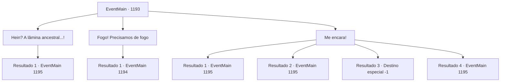

# Eventos principais · 1193

[Índice da tabela](index.md) · [Índice geral](../index.md)

ID: `pt:EventMain:1193` · Fonte: `EventMain4` · Versão: 1.2.47.

Mapeamento estático dos arquivos; a disponibilidade e a execução dependem do estado da run.

## Texto do evento

*Sem texto no arquivo.*

## Dados de entrada

```json
{
  "id": 1193,
  "grade": 1,
  "normalGoal": "",
  "required": ""
}
```

## Mapa das escolhas



## Escolhas e resultados

### Escolha 1

Hein? A lâmina ancestral...!

Requisitos e outros campos da escolha:

```json
{
  "required": "8_378_1|1_3_25"
}
```

#### Resultado 1.1

A arma do seu pai começa a emitir luz, as letras gravadas nela brilhando intensamente.
 'Redi unde venisti'
 Significava, 'retorne aonde você pertence'. Sem pensar muito, você lê a frase inscrita. A espada fica envolta em luz ardente, brilhante o suficiente para iluminar todo o pátio. Chama a atenção de todos. Kalman rosna com raiva. <color=purple>

 "O que você—?! Pare com o teatro e MORRA DE UMA VEZ!"

</color> A voz de Kalman ecoa. Seu braço gigante vem voando. Você ergue a lâmina do seu pai, bloqueando o ataque de Kalman. Com um chiado alto, a carne da abominação começa a queimar, liberando fumaça pálida. <color=purple>

 "Argh...!"

</color> Você percebe perplexidade na voz de Kalman. Ele dá um passo para trás. Você aproveita a oportunidade e investe, balançando sua arma.

Continuação registrada: [Evento 1195](1195.md) na mesma tabela.

```json
{
  "required": "",
  "chance": "1",
  "nextEvent": 1195,
  "type": 2,
  "reward": "4_378_1|16_381_1|6_2_202|5_930_1",
  "place": 4
}
```

### Escolha 2

Fogo! Precisamos de fogo

Requisitos e outros campos da escolha:

```json
{
  "required": "1_14_10"
}
```

#### Resultado 2.1

A carne da abominação engole inteiras as armas dos soldados, regenerando-se instantaneamente. Você percebe que o fogo pode impedir sua regeneração. Você olha ao redor e percebe os destroços de um armazém desabado. Lá, você avista alguns barris de óleo espalhados pelo chão. Você se afasta, aproximando-se lentamente do armazém. Kalman percebe você se afastando. <color=purple>

 "Não temas, pequenino. Pois eu farei rápido...!"

</color> A abominação finca o braço no chão, puxa-se para trás e se lança para frente. Você rola rapidamente para fora do alcance do perigo. Você ouve os barris de óleo se quebrando. Kalman se levanta novamente, sua carne coberta de óleo. <color=purple>

 "SEU RATO! Você é bem ágil."

</color>

Continuação registrada: [Evento 1194](1194.md) na mesma tabela.

```json
{
  "required": "",
  "chance": "1",
  "nextEvent": 1194,
  "type": 2,
  "reward": ""
}
```

### Escolha 3

Me encara!

Requisitos e outros campos da escolha:

```json
{
  "required": ""
}
```

#### Resultado 3.1

Você investe contra a abominação. Kalman zomba. <color=purple>

 "Kyahaha... Ah, eu me pergunto de onde você tirou esse temperamento."

</color> O fedor da decomposição invade suas narinas. Mas, felizmente, não afeta muito você. Você mergulha profundamente em sua carne, atacando-a implacavelmente.

Continuação registrada: [Evento 1195](1195.md) na mesma tabela.

```json
{
  "required": "21_15_3",
  "chance": "1|0_13_1",
  "nextEvent": 1195,
  "type": 0,
  "reward": "6_0_202",
  "place": 4
}
```

#### Resultado 3.2

Você investe contra a abominação. Kalman zomba. <color=purple>

 "Kyahaha... Oh, fico me perguntando de onde você tirou esse temperamento."

</color> Seu fedor de putrefação ataca suas narinas. Você imediatamente se sente enjoado. Isso não é algo que humanos poderiam suportar. Você vomita imediatamente, esvaziando o estômago do café da manhã. A pilha de vômito fumegante cai aos pés de Kalman. <color=purple>

 "V- VOCÊ OUSA!!"

</color> A voz de Kalman uiva. A próxima coisa que você vê é o punho da abominação voando em sua direção.

Continuação registrada: [Evento 1195](1195.md) na mesma tabela.

```json
{
  "required": "21_15_3|1_1_2",
  "chance": "30",
  "nextEvent": 1195,
  "type": 1,
  "reward": "0_1_-1|6_0_202",
  "place": 4
}
```

#### Resultado 3.3

Você investe contra a abominação. Kalman desdenha. <color=purple>

 "Kyahaha... Oh, eu me pergunto de onde você tirou esse temperamento."

</color> Seu fedor de podridão ataca suas narinas. Você imediatamente fica enjoado. Isso não é algo que humanos poderiam suportar. Você vomita imediatamente, esvaziando seu estômago do café da manhã. Sua cabeça dói, e o mundo gira ao seu redor. <color=purple>

 "Oh, não fique tão triste agora. Vou fazer bom uso da sua carne."

</color> Seu pesado pé pisoteia você, esmagando-o. Seu corpo se estilhaça em pedaços com o impacto.

Continuação registrada: [Destino especial `-1`](../destinos-especiais.md).

```json
{
  "required": "21_15_3|2_1_2",
  "chance": "30",
  "nextEvent": -1,
  "type": 1,
  "reward": "0_1_-1|15_7_1|15_7_6|25_8_1"
}
```

#### Resultado 3.4

Você investe contra a abominação. Kalman zomba. <color=purple>

 "Kyahaha... Ah, eu me pergunto de onde você tirou esse temperamento."

</color> O fedor da decomposição invade suas narinas. Mas, felizmente, não afeta muito você. Você mergulha profundamente em sua carne, atacando-a implacavelmente.

Continuação registrada: [Evento 1195](1195.md) na mesma tabela.

```json
{
  "required": "20_15_3",
  "chance": "1",
  "nextEvent": 1195,
  "type": 2,
  "reward": "6_0_202",
  "place": 4
}
```

## Referências que chegam a este evento

- [Evento 1192 · escolha 1 · resultado 1](1192.md#escolha-1)
- [Evento 1192 · escolha 1 · resultado 2](1192.md#escolha-1)
- [Evento 1192 · escolha 2 · resultado 1](1192.md#escolha-2)
