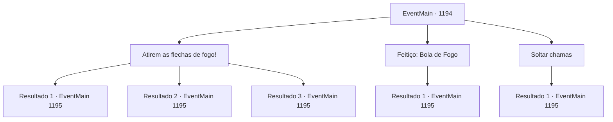

# Eventos principais · 1194

[Índice da tabela](index.md) · [Índice geral](../index.md)

ID: `pt:EventMain:1194` · Fonte: `EventMain4` · Versão: 1.2.47.

Mapeamento estático dos arquivos; a disponibilidade e a execução dependem do estado da run.

## Texto do evento

*Sem texto no arquivo.*

## Dados de entrada

```json
{
  "id": 1194,
  "grade": 1,
  "normalGoal": "",
  "required": ""
}
```

## Mapa das escolhas



## Escolhas e resultados

### Escolha 1

Atirem as flechas de fogo!

Requisitos e outros campos da escolha:

```json
{
  "required": ""
}
```

#### Resultado 1.1

Os arqueiros obedecem imediatamente às suas ordens, disparando flechas flamejantes. O fogo se espalha pelo óleo, envolvendo a abominação em chamas. <color=purple>

 "AAAARRGGHH!!"

</color> A abominação rola no chão, tentando extinguir as chamas. Pedaços de carne podre caem, lançando veneno e brasas por toda parte. <color=purple>

 "V- VOCÊ OUSA!!"

</color> A voz de Kalman uiva. A próxima coisa que você vê é o punho da abominação voando em sua direção.

Continuação registrada: [Evento 1195](1195.md) na mesma tabela.

```json
{
  "required": "5_881_1",
  "chance": "1|0_12_1",
  "nextEvent": 1195,
  "type": 0,
  "reward": "6_2_202|5_930_1",
  "place": 4
}
```

#### Resultado 1.2

Você ordena aos seus homens que disparem as flechas incendiárias, mas em vão. Eles provavelmente não ouviram você. Você grita mais uma vez. Finalmente, os arqueiros apressadamente preparam as flechas incendiárias. <color=purple>

 "AH, NÃO, VOCÊ NÃO VAI!"

</color> Kalman corre até você. Os arqueiros recuam, temendo que possam queimar você também.

Continuação registrada: [Evento 1195](1195.md) na mesma tabela.

```json
{
  "required": "5_881_1",
  "chance": "20",
  "nextEvent": 1195,
  "type": 1,
  "reward": "6_0_202",
  "place": 4
}
```

#### Resultado 1.3

Mesmo antes de você conseguir gritar ordens, Tarrys já tem uma flecha de fogo pronta em seu arco. Sua flecha acerta em cheio, atingindo precisamente a pata dianteira da abominação. A partir daí, o fogo se espalha pelo corpo dela, envolvendo a abominação em chamas. <color=purple>

 "AAAARRGGHH!!"

</color> A abominação rola pelo chão, tentando apagar as chamas. Pedaços de carne podre caem, lançando veneno e brasas por toda parte. <color=purple>

 "V- VOCÊ OUSA!!"

</color> A voz de Kalman uiva. A próxima coisa que você vê é o punho da abominação vindo em sua direção.

Continuação registrada: [Evento 1195](1195.md) na mesma tabela.

```json
{
  "required": "18_881_1",
  "chance": "1",
  "nextEvent": 1195,
  "type": 2,
  "reward": "6_2_202|5_930_1",
  "place": 4
}
```

### Escolha 2

Feitiço: Bola de Fogo

Requisitos e outros campos da escolha:

```json
{
  "required": "20_0_2|1_1_2"
}
```

#### Resultado 2.1

Você conjura Bola de Fogo na abominação. Já está coberta de óleo — num instante, fica envolta em chamas. <color=purple>

 "AAAARRGGHH!!"

</color> A abominação se remexe, tentando apagar as chamas. Pedaços de carne podre caem, lançando veneno e brasas por toda parte. <color=purple>

 "V- VOCÊ OUSA!!"

</color> A voz de Kalman uiva. A próxima coisa que você vê é o punho da abominação voando na sua direção.

Continuação registrada: [Evento 1195](1195.md) na mesma tabela.

```json
{
  "required": "",
  "chance": "1",
  "nextEvent": 1195,
  "type": 2,
  "reward": "0_1_-1|6_2_202|5_930_1",
  "place": 4
}
```

### Escolha 3

Soltar chamas

Requisitos e outros campos da escolha:

```json
{
  "required": "20_14_2"
}
```

#### Resultado 3.1

Você atira chamas na abominação. Ela já está coberta de óleo - num instante, é engolida por chamas violentas. <color=purple>

 "AAAARRGGHH!!"

</color> A abominação rola, tentando apagar as chamas. Pedaços de carne podre caem, lançando veneno e brasas por toda parte. <color=purple>

 "V- VOCÊ OUSA!!"

</color> A voz de Kalman uiva. A próxima coisa que você vê é o punho da abominação voando em sua direção.

Continuação registrada: [Evento 1195](1195.md) na mesma tabela.

```json
{
  "required": "",
  "chance": "1",
  "nextEvent": 1195,
  "type": 2,
  "reward": "6_2_202|5_930_1",
  "place": 4
}
```

## Referências que chegam a este evento

- [Evento 1193 · escolha 2 · resultado 1](1193.md#escolha-2)
