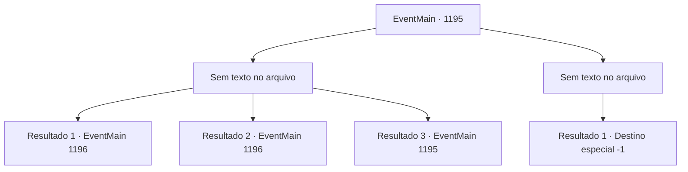

# Eventos principais · 1195

[Índice da tabela](index.md) · [Índice geral](../index.md)

ID: `pt:EventMain:1195` · Fonte: `EventMain4` · Versão: 1.2.47.

Mapeamento estático dos arquivos; a disponibilidade e a execução dependem do estado da run.

## Texto do evento

*Sem texto no arquivo.*

## Dados de entrada

```json
{
  "id": 1195,
  "grade": 1,
  "normalGoal": "",
  "required": ""
}
```

## Mapa das escolhas



## Escolhas e resultados

### Escolha 1

*Sem texto no arquivo; o papel dessa opção depende da interface do jogo.*

Requisitos e outros campos da escolha:

```json
{
  "required": ""
}
```

#### Resultado 1.1

A carne podre da abominação se abre e sua estrutura esquelética se desfaz. Lagos de líquido viscoso permanecem, e a forma da abominação desaparece quando os corpos fundidos são separados mais uma vez. Kalman rasteja desesperadamente para fora da pilha de corpos. Sua túnica está rasgada, e um de seus braços parece ter quebrado. 

 "Não... Isso não está acontecendo...!"

 Ele te encara e amaldiçoa. 

 "Você— você não é um governante digno! Eu— EU SOU O VERDADEIRO PATRIARCA DA CASA Briovich!"

 Kalman rasteja na sua direção, mas morre antes mesmo de alcançar seus pés. Quando Kalman perece, os corpos que constituíam a abominação viram cinzas e desaparecem. Rennart se aproxima de Kalman e toca seu pescoço. 

 "Ele está morto. Com certeza."

 Os olhos de Kalman ainda estão abertos, encarando o céu vazio.

Continuação registrada: [Evento 1196](1196.md) na mesma tabela.

```json
{
  "required": "10_381_1|5_930_1",
  "chance": "1",
  "nextEvent": 1196,
  "type": 2,
  "reward": ""
}
```

#### Resultado 1.2

|drawing_killTheCreature| Você empunha a lâmina brilhante e corta o peito da abominação. Luz radiante a envolve. A carne podre da abominação se abre e sua estrutura esquelética se desfaz. Poças de líquido viscoso permanecem, e a forma da abominação desaparece enquanto os corpos convergidos se separam novamente. Kalman rasteja desesperadamente para fora da pilha de corpos. Sua túnica está rasgada, e um de seus braços parece estar quebrado. 

 "Não... Isso não está acontecendo...!"

 Ele o encara e o amaldiçoa. 

 "Você— você não é um governante digno! Eu— EU SOU O VERDADEIRO PATRIARCA DA CASA Briovich!"

 Kalman rasteja em sua direção, mas morre antes de alcançar seus pés. Quando Kalman perece, os corpos que constituíam a abominação viram cinzas e desaparecem. Rennart se aproxima de Kalman e toca seu pescoço. 

 "Ele está morto. Com certeza."

 Os olhos de Kalman ainda estão abertos, fitando o céu vazio.

Continuação registrada: [Evento 1196](1196.md) na mesma tabela.

```json
{
  "required": "8_381_1",
  "chance": "1",
  "nextEvent": 1196,
  "type": 2,
  "reward": ""
}
```

#### Resultado 1.3

Você consegue derrotar a abominação. Mas Kalman ainda não desistiu. O corpo da abominação se contorce e se ergue mais uma vez. <color=purple>

 "Não...! Ainda não... ISTO NÃO TERMINA AQUI!!"

</color> Fumaça preta começa a emanar de seu corpo.

Continuação registrada: [Evento 1195](1195.md) na mesma tabela.

```json
{
  "required": "18_930_1",
  "chance": "1",
  "nextEvent": 1195,
  "type": 2,
  "reward": "6_2_202|5_930_1",
  "place": 4
}
```

### Escolha 2

*Sem texto no arquivo; o papel dessa opção depende da interface do jogo.*

Requisitos e outros campos da escolha:

```json
{
  "required": ""
}
```

#### Resultado 2.1

A mão gigante da abominação agarra você. Sua carne enegrecida secreta continuamente um líquido negro e viscoso. <color=purple>

 "Oh, não fique tão triste agora. Vou fazer bom uso da sua carne."

</color> Sua boca se abre. Fragmentos afiados de osso e armas misturados para se assemelharem a dentes. Você tenta se libertar de seu aperto, mas é incapaz de fazê-lo. Infelizmente, você é engolido pela abominação. Tudo fica preto.

Continuação registrada: [Destino especial `-1`](../destinos-especiais.md).

```json
{
  "required": "",
  "chance": "1",
  "nextEvent": -1,
  "type": 2,
  "reward": "0_0_-1|0_1_-1|15_7_1|15_7_6|25_8_1"
}
```

## Referências que chegam a este evento

- [Evento 1193 · escolha 1 · resultado 1](1193.md#escolha-1)
- [Evento 1193 · escolha 3 · resultado 1](1193.md#escolha-3)
- [Evento 1193 · escolha 3 · resultado 2](1193.md#escolha-3)
- [Evento 1193 · escolha 3 · resultado 4](1193.md#escolha-3)
- [Evento 1194 · escolha 1 · resultado 1](1194.md#escolha-1)
- [Evento 1194 · escolha 1 · resultado 2](1194.md#escolha-1)
- [Evento 1194 · escolha 1 · resultado 3](1194.md#escolha-1)
- [Evento 1194 · escolha 2 · resultado 1](1194.md#escolha-2)
- [Evento 1194 · escolha 3 · resultado 1](1194.md#escolha-3)
- [Evento 1195 · escolha 1 · resultado 3](1195.md#escolha-1)
