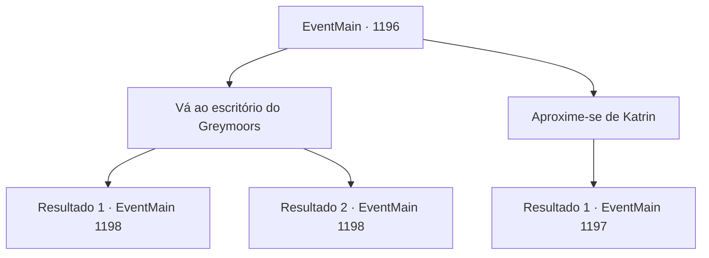

# Eventos principais · 1196

[Índice da tabela](index.md) · [Índice geral](../index.md)

ID: `pt:EventMain:1196` · Fonte: `EventMain4` · Versão: 1.2.47.

Mapeamento estático dos arquivos; a disponibilidade e a execução dependem do estado da run.

## Texto do evento

*Sem texto no arquivo.*

## Dados de entrada

```json
{
  "id": 1196,
  "grade": 1,
  "normalGoal": "",
  "required": ""
}
```

## Mapa das escolhas



## Escolhas e resultados

### Escolha 1

Vá ao escritório do Greymoors

Requisitos e outros campos da escolha:

```json
{
  "required": "-1|5_928_1|5_928_9"
}
```

#### Resultado 1.1

A guerra acabou. Os soldados de Greymoor foram desarmados e enviados de volta para suas casas. Os restos de Katrin são recuperados e enterrados em um cemitério além do castelo interior. Você se dirige ao escritório na Fortaleza de Greymoor. Lá, você nomeia Rennart como vice-castelão, encarregando-o das reparações pós-guerra. Ele tira sua pena de escrever e faz uma lista de tarefas. O som da pena arranhando o papel preenche o escritório. Pelas janelas, você olha lá embaixo, apreciando a vista de todo o domínio de Greymoor. Seu olhar percorre as aldeias, as vastas planícies e Briovich, situada bem no fim do horizonte. O pôr do sol pinta o céu de vermelho.

Continuação registrada: [Evento 1198](1198.md) na mesma tabela.

```json
{
  "required": "5_928_1",
  "chance": "1",
  "nextEvent": 1198,
  "type": 2,
  "reward": "15_7_5|15_7_7"
}
```

#### Resultado 1.2

A guerra acabou. Os soldados de Greymoor foram desarmados e enviados de volta para suas casas. Os restos de Katrin são recuperados e enterrados em um cemitério além do castelo interior. Você se dirige ao escritório na Fortaleza de Greymoor. Lá, você nomeia Rennart como vice-castelão, encarregando-o das reparações pós-guerra. Ele tira sua pena de escrever e faz uma lista de tarefas. O som da pena arranhando o papel preenche o escritório. Pelas janelas, você olha lá embaixo, apreciando a vista de todo o domínio de Greymoor. Seu olhar percorre as aldeias, as vastas planícies e Briovich, situada bem no fim do horizonte. O pôr do sol pinta o céu de vermelho.

Continuação registrada: [Evento 1198](1198.md) na mesma tabela.

```json
{
  "required": "5_928_9",
  "chance": "1",
  "nextEvent": 1198,
  "type": 2,
  "reward": "15_7_7|15_7_14"
}
```

### Escolha 2

Aproxime-se de Katrin

Requisitos e outros campos da escolha:

```json
{
  "required": "18_928_1|18_928_9"
}
```

#### Resultado 2.1

A guerra acabou. Os soldados de Greymoor foram desarmados e enviados de volta para suas casas. As mãos e os pés de Katrin estão amarrados. Poeira e escombros ainda cobrem seu cabelo e suas roupas. Você conduz Katrin até o escritório dentro da Fortaleza de Greymoor. Rennart acompanha você. O lugar está uma bagunça - seus soldados já reviraram o escritório, procurando por qualquer perigo adicional. Você se senta em uma cadeira e encara Katrin, cujo rosto está coberto de poeira. 

 "Eu, Condessa Greymoor, admito a derrota."


Continuação registrada: [Evento 1197](1197.md) na mesma tabela.

```json
{
  "required": "",
  "chance": "1",
  "nextEvent": 1197,
  "type": 2,
  "reward": ""
}
```

## Referências que chegam a este evento

- [Evento 1195 · escolha 1 · resultado 1](1195.md#escolha-1)
- [Evento 1195 · escolha 1 · resultado 2](1195.md#escolha-1)
