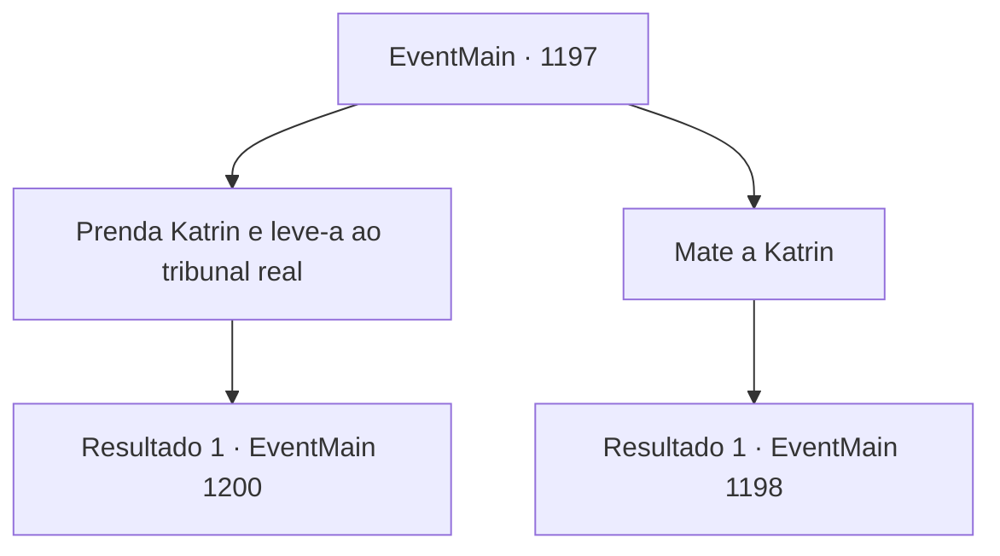

# Eventos principais · 1197

[Índice da tabela](index.md) · [Índice geral](../index.md)

ID: `pt:EventMain:1197` · Fonte: `EventMain4` · Versão: 1.2.47.

Mapeamento estático dos arquivos; a disponibilidade e a execução dependem do estado da run.

## Texto do evento

*Sem texto no arquivo.*

## Dados de entrada

```json
{
  "id": 1197,
  "grade": 1,
  "normalGoal": "",
  "required": ""
}
```

## Mapa das escolhas



## Escolhas e resultados

### Escolha 1

Prenda Katrin e leve-a ao tribunal real

Requisitos e outros campos da escolha:

```json
{
  "required": ""
}
```

#### Resultado 1.1

Você decide prender Katrin para levar ao tribunal real. Rennart pega sua pena e registra suas ordens. 

 "Muito bem, então. Farei os preparativos necessários imediatamente."

 Ele pega o documento e sai do escritório. Alguns instantes depois, você está a caminho da capital em uma diligência. Atrás de você há uma fila de outras diligências, transportando vários documentos e vassalos da Casa Greymoor que participaram da diplomacia com os orcs. |drawing_stephangrad| Você chega a Stephangrad, a cidade capital do Reino de Rothar. No alto das muralhas duplas, uma bandeira com uma águia dourada tremula ao vento. Você atravessa o portão principal, e uma larga estrada se revela. As ruas estão densamente ocupadas por edifícios de pedra. Pedestres e carroções estão por toda parte, movimentando-se apressadamente. Você os ultrapassa e chega ao palácio real. Seu gigantesco portão de bronze é adornado com arcos brancos imaculados. Um guarda real vigia ao lado. Ele se aproxima, confirma sua identidade e abre o portão. 

 "Por aqui."


Continuação registrada: [Evento 1200](1200.md) na mesma tabela.

```json
{
  "required": "",
  "chance": "1",
  "nextEvent": 1200,
  "type": 2,
  "reward": "15_7_9"
}
```

### Escolha 2

Mate a Katrin

Requisitos e outros campos da escolha:

```json
{
  "required": "2_3_0"
}
```

#### Resultado 2.1

Você ordena que se livrem de Katrin, discretamente. Rennart acena e responde. 

 "Entendido."

 Ele manda alguns dos homens colocarem Katrin numa carroça. Alguns dos seus soldados são escolhidos como escoltas. A carroça deixa o castelo e desaparece nas colinas. Você segue a carroça até sua forma não poder mais ser vista. Então, você aperta as rédeas. Você ordena que seus homens avancem. Rennart também segue, sem dizer nada. Infelizmente, seus homens retornam a Briovich.

Continuação registrada: [Evento 1198](1198.md) na mesma tabela.

```json
{
  "required": "",
  "chance": "1",
  "nextEvent": 1198,
  "type": 2,
  "reward": "15_7_5|15_7_10|0_3_-5"
}
```

## Referências que chegam a este evento

- [Evento 1196 · escolha 2 · resultado 1](1196.md#escolha-2)
