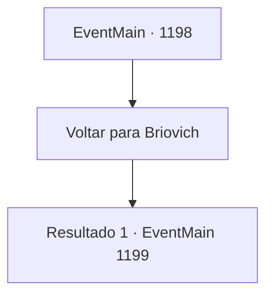

# Eventos principais · 1198

[Índice da tabela](index.md) · [Índice geral](../index.md)

ID: `pt:EventMain:1198` · Fonte: `EventMain4` · Versão: 1.2.47.

Mapeamento estático dos arquivos; a disponibilidade e a execução dependem do estado da run.

## Texto do evento

*Sem texto no arquivo.*

## Dados de entrada

```json
{
  "id": 1198,
  "grade": 1,
  "normalGoal": "",
  "required": ""
}
```

## Mapa das escolhas



## Escolhas e resultados

### Escolha 1

Voltar para Briovich

Requisitos e outros campos da escolha:

```json
{
  "required": ""
}
```

#### Resultado 1.1

Quando você finalmente chega ao Castelo Briovich, encontra os portões escancarados. Os moradores da propriedade estão alinhados ao longo da estrada, celebrando seu retorno vitorioso. Você os observa de dentro da carroça, passando lentamente pelo portão do castelo. |drawing_royal| Atrás de você, ouve-se o passo dos seus soldados e as felicitações dos moradores se misturando em um grande brado. À noite, é realizado um banquete para celebrar sua vitória. Você lembra que fazia tempo desde que vinho e carne enchiam o salão principal. Pedaços de carne, cozidos à perfeição em fornos, preenchem os pratos. Barris de vinho são abertos um a um. Os soldados trocam taças, rindo. Um deles começa a cantar, e os outros acompanham batendo nas mesas em ritmo. Você se senta no centro, observando a cena se desenrolar. Rennart se senta ao seu lado, bebendo vinho de sua taça. Mas você percebe que o olhar dele está em outro lugar. Ele sorri de maneira constrangida, como se tivesse sentido seu olhar. 

 "Ah, minhas desculpas. Eu estava... perdido em pensamentos por um segundo ali."

 Ele começa a bater levemente a mesa com os dedos. 

 "Eu estava pensando no que fazer com o ouro compensatório da Casa Greymoor."

 Seus dedos se abrem, um a um. 

 "Precisamos de uma nova convocação para repor o efetivo, precisamos de novos vassalos e cavaleiros também. Também temos que comprar mais cavalos, equipamentos melhores... Ah, sem contar os reparos nas muralhas do castelo."


Continuação registrada: [Evento 1199](1199.md) na mesma tabela.

```json
{
  "required": "",
  "chance": "1",
  "nextEvent": 1199,
  "type": 2,
  "reward": ""
}
```

## Referências que chegam a este evento

- [Evento 1196 · escolha 1 · resultado 1](1196.md#escolha-1)
- [Evento 1196 · escolha 1 · resultado 2](1196.md#escolha-1)
- [Evento 1197 · escolha 2 · resultado 1](1197.md#escolha-2)
