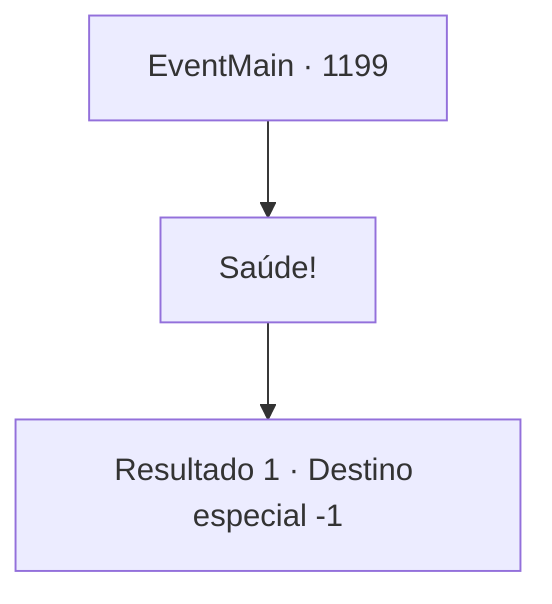

# Eventos principais · 1199

[Índice da tabela](index.md) · [Índice geral](../index.md)

ID: `pt:EventMain:1199` · Fonte: `EventMain4` · Versão: 1.2.47.

Mapeamento estático dos arquivos; a disponibilidade e a execução dependem do estado da run.

## Texto do evento

*Sem texto no arquivo.*

## Dados de entrada

```json
{
  "id": 1199,
  "grade": 1,
  "normalGoal": "",
  "required": ""
}
```

## Mapa das escolhas



## Escolhas e resultados

### Escolha 1

Saúde!

Requisitos e outros campos da escolha:

```json
{
  "required": ""
}
```

#### Resultado 1.1

Você enche o copo dele com vinho, dizendo para ele esquecer do trabalho por um dia. Você diz para ele aproveitar o momento e ergue seu copo. 

 "...Você está certo, meu senhor. Não é hora para preocupações."

 Rennart sorri e pega seu copo. Sinos claros ecoam pelo animado barulho do salão de refeições. Você toma um gole do seu vinho.

Continuação registrada: [Destino especial `-1`](../destinos-especiais.md).

```json
{
  "required": "",
  "chance": "1",
  "nextEvent": -1,
  "type": 2,
  "reward": ""
}
```

## Referências que chegam a este evento

- [Evento 1198 · escolha 1 · resultado 1](1198.md#escolha-1)
