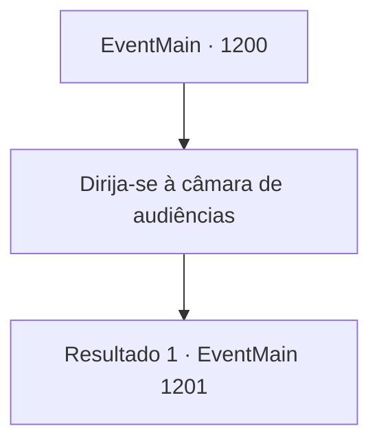

# Eventos principais · 1200

[Índice da tabela](index.md) · [Índice geral](../index.md)

ID: `pt:EventMain:1200` · Fonte: `EventMain4` · Versão: 1.2.47.

Mapeamento estático dos arquivos; a disponibilidade e a execução dependem do estado da run.

## Texto do evento

*Sem texto no arquivo.*

## Dados de entrada

```json
{
  "id": 1200,
  "grade": 1,
  "normalGoal": "",
  "required": ""
}
```

## Mapa das escolhas



## Escolhas e resultados

### Escolha 1

Dirija-se à câmara de audiências

Requisitos e outros campos da escolha:

```json
{
  "required": ""
}
```

#### Resultado 1.1

A guarda real entra primeiro. Você e Rennart seguem a guarda real, escoltando Katrin e outros vassalos da Casa Greymoor. Vocês caminham por um tapete vermelho, passando pelo salão principal. As portas duplas da câmara de audiência se abrem. O rei Rothar está sentado em seu trono. Você se ajoelha, ao que o rei levanta a mão — sinalizando para que você se levante. 

 "Deve ter sido uma longa viagem, desde a propriedade Briovich. Sabe — eu já estava pensando em convocá-lo à capital."

 O rei Rothar levanta-se de seu assento, aproxima-se de você e toca seu ombro. 

 "Ouvi dizer que você lidou com os orcs na fronteira? Ótimo trabalho."

 Seu olhar volta-se para a pessoa ao seu lado — Katrin, amarrada com cordas. O rei a observa de cima a baixo, confuso. 

 "Você deve ser a Condessa Greymoor. O que está fazendo aqui, arrastada como uma prisioneira?"


Continuação registrada: [Evento 1201](1201.md) na mesma tabela.

```json
{
  "required": "",
  "chance": "1",
  "nextEvent": 1201,
  "type": 2,
  "reward": ""
}
```

## Referências que chegam a este evento

- [Evento 1197 · escolha 1 · resultado 1](1197.md#escolha-1)
