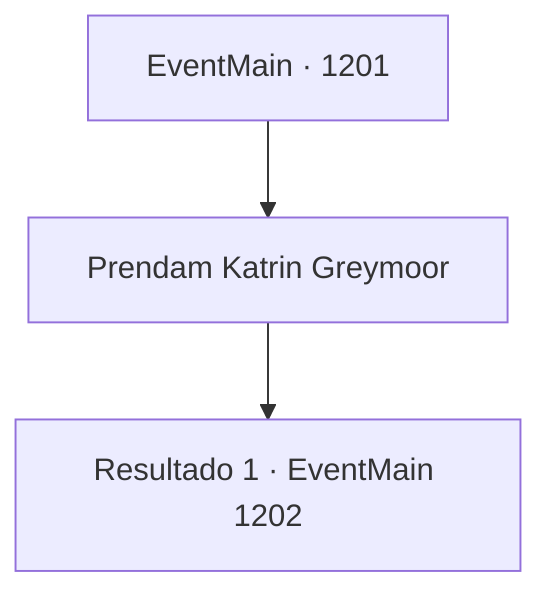

# Eventos principais · 1201

[Índice da tabela](index.md) · [Índice geral](../index.md)

ID: `pt:EventMain:1201` · Fonte: `EventMain4` · Versão: 1.2.47.

Mapeamento estático dos arquivos; a disponibilidade e a execução dependem do estado da run.

## Texto do evento

*Sem texto no arquivo.*

## Dados de entrada

```json
{
  "id": 1201,
  "grade": 1,
  "normalGoal": "",
  "required": ""
}
```

## Mapa das escolhas



## Escolhas e resultados

### Escolha 1

Prendam Katrin Greymoor

Requisitos e outros campos da escolha:

```json
{
  "required": ""
}
```

#### Resultado 1.1

Você apresenta ao rei o livro-razão que contém todos os registros das transações entre a tribo Zaraid e a Casa Greymoor. Você também se certifica de acusar a Casa Greymoor de traição. Rennart acrescenta. 

 "Nós já temos os documentos necessários, de volta às nossas carroças."

 O rei Rothar franze a testa. 

 "Então... a Condessa Greymoor fez um acordo com os orcs e os pagou para atacar a Fazenda Briovich?"

 A atmosfera da sala de audiência congela. O rei olha para Katrin e pergunta. 

 "Tudo isso é verdade? Que você fez um acordo com a tribo orc Zaraid e deliberadamente instigou ataques à Fazenda Briovich?"

 Katrin balança a cabeça. 

 "N- Não, Vossa Majestade! Isso tudo é difamação!"

 Seus olhos tremem de medo. Então, um de seus vassalos fala. 

 "Tudo foi feito sob ordens da Condessa Greymoor! E- Eu juro que não quis fazer parte disso."

 A voz do rei fica fria. 

 "Hm..."

 Ele se volta para Katrin antes de proferir seu veredito. 

 "Prendam essa traidora."

 Dois guardas reais agarram Katrin e deixam a sala. Você consegue ouvir seus pés arrastando-se sobre o tapete. As portas de duas folhas se fecham. Passos desaparecem ao longe. O rei Rothar retorna ao seu trono. 

 "Soberano do Domínio Briovich — você corajosamente frustraste a invasão orc e, não apenas isso, trouxe uma traidora ao reino bem diante dos meus olhos. Não posso deixar de recompensá-lo adequadamente por tudo isso."


Continuação registrada: [Evento 1202](1202.md) na mesma tabela.

```json
{
  "required": "",
  "chance": "1",
  "nextEvent": 1202,
  "type": 2,
  "reward": "4_388_1"
}
```

## Referências que chegam a este evento

- [Evento 1200 · escolha 1 · resultado 1](1200.md#escolha-1)
