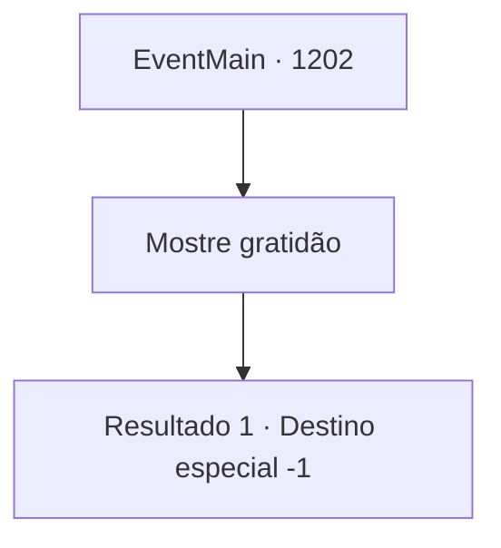

# Eventos principais · 1202

[Índice da tabela](index.md) · [Índice geral](../index.md)

ID: `pt:EventMain:1202` · Fonte: `EventMain4` · Versão: 1.2.47.

Mapeamento estático dos arquivos; a disponibilidade e a execução dependem do estado da run.

## Texto do evento

*Sem texto no arquivo.*

## Dados de entrada

```json
{
  "id": 1202,
  "grade": 1,
  "normalGoal": "",
  "required": ""
}
```

## Mapa das escolhas



## Escolhas e resultados

### Escolha 1

Mostre gratidão

Requisitos e outros campos da escolha:

```json
{
  "required": ""
}
```

#### Resultado 1.1

Você se curva perante o rei para demonstrar gratidão. Ele faz um gesto para um de seus servos. O servo tira um pedaço de pergaminho. O rei pega sua pena de escrever. 

 "Por meio deste, concedo a propriedade de Greymoor a você. Mas nem mesmo isso seria suficiente, não..."

 A pena escorrega da borda do pergaminho enquanto o Rei Rothar assina seu nome. Então, o selo real é carimbado nele. O rei pega o documento, examina-o de cima a baixo e acena feliz. 

 "Considerando o que você fez por mim e pelo meu reino, acredito que uma elevação de título é apropriada."

 O rei esboça um leve sorriso. 

 "Por meio deste, elevo seu título nobre ao de Duque. Uma cerimônia será realizada mais tarde na grande catedral."

 As pessoas na sala de audiência começam a murmurar. O rei levanta a mão para calar o barulho e continua. 

 "Muito bem, você pode retornar agora. Tenho certeza de que ficará ocupado por um tempo - afinal, você tem uma propriedade adicional para cuidar."

 Você e Rennart se curvam diante do rei antes de saírem da sala de audiência. 

 "Bem, meu senhor. Você agora é oficialmente proprietário de duas propriedades. Parabéns."

 É possível ouvir a admiração na voz de Rennart. Você guarda o pergaminho no bolso. A estrada de volta para Stephangrad fica abaixo das escadas. Duas propriedades aguardam você - Briovich e Greymoor.

Continuação registrada: [Destino especial `-1`](../destinos-especiais.md).

```json
{
  "required": "",
  "chance": "1",
  "nextEvent": -1,
  "type": 2,
  "reward": "15_7_8"
}
```

## Referências que chegam a este evento

- [Evento 1201 · escolha 1 · resultado 1](1201.md#escolha-1)
