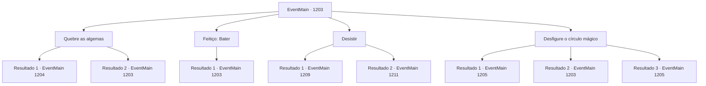

# Eventos principais · 1203

[Índice da tabela](index.md) · [Índice geral](../index.md)

ID: `pt:EventMain:1203` · Fonte: `EventMain4` · Versão: 1.2.47.

Mapeamento estático dos arquivos; a disponibilidade e a execução dependem do estado da run.

## Texto do evento

*Sem texto no arquivo.*

## Dados de entrada

```json
{
  "id": 1203,
  "grade": 1,
  "normalGoal": "",
  "required": ""
}
```

## Mapa das escolhas



## Escolhas e resultados

### Escolha 1

Quebre as algemas

Requisitos e outros campos da escolha:

```json
{
  "required": "5_931_0"
}
```

#### Resultado 1.1

Você reúne todas as suas forças e quebra as algemas. Com um estrondo alto, as algemas se estilhaçam em pedaços. Mas ainda há as barras de aço para lidar.

Continuação registrada: [Evento 1204](1204.md) na mesma tabela.

```json
{
  "required": "",
  "chance": "1|0_5_1",
  "nextEvent": 1204,
  "type": 0,
  "reward": ""
}
```

#### Resultado 1.2

Você reúne todas as suas forças e tenta quebrar as algemas. Mas não importa o quanto você tente, a dor no pulso só piora. As algemas não dão sinais de afrouxarem.

Continuação registrada: [Evento 1203](1203.md) na mesma tabela.

```json
{
  "required": "",
  "chance": "20",
  "nextEvent": 1203,
  "type": 1,
  "reward": "5_931_9"
}
```

### Escolha 2

Feitiço: Bater

Requisitos e outros campos da escolha:

```json
{
  "required": "20_0_1|5_932_0"
}
```

#### Resultado 2.1

Você conjura um feitiço para desfazer a tranca. Mas um símbolo no chão brilha, anulando sua magia. Ao inspecionar de perto, você percebe um círculo mágico inscrito no chão de pedra — o de um campo antimágico.

Continuação registrada: [Evento 1203](1203.md) na mesma tabela.

```json
{
  "required": "",
  "chance": "1",
  "nextEvent": 1203,
  "type": 2,
  "reward": "5_932_1"
}
```

### Escolha 3

Desistir

Requisitos e outros campos da escolha:

```json
{
  "required": ""
}
```

#### Resultado 3.1

Você está sentado, encostado na parede, olhando para o nada. Então, ouve a porta se abrir, seguida pelo som de passos pesados. 

 "Ai, ai, meu Deus!"

 Tarris aparece do outro lado das barras de ferro. Ele se atrapalha por um momento, então tira uma gazua do bolso. 

 "Por favor, aguarde só um instante, meu senhor. Vou tirá-lo daí num piscar de olhos."

 Seu rosto enrugado se enruga ainda mais. Pouco depois, as barras de ferro se abrem. 

 "Lá fora está um caos completo. De algum modo, conseguimos tomar o pátio interno, mas então, de repente, os soldados mortos começaram a se levantar de novo..."

 Você o segue para fora da prisão. Então, vê o pátio interno completamente devastado. Soldados de Greymoor e soldados de Brivovic estão sendo atacados pelos mortos-vivos. Carniçais, wights, espectros, cavaleiros da morte e até os soldados que, até pouco tempo atrás, eram seus companheiros, levantam-se dos mortos e atacam os vivos. 

 "Grroooar...!"

 Nesse momento, um cavaleiro da morte avista você e golpeia com sua espada em sua direção. Tarris gira a lança, tentando desviar a lâmina, mas não é páreo para ele. 

 "Ai, meu Deus! Estou perdido!"

 Tarris é arremessado ao chão e, logo em seguida, o capitão mercenário intercepta a espada do cavaleiro da morte com a sua. 

 "Eu lutarei ao seu lado."

 Junto dele, você enfrenta o cavaleiro da morte.

Continuação registrada: [Evento 1209](1209.md) na mesma tabela.

```json
{
  "required": "18_881_1|5_914_1",
  "chance": "1",
  "nextEvent": 1209,
  "type": 2,
  "reward": "6_2_54",
  "place": 4
}
```

#### Resultado 3.2

Muito tempo se passa. A comoção lá fora cessa. Então, você começa a ouvir passos. Você olha para fora da sua cela e vê Katrin olhando para você desde além das barras de aço. 

 "Você realmente teve que apontar sua espada para mim?"

 Ela estala a língua em desapontamento. 

 "Você deve usar um casus belli apenas quando realmente tem poder para sustentá-lo. Não me diga que você seriamente não sabia disso?"

 Katrin desvia o olhar de você para um cavaleiro de meia-idade parado por perto. 

 "Sir Wojciech. Poderia, por favor, escoltar nosso... estimado convidado até o salão de audiências?"

 O cavaleiro se curva, abre a porta de aço da sua cela e ajuda você a se levantar. 

 "Siga-me, por favor."

 Alguns momentos depois, você está sentado em uma cadeira no salão de audiências. Então, Katrin coloca um pedaço de papel e uma pena à sua frente. 

 "Não acha que já está na hora de você retornar com seus soldados? Bem, considerando que você está aqui conosco pessoalmente... não acho que mais derramamento de sangue seja necessário."

 Katrin empurra a pena e o papel em sua direção. Escrito no documento estão os termos da sua rendição. Os termos são os seguintes. A Casa Briovich deverá admitir a derrota e retornar à sua propriedade com todos os seus soldados. A Casa Briovich deverá pagar 200.000 de ouro, ou em itens de igual valor, à Casa Greymoor como compensação. Acrescentada no final há uma condição adicional, vinculando ambas as Casas a um tratado de paz mútuo pelos próximos dez anos.

Continuação registrada: [Evento 1211](1211.md) na mesma tabela.

```json
{
  "required": "-1|5_881_1|18_914_1",
  "chance": "1",
  "nextEvent": 1211,
  "type": 2,
  "reward": ""
}
```

### Escolha 4

Desfigure o círculo mágico

Requisitos e outros campos da escolha:

```json
{
  "required": "5_932_1|5_933_0"
}
```

#### Resultado 4.1

Você pega uma pedra do chão próximo. O círculo mágico mostra-se ainda mais complexo. Era um campo anti-magia armado, que ativava uma armadilha quando era danificado. Você decifra cuidadosamente o círculo mágico, conseguindo destruí-lo sem acionar a armadilha. Finalmente, você sente a magia retornar a você. Você lança um feitiço para desfazer as algemas e destrancar a porta da cela. Você sai da sua cela, atravessa o corredor subterrâneo úmido e chega a uma escadaria em espiral. Você abafas seus passos e sobe as escadas. Então, você se depara com uma porta. Um raio de luz brilha através dela.

Continuação registrada: [Evento 1205](1205.md) na mesma tabela.

```json
{
  "required": "",
  "chance": "1|0_7_1",
  "nextEvent": 1205,
  "type": 0,
  "reward": "5_933_1"
}
```

#### Resultado 4.2

Você pega uma pedra do chão próximo. Em seguida, você procede a danificar o círculo mágico. O círculo mágico começa a brilhar em azul e emite uma descarga elétrica. Um raio percorre seu corpo. Você fica deitado no chão, tremendo e se recuperando do choque.

Continuação registrada: [Evento 1203](1203.md) na mesma tabela.

```json
{
  "required": "21_17_1",
  "chance": "20",
  "nextEvent": 1203,
  "type": 1,
  "reward": "5_933_9"
}
```

#### Resultado 4.3

Você pega uma pedra do chão próximo. Então, você procede a desfazer o círculo mágico. O círculo mágico começa a brilhar em azul e emite uma descarga elétrica. Um raio de eletricidade percorre seu corpo, Mas você é resistente a ele. Ignorando o choque, você continua a arranhar o chão, apagando o símbolo mágico. Finalmente, você sente a magia retornar a você. Você lança um feitiço para desfazer as algemas e destrancar a porta da cela. Você sai da sua cela, passando pelo corredor subterrâneo molhado, e chega a uma escada em espiral. Você abafa seus passos e sobe as escadas. Então, você se depara com uma porta. Um raio de luz brilha através dela.

Continuação registrada: [Evento 1205](1205.md) na mesma tabela.

```json
{
  "required": "20_17_1",
  "chance": "1",
  "nextEvent": 1205,
  "type": 2,
  "reward": "5_933_1"
}
```

## Referências que chegam a este evento

- [Evento 1173 · escolha 2 · resultado 1](1173.md#escolha-2)
- [Evento 1178 · escolha 2 · resultado 1](1178.md#escolha-2)
- [Evento 1183 · escolha 2 · resultado 1](1183.md#escolha-2)
- [Evento 1184 · escolha 2 · resultado 1](1184.md#escolha-2)
- [Evento 1203 · escolha 1 · resultado 2](1203.md#escolha-1)
- [Evento 1203 · escolha 2 · resultado 1](1203.md#escolha-2)
- [Evento 1203 · escolha 4 · resultado 2](1203.md#escolha-4)
