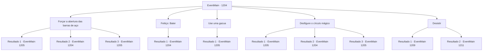

# Eventos principais · 1204

[Índice da tabela](index.md) · [Índice geral](../index.md)

ID: `pt:EventMain:1204` · Fonte: `EventMain4` · Versão: 1.2.47.

Mapeamento estático dos arquivos; a disponibilidade e a execução dependem do estado da run.

## Texto do evento

*Sem texto no arquivo.*

## Dados de entrada

```json
{
  "id": 1204,
  "grade": 1,
  "normalGoal": "",
  "required": ""
}
```

## Mapa das escolhas



## Escolhas e resultados

### Escolha 1

Forçar a abertura das barras de aço

Requisitos e outros campos da escolha:

```json
{
  "required": "5_934_0"
}
```

#### Resultado 1.1

Você agarra as barras de aço e as força para longe. Com um estrondo agudo, as barras cedem à sua força. Você se espremem pela abertura e recupera sua liberdade. Você sai da cela, passando pelo corredor subterrâneo úmido, e chega a uma escada em espiral. Você abafa seus passos e sobe as escadas. Então, você encontra uma porta. Um raio de luz brilha através dela.

Continuação registrada: [Evento 1205](1205.md) na mesma tabela.

```json
{
  "required": "21_60_2",
  "chance": "1|0_5_1",
  "nextEvent": 1205,
  "type": 0,
  "reward": ""
}
```

#### Resultado 1.2

Você agarra as barras de aço e tenta separá-las. Mas tudo o que elas fazem é fazer barulho — elas não cedem.

Continuação registrada: [Evento 1204](1204.md) na mesma tabela.

```json
{
  "required": "21_60_2",
  "chance": "25",
  "nextEvent": 1204,
  "type": 1,
  "reward": "5_934_9"
}
```

#### Resultado 1.3

Você agarra as barras de aço e as força para longe. Com um estrondo agudo, as barras cedem à sua força. Você se espremem pela abertura e recupera sua liberdade. Você sai da cela, passando pelo corredor subterrâneo úmido, e chega a uma escada em espiral. Você abafa seus passos e sobe as escadas. Então, você encontra uma porta. Um raio de luz brilha através dela.

Continuação registrada: [Evento 1205](1205.md) na mesma tabela.

```json
{
  "required": "20_60_2",
  "chance": "1",
  "nextEvent": 1205,
  "type": 2,
  "reward": ""
}
```

### Escolha 2

Feitiço: Bater

Requisitos e outros campos da escolha:

```json
{
  "required": "20_0_1|5_932_0"
}
```

#### Resultado 2.1

Você conjura um feitiço para desfazer a tranca. Mas um símbolo no chão brilha, anulando sua magia. Ao inspecionar de perto, você percebe um círculo mágico inscrito no chão de pedra — o de um campo antimágico.

Continuação registrada: [Evento 1204](1204.md) na mesma tabela.

```json
{
  "required": "",
  "chance": "1",
  "nextEvent": 1204,
  "type": 2,
  "reward": "5_932_1"
}
```

### Escolha 3

Use uma gazua

Requisitos e outros campos da escolha:

```json
{
  "required": "8_41_1"
}
```

#### Resultado 3.1

Você puxa uma gazua e passa as mãos pelas barras de aço. Com um rápido truque de mão, você enfia a gazua na fechadura e a move. Logo, com um estalo, a porta da cela se abre. Você sai da sua cela, atravessa o corredor úmido no subsolo e chega a uma escada em espiral. Você abafA os passos e sobe a escada. Então, você se depara com uma porta. Um raio de luz atravessa por ela.

Continuação registrada: [Evento 1205](1205.md) na mesma tabela.

```json
{
  "required": "",
  "chance": "1",
  "nextEvent": 1205,
  "type": 2,
  "reward": "4_41_1"
}
```

### Escolha 4

Desfigure o círculo mágico

Requisitos e outros campos da escolha:

```json
{
  "required": "5_932_1|5_933_0"
}
```

#### Resultado 4.1

Você pega uma pedra do chão próximo. O círculo mágico mostra-se ainda mais complexo. Era um campo anti-magia armado, que ativava uma armadilha quando era danificado. Você decifra cuidadosamente o círculo mágico, conseguindo destruí-lo sem acionar a armadilha. Finalmente, você sente a magia retornar a você. Você lança um feitiço para desfazer as algemas e destrancar a porta da cela. Você sai da sua cela, atravessa o corredor subterrâneo úmido e chega a uma escadaria em espiral. Você abafas seus passos e sobe as escadas. Então, você se depara com uma porta. Um raio de luz brilha através dela.

Continuação registrada: [Evento 1205](1205.md) na mesma tabela.

```json
{
  "required": "",
  "chance": "1|0_7_1",
  "nextEvent": 1205,
  "type": 0,
  "reward": "5_933_1"
}
```

#### Resultado 4.2

Você pega uma pedra do chão próximo. Em seguida, você desfigura o círculo mágico. O círculo mágico começa a brilhar em azul e emite uma descarga elétrica. Um raio percorre seu corpo. Você fica deitado no chão, tremendo e se recuperando do choque.

Continuação registrada: [Evento 1204](1204.md) na mesma tabela.

```json
{
  "required": "21_17_1",
  "chance": "20",
  "nextEvent": 1204,
  "type": 1,
  "reward": "5_933_9"
}
```

#### Resultado 4.3

Você pega uma pedra do chão próximo. Então, você procede a desfazer o círculo mágico. O círculo mágico começa a brilhar em azul e emite uma descarga elétrica. Um raio de eletricidade percorre seu corpo, Mas você é resistente a ele. Ignorando o choque, você continua a arranhar o chão, apagando o símbolo mágico. Finalmente, você sente a magia retornar a você. Você lança um feitiço para desfazer as algemas e destrancar a porta da cela. Você sai da sua cela, passando pelo corredor subterrâneo molhado, e chega a uma escada em espiral. Você abafa seus passos e sobe as escadas. Então, você se depara com uma porta. Um raio de luz brilha através dela.

Continuação registrada: [Evento 1205](1205.md) na mesma tabela.

```json
{
  "required": "20_17_1",
  "chance": "1",
  "nextEvent": 1205,
  "type": 2,
  "reward": "5_933_1"
}
```

### Escolha 5

Desistir

Requisitos e outros campos da escolha:

```json
{
  "required": ""
}
```

#### Resultado 5.1

Você se senta ali, olhando para o horizonte. Então, você ouve uma porta se abrindo, seguida de passos familiares. 

 "Oh, ah não!"

 Tarrys aparece além das barras de aço. Ele entra em pânico por um instante antes de tirar uma gazua dos bolsos. 

 "Espere, meu senhor. Eu vou tirá-lo daqui em pouco tempo."

 Seu rosto enrugado parece ainda mais enrugado enquanto ele luta com a fechadura. Logo, a porta da cela se abre. 

 "Está um caos total lá fora. Conseguimos proteger a parte interna do castelo, mas agora os soldados mortos estão se levantando novamente...!"

 Você o segue para fora, deixando a prisão para trás. Quando você chega ao pátio interno, está tão caótico quanto Tarrys mencionou. Soldados de ambas as Casas estão lutando contra os mortos-vivos. Ghouls, wights, espectros, cavaleiros da morte, até alguns dos soldados infectados que lutavam minutos antes agora arranham sem rumo os vivos. 

 "Gworr...!"

 Então, um dos cavaleiros da morte te avista e balança sua espada. Tarrys tenta aparar com sua lança, mas não é suficiente. 

 "Argh!! Droga!!"

 Tarrys é jogado ao chão. O líder mercenário aparece e trava armas com o cavaleiro da morte. 

 "Ainda estamos com você."

 Juntos, você e o líder mercenário revidam.

Continuação registrada: [Evento 1209](1209.md) na mesma tabela.

```json
{
  "required": "18_881_1|5_914_1",
  "chance": "1",
  "nextEvent": 1209,
  "type": 2,
  "reward": "6_2_54",
  "place": 4
}
```

#### Resultado 5.2

Muito tempo se passa. A comoção lá fora cessa. Então, você começa a ouvir passos. Você olha para fora da sua cela e vê Katrin olhando para você desde além das barras de aço. 

 "Você realmente teve que apontar sua espada para mim?"

 Ela estala a língua em desapontamento. 

 "Você deve usar um casus belli apenas quando realmente tem poder para sustentá-lo. Não me diga que você seriamente não sabia disso?"

 Katrin desvia o olhar de você para um cavaleiro de meia-idade parado por perto. 

 "Sir Wojciech. Poderia, por favor, escoltar nosso... estimado convidado até o salão de audiências?"

 O cavaleiro se curva, abre a porta de aço da sua cela e ajuda você a se levantar. 

 "Siga-me, por favor."

 Alguns momentos depois, você está sentado em uma cadeira no salão de audiências. Então, Katrin coloca um pedaço de papel e uma pena à sua frente. 

 "Não acha que já está na hora de você retornar com seus soldados? Bem, considerando que você está aqui conosco pessoalmente... não acho que mais derramamento de sangue seja necessário."

 Katrin empurra a pena e o papel em sua direção. Escrito no documento estão os termos da sua rendição. Os termos são os seguintes. A Casa Briovich deverá admitir a derrota e retornar à sua propriedade com todos os seus soldados. A Casa Briovich deverá pagar 200.000 de ouro, ou em itens de igual valor, à Casa Greymoor como compensação. Acrescentada no final há uma condição adicional, vinculando ambas as Casas a um tratado de paz mútuo pelos próximos dez anos.

Continuação registrada: [Evento 1211](1211.md) na mesma tabela.

```json
{
  "required": "-1|5_881_1|18_914_1",
  "chance": "1",
  "nextEvent": 1211,
  "type": 2,
  "reward": ""
}
```

## Referências que chegam a este evento

- [Evento 1203 · escolha 1 · resultado 1](1203.md#escolha-1)
- [Evento 1204 · escolha 1 · resultado 2](1204.md#escolha-1)
- [Evento 1204 · escolha 2 · resultado 1](1204.md#escolha-2)
- [Evento 1204 · escolha 4 · resultado 2](1204.md#escolha-4)
