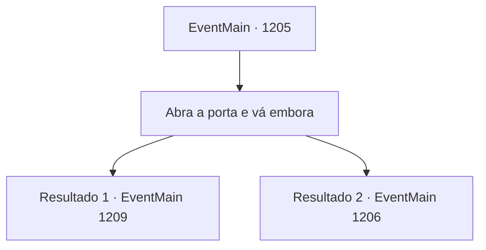

# Eventos principais · 1205

[Índice da tabela](index.md) · [Índice geral](../index.md)

ID: `pt:EventMain:1205` · Fonte: `EventMain4` · Versão: 1.2.47.

Mapeamento estático dos arquivos; a disponibilidade e a execução dependem do estado da run.

## Texto do evento

*Sem texto no arquivo.*

## Dados de entrada

```json
{
  "id": 1205,
  "grade": 1,
  "normalGoal": "",
  "required": ""
}
```

## Mapa das escolhas



## Escolhas e resultados

### Escolha 1

Abra a porta e vá embora

Requisitos e outros campos da escolha:

```json
{
  "required": ""
}
```

#### Resultado 1.1

Você abre a porta e avança, deixando a prisão para trás. Você percebe que o pátio interno está em total caos. Soldados de ambas as Casas estão lutando contra os mortos-vivos. Necrófagos, wights, aparições, cavaleiros da morte, até alguns dos soldados doentes que estavam lutando minutos antes agora arranham os vivos sem pensar. 

 "Hã...?! Meu Senhor!"

 Então, Tarrys vê você e corre em sua direção. Ele confere seus ferimentos, depois continua. 

 "Você está bem? Conseguimos assegurar o interior do castelo, mas agora está um caos total!"

 O líder mercenário se aproxima e interrompe. 

 "Precisamos lidar com esses mortos-vivos primeiro."

 Assim que termina, um cavaleiro da morte se move em sua direção. Juntos, você e o líder mercenário revidam.

Continuação registrada: [Evento 1209](1209.md) na mesma tabela.

```json
{
  "required": "18_881_1|5_914_1",
  "chance": "1",
  "nextEvent": 1209,
  "type": 2,
  "reward": "6_2_54",
  "place": 4
}
```

#### Resultado 1.2

Você abre a porta e dá um passo à frente, deixando a prisão para trás. O pátio interno surge à sua frente. Soldados de Greymoor estão ocupados movimentando mercadorias. Eles ainda não o encontraram. Aparentemente, as forças de Briovich ainda mantêm o cerco, lutando pelo interior do castelo.

Continuação registrada: [Evento 1206](1206.md) na mesma tabela.

```json
{
  "required": "-1|5_881_1|18_914_1",
  "chance": "1",
  "nextEvent": 1206,
  "type": 2,
  "reward": ""
}
```

## Referências que chegam a este evento

- [Evento 1203 · escolha 4 · resultado 1](1203.md#escolha-4)
- [Evento 1203 · escolha 4 · resultado 3](1203.md#escolha-4)
- [Evento 1204 · escolha 1 · resultado 1](1204.md#escolha-1)
- [Evento 1204 · escolha 1 · resultado 3](1204.md#escolha-1)
- [Evento 1204 · escolha 3 · resultado 1](1204.md#escolha-3)
- [Evento 1204 · escolha 4 · resultado 1](1204.md#escolha-4)
- [Evento 1204 · escolha 4 · resultado 3](1204.md#escolha-4)
