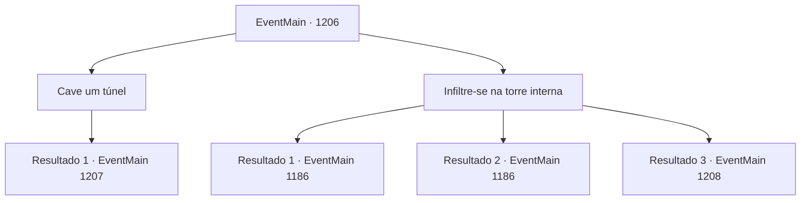

# Eventos principais · 1206

[Índice da tabela](index.md) · [Índice geral](../index.md)

ID: `pt:EventMain:1206` · Fonte: `EventMain4` · Versão: 1.2.47.

Mapeamento estático dos arquivos; a disponibilidade e a execução dependem do estado da run.

## Texto do evento

*Sem texto no arquivo.*

## Dados de entrada

```json
{
  "id": 1206,
  "grade": 1,
  "normalGoal": "",
  "required": ""
}
```

## Mapa das escolhas



## Escolhas e resultados

### Escolha 1

Cave um túnel

Requisitos e outros campos da escolha:

```json
{
  "required": "8_38_1"
}
```

#### Resultado 1.1

Você se esgueira para um canto, pá na mão, e começa a cavar para baixo. Enquanto cava o solo sob as paredes do castelo, você percebe algo errado. Você deveria colocar vigas de sustentação ao cavar um túnel subterrâneo — o que você percebe tarde demais que não fez. Você olha para cima e percebe que as paredes do castelo estão começando a inclinar. Apressadamente, você corre para longe do túnel. Não muito depois, a parede acima do túnel desmorona. Uma tempestade de poeira e detritos te cega momentaneamente. 

 "As paredes! A parede oeste foi rompida!"

 Você ouve alguém gritar e vê um grupo de soldados Briovich correndo em direção à abertura. 

 "Droga! Rápido! Não os deixe entrar!"

 Você vê que os soldados Greymoor estão entrando em pânico. Alguns correm para os portões, outros correm até a parede destruída. Aproveitando a oportunidade, você se reúne com seus soldados, como se esse tivesse sido o plano o tempo todo.

Continuação registrada: [Evento 1207](1207.md) na mesma tabela.

```json
{
  "required": "",
  "chance": "1",
  "nextEvent": 1207,
  "type": 2,
  "reward": "4_38_1|6_2_136",
  "place": 4
}
```

### Escolha 2

Infiltre-se na torre interna

Requisitos e outros campos da escolha:

```json
{
  "required": ""
}
```

#### Resultado 2.1

Sozinho, você corre para a torre interna do castelo, onde deve estar a alavanca do portão. Ninguém parece ter percebido sua presença. Os guardas da torre devem ter se juntado à batalha no pátio. Sem resistência, você chega à alavanca. As correntes tilintam, e os portões se abrem. 

 "Q- o quê?!"

 Os dois exércitos ficam boquiabertos. Logo, Rennart recobra os sentidos e grita ordens. 

 "O portão está aberto! Avançar!"

 Você ouve Rennart do lado de fora. Assim que Rennart grita as ordens, soldados de Briovich invadem. Logo, os ruídos no pátio cessam. As forças de Briovich derrotaram as forças de Greymoor e conquistaram o castelo interno. Então, você desce das torres e segue para o pátio interno. Rennart se aproxima de passos apressados. 

 "Meu Senhor! Você está bem? Como você...!?"

 Ele verifica seu corpo em busca de sinais de ferimentos. Você assegura que está bem, então aponta para o edifício à sua frente. 

 "Você está certo... ainda temos uma última tarefa pela frente."|drawing_greymoorKeep| Ele se vira para encarar o Greymoor Keep — o prédio principal, onde reside o castelão do Castelo Greymoor.

Continuação registrada: [Evento 1186](1186.md) na mesma tabela.

```json
{
  "required": "21_5_4|21_43_1",
  "chance": "1|0_6_1",
  "nextEvent": 1186,
  "type": 0,
  "reward": ""
}
```

#### Resultado 2.2

Sozinho, você corre para a torre interna do castelo, onde deve estar a alavanca do portão. Ninguém parece ter percebido sua presença. Os guardas da torre devem ter se juntado à batalha no pátio. Sem resistência, você chega à alavanca. As correntes tilintam, e os portões se abrem. 

 "Q- o quê?!"

 Os dois exércitos ficam boquiabertos. Logo, Rennart recobra os sentidos e grita ordens. 

 "O portão está aberto! Avançar!"

 Você ouve Rennart do lado de fora. Assim que Rennart grita as ordens, soldados de Briovich invadem. Logo, os ruídos no pátio cessam. As forças de Briovich derrotaram as forças de Greymoor e conquistaram o castelo interno. Então, você desce das torres e segue para o pátio interno. Rennart se aproxima de passos apressados. 

 "Meu Senhor! Você está bem? Como você...!?"

 Ele verifica seu corpo em busca de sinais de ferimentos. Você assegura que está bem, então aponta para o edifício à sua frente. 

 "Você está certo... ainda temos uma última tarefa pela frente."|drawing_greymoorKeep| Ele se vira para encarar o Greymoor Keep — o prédio principal, onde reside o castelão do Castelo Greymoor.

Continuação registrada: [Evento 1186](1186.md) na mesma tabela.

```json
{
  "required": "-1|20_5_4|20_43_1",
  "chance": "1|0_6_1",
  "nextEvent": 1186,
  "type": 0,
  "reward": ""
}
```

#### Resultado 2.3

Sozinho, você corre até a torre interna do castelo, onde deveria estar a alavanca do portão. Mas então, guardas na torre aparecem para impedí‑lo. 

 "Ei!? Onde você pensa que está indo?!"

 Os guardas correm em sua direção, brandindo suas lanças.

Continuação registrada: [Evento 1208](1208.md) na mesma tabela.

```json
{
  "required": "",
  "chance": "25",
  "nextEvent": 1208,
  "type": 1,
  "reward": "6_0_136",
  "place": 4
}
```

## Referências que chegam a este evento

- [Evento 1205 · escolha 1 · resultado 2](1205.md#escolha-1)
