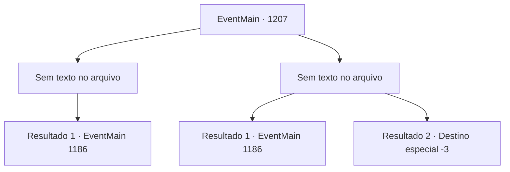

# Eventos principais · 1207

[Índice da tabela](index.md) · [Índice geral](../index.md)

ID: `pt:EventMain:1207` · Fonte: `EventMain4` · Versão: 1.2.47.

Mapeamento estático dos arquivos; a disponibilidade e a execução dependem do estado da run.

## Texto do evento

*Sem texto no arquivo.*

## Dados de entrada

```json
{
  "id": 1207,
  "grade": 1,
  "normalGoal": "",
  "required": ""
}
```

## Mapa das escolhas



## Escolhas e resultados

### Escolha 1

*Sem texto no arquivo; o papel dessa opção depende da interface do jogo.*

Requisitos e outros campos da escolha:

```json
{
  "required": ""
}
```

#### Resultado 1.1

Você assume a linha de frente, lutando contra os soldados inimigos. Logo, as forças de Briovich derrotam as forças de Greymoor e conquistam o castelo interior. Então, você desce das torres e se dirige ao pátio interior. Rennart se aproxima de você a passos apressados. 

 "Meu senhor! Você está bem? Como...!?"

 Ele examina seu corpo em busca de qualquer sinal de ferimento. Você assegura que está bem, então aponta para o edifício à sua frente. 

 "Você está certo... ainda temos uma última tarefa pela frente."|drawing_greymoorKeep| Ele se volta para encarar a Fortaleza Greymoor - o edifício principal, onde reside o castelão do Castelo Greymoor.

Continuação registrada: [Evento 1186](1186.md) na mesma tabela.

```json
{
  "required": "",
  "chance": "1",
  "nextEvent": 1186,
  "type": 2,
  "reward": ""
}
```

### Escolha 2

*Sem texto no arquivo; o papel dessa opção depende da interface do jogo.*

Requisitos e outros campos da escolha:

```json
{
  "required": ""
}
```

#### Resultado 2.1

Você assume a linha de frente, lutando contra os soldados inimigos. Um dos soldados inimigos te acerta forte, empurrando você para trás. Mas felizmente, a maré da batalha já está a favor de Briovich. Logo, as forças de Briovich derrotaram as forças de Greymoor e conquistaram o castelo interior. Em seguida, você desce das torres e segue para o pátio interno. Rennart se aproxima de você em passos apressados. 

 "Meu senhor! Você está bem? Como você...!?"

 Ele examina seu corpo em busca de qualquer sinal de ferimentos. Você o assegura de que está bem, então aponta para o prédio à sua frente. 

 "Você está certo... ainda temos uma última tarefa à nossa frente."|drawing_greymoorKeep| Ele se vira para encarar o Castelo Greymoor — o edifício principal, onde reside o castelão do Castelo Greymoor.

Continuação registrada: [Evento 1186](1186.md) na mesma tabela.

```json
{
  "required": "1_0_2|1_1_2",
  "chance": "1",
  "nextEvent": 1186,
  "type": 2,
  "reward": "0_0_-1|0_1_-1"
}
```

#### Resultado 2.2

Você assume a linha de frente, mas logo se vê no chão após receber um ferimento grave. Seus homens rapidamente o levam para a retaguarda, mas seu sangramento não cessa. Você se encosta na parede do castelo, encarando o campo de batalha. Infelizmente, sua visão se apaga, assim como sua consciência.

Continuação registrada: [Destino especial `-3`](../destinos-especiais.md).

```json
{
  "required": "-1|2_0_2|2_1_2",
  "chance": "1",
  "nextEvent": -3,
  "type": 2,
  "reward": "0_0_-1|0_1_-1"
}
```

## Referências que chegam a este evento

- [Evento 1206 · escolha 1 · resultado 1](1206.md#escolha-1)
