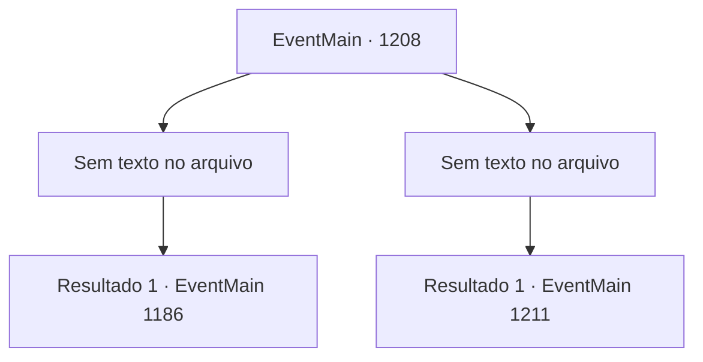

# Eventos principais · 1208

[Índice da tabela](index.md) · [Índice geral](../index.md)

ID: `pt:EventMain:1208` · Fonte: `EventMain4` · Versão: 1.2.47.

Mapeamento estático dos arquivos; a disponibilidade e a execução dependem do estado da run.

## Texto do evento

*Sem texto no arquivo.*

## Dados de entrada

```json
{
  "id": 1208,
  "grade": 1,
  "normalGoal": "",
  "required": ""
}
```

## Mapa das escolhas



## Escolhas e resultados

### Escolha 1

*Sem texto no arquivo; o papel dessa opção depende da interface do jogo.*

Requisitos e outros campos da escolha:

```json
{
  "required": ""
}
```

#### Resultado 1.1

Você dá uma boa surra nos guardas e sobe a torre interna do castelo. No topo da torre encontra-se a alavanca do portão. Sem qualquer resistência — bem, você se livrou dela alguns momentos atrás — você puxa a alavanca. As correntes tilintam, e os portões se abrem. 

 "Q- q- quê?!"

 Ambos os exércitos ficam boquiabertos. Logo, Rennart volta a si e grita ordens. 

 "O portão está aberto! Ataquem!"

 Você ouve Rennart lá fora. Assim que Rennart grita as ordens, soldados de Briovich invadem. Logo, os ruídos no pátio cessam. As forças de Briovich derrotaram as forças de Greymoor e conquistaram o castelo interno. Então, você desce das torres e se dirige ao pátio interno. Rennart se aproxima de você apressadamente. 

 "Meu Senhor! Você está bem? Como você...!?"

 Ele examina seu corpo em busca de sinais de ferimentos. Você lhe assegura que está bem, então aponta para o edifício à sua frente. 

 "Você está certo... ainda temos uma última tarefa a cumprir."|drawing_greymoorKeep| Ele se vira para encarar a Torre de Greymoor — o edifício principal, onde reside o castelão do Castelo Greymoor.

Continuação registrada: [Evento 1186](1186.md) na mesma tabela.

```json
{
  "required": "",
  "chance": "1",
  "nextEvent": 1186,
  "type": 2,
  "reward": ""
}
```

### Escolha 2

*Sem texto no arquivo; o papel dessa opção depende da interface do jogo.*

Requisitos e outros campos da escolha:

```json
{
  "required": ""
}
```

#### Resultado 2.1

Os soldados de Greymoor lhe dão uma boa surra. Logo, você é amarrado e trazido para a Fortaleza de Greymoor. Você é apresentado a Katrin, que está olhando pela janela. Ela se vira para encará-lo. 

 "Você realmente teve que apontar sua espada para mim?"

 Ela puxa a cadeira e se senta, então continua. 

 "Você não acha que já passou da hora de voltar com seus soldados? Bem, considerando que você está aqui conosco... não acho que mais derramamento de sangue seja necessário."

 Katrin coloca um pedaço de papel e uma pena diante de você. Escrito no documento estão os termos da sua rendição. Os termos são os seguintes. A Casa Briovich deverá admitir a derrota e retornar à sua propriedade com todos os seus soldados. A Casa Briovich deverá pagar 200.000 peças de ouro, ou em itens de igual valor, à Casa Greymoor como compensação. Adicionado ao final há uma condição adicional: assinar ambas as Casas em um tratado de paz mútuo pelos próximos dez anos.

Continuação registrada: [Evento 1211](1211.md) na mesma tabela.

```json
{
  "required": "",
  "chance": "1",
  "nextEvent": 1211,
  "type": 2,
  "reward": ""
}
```

## Referências que chegam a este evento

- [Evento 1206 · escolha 2 · resultado 3](1206.md#escolha-2)
